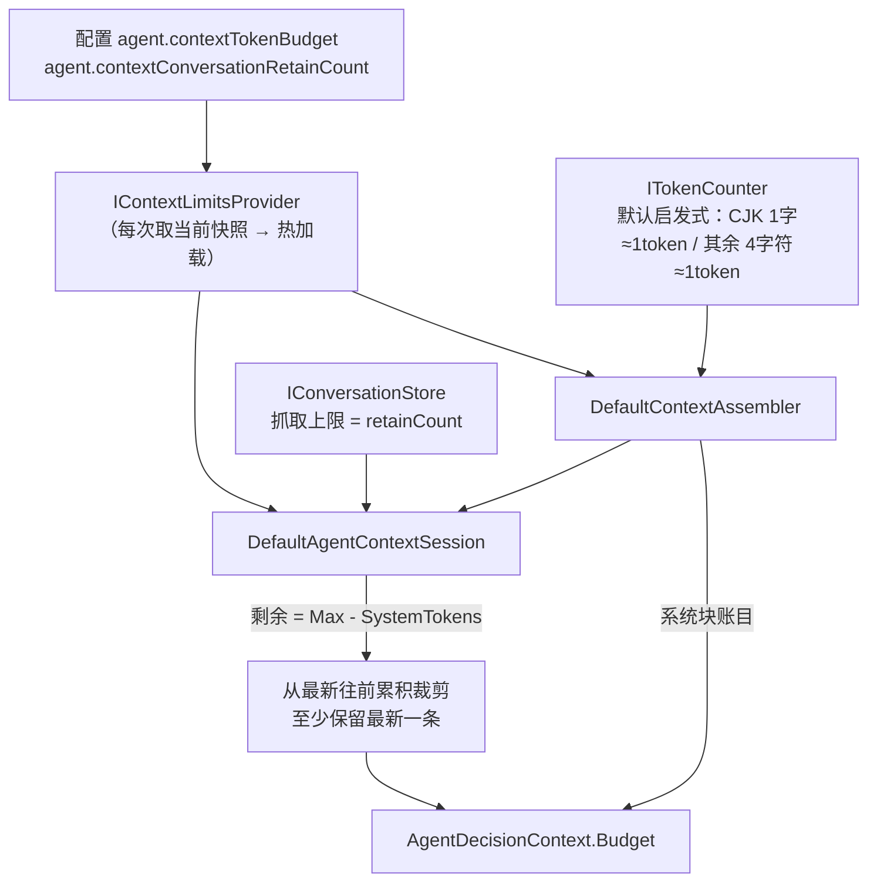

# 上下文预算：装配、裁剪与「配置即真值」

> **状态**：已落地（内核优化步 0）。相关代码：`openLuo.AgentContext`（计数端口 / 保留策略 / 装配器 / 会话窗口）、
> `openLuo.Application/Composition/ConfigContextLimitsProvider.cs`、`openLuo.Server/TurnBudgetPolicy.cs`。
> **一句话**：预算不再是摆设——超预算要么在限额内完成，要么**显式记录**被裁了什么；配置里出现的每个键都有消费者。

---

## 1. 为什么改（改前的三处失真）

| # | 事实 | 后果 |
| --- | --- | --- |
| 1 | `DefaultContextAssembler` 用 `maxTokenBudget = 24_000` 硬编码；贡献者自报 `TokenEstimate = Content.Length / 4` | 中文**低估约 4 倍**（1000 汉字 ≈ 1000 token，被算成 250），预算形同虚设 |
| 2 | 裁剪按 `OrderBy(Region)` 后 `break`（顺序 = 枚举序，`Priority` 只在同区域内可比） | 排在后面的 Capabilities / RuntimeRules 被排在前面的块挤掉后**整段丢弃**，且 `SourceStates` 仍报 `Ok`——模型莫名"忘记平台规则与能力清单"，无任何信号 |
| 3 | 对话历史按条数（硬编码 32）单独装载，**不在预算内** | 历史与系统块各自为政；实际 prompt 大小无人可知 |

同时，配置文件里有一批**零消费者的假旋钮**（用户改了不生效）：`memoryRetrieval.*`、`memoryStore.*`、
`executors.*`、`timeouts.*`、`resilience.*`、`interAgent.*`、`pluginRuntime.*`、`lifecycle.*`、
`agent.taskDispatchTimeoutSeconds`、`agent.invocationConfirmTimeoutSeconds`、`security` 段的旧键，
以及 `memory.example.jsonc` 宣称 `[热加载]` 的整段。

## 2. 现在的模型

### 2.1 保留策略（`ContextRegionPolicies`，单一来源）

| 级别 | 区域 | 理由 |
| --- | --- | --- |
| **Pinned（不裁）** | Identity、TimeContext、RuntimeRules、CurrentUserInput、ToolResults、Capabilities | 裁掉会导致行为崩坏（丢人格/丢规则/丢能力说明/丢当轮输入/模型重复调工具）；体积极小 |
| **Droppable（可裁）** | WorldContext、SceneState、GoalContext、LongTermMemory、ConversationHistory | 预算紧张时让位；记忆与场景是最先让的 |

未表态的新区域按 **Pinned** 处理（失败方向选"宁可超预算也不无声丢弃"），并由 `ContextRegionPolicyTests`
强制"每个 `ContextRegion` 成员都必须显式表态"。

### 2.2 裁剪算法

1. 全部 **Pinned** 入列（累加占用；若已超上限则置 `OverBudget = true`，并**不再**接收任何可裁块）；
2. **Droppable** 按 `Priority` 降序贪心填充，放不下的**跳过并继续**（不再级联丢弃）——所以一个
   体积大但优先级低的历史块不会饿死后面体积小的高价值块；
3. 被裁条目逐条记入 `Budget.DroppedContributions`（id / 贡献者 / 区域 / 优先级 / token）；
4. 呈现顺序仍是 `Region` 枚举序 → 区域内 `Priority` 降序（系统块前缀稳定，利于模型侧前缀缓存）。

对话历史：先按 `retainCount` 抓取，再按 `剩余 = MaxTokens − SystemTokens` **从最新往前**累积，
最旧一侧截断（`Budget.ConversationTurnsDropped` 记账）；**至少保留最新一条**——"只剩人设、忘了刚才说了什么"
比"略超预算"更糟。回合内追加的 tool 消息不做裁剪（`assistant(tool_calls)` 与其结果必须成组，拆开会被模型 API 拒绝），
但计入 `Budget.ConversationTokens`。

### 2.3 配置键（真值表）

| 键 | 默认 | 消费者 | 语义 |
| --- | --- | --- | --- |
| `agent.contextTokenBudget` | 24000 | `ConfigContextLimitsProvider` → 装配器/会话 | 系统块 + 对话历史的 token 上限 |
| `agent.contextConversationRetainCount` | 24 | 同上 | 单回合**抓取上限**（真正裁剪由 token 预算决定） |
| `agent.chatRoundTimeoutSeconds` | 600 | `ComposedAgentRuntime.BuildDefaultBudgets` | 回合总时限 → `DecisionBudgets.OverallDeadline`（**两次决策之间**比较时钟，不打断已开始的工具调用） |
| `agent.pendingAbilityConfirmTimeoutSeconds` | 45 | `HubStartup.BuildConfirmTimeout` | 高危能力确认握手超时 → `HubServerOptions.ConfirmTimeoutSeconds` |
| `agent.injectTimeContext` | true | `TimeContextContributor` | 是否注入时间块 |

以上均经**闭包/端口**读取当前快照 → 改配置立即生效（无需重启）。

## 3. 回合预算的 wire 覆盖

客户端可在 `turn.request` 的 `budgets` 里覆盖回合预算；服务端**必须**夹取（`TurnBudgetPolicy`）：

| 字段 | 上限 |
| --- | --- |
| `maxDecisions` | 32 |
| `maxToolCallsPerDecision` | 20 |
| `maxConcurrentTools` | 8 |
| `overallDeadlineSec` | 3600 |
| `stepIdleTimeoutSec` | 900（不给"关闭"档：客户端可调小，但不能让工具无限阻塞回合） |
| `maxToolRetries` | 5 |

未传（null）时**交给运行时用配置默认**，不要把"没传"变成"传了内核默认值"。

## 4. 内核预算字段的真实执行点

| 字段 | 执行点 |
| --- | --- |
| `MaxDecisions` | 决策循环 `for` 上限（`MaxDecisionsReached`） |
| `MaxToolCallsPerDecision` | 循环内截断该次决策的调用列表，超出的**不执行**并写入 `AgentToolUseStep(tool_calls_truncated)` |
| `MaxConcurrentTools` | 派发器并行切片宽度 |
| `OverallDeadline` | 每次决策前比较时钟（`OverallTimeout`） |
| `StepIdleTimeout` | 派发器给每个工具调用套 `CancelAfter`（默认 240s：**必须大于最慢的合法工具**，实测远程 TTS ≈150s）；超时记 `CapabilityStatus.Timeout` 且**不进重试**（重试只会把等待放大 maxRetries+1 倍） |
| `MaxToolRetries` | 派发器内对 `Failed` 的原样重放次数 |

> `MaxSkillLoadsPerTurn` 曾是零读取的死字段，已删除。

## 5. 怎么验证

- 单测：`tests/openLuo.AgentContext.Tests/{ContextBudgetPrimitiveTests,ContextSessionBudgetTests}.cs`
  （计数口径、保底不被裁、跳过式填充、呈现序稳定、窗口裁剪与至少保留一条、`OverBudget`/被裁明细）。
- E2E：`HubSecurityGuardTests` + 预算覆盖夹取（见 `openLuo.Server.TurnBudgetPolicy`）。
- 冒烟：`make publish` 后用 `/v1/sessions` + WS `turn.request` 带 `budgets` 观察轨迹里的真实预算。

## 6. 刻意不做的事

- **不引入真 tokenizer**：`ITokenCounter` 是端口，宿主可注册与模型配套的分词器；默认启发式只保证
  量级正确（中文不再低估 4 倍）。引入 tiktoken 类依赖会把"内核零包依赖"打破，收益有限。
- **不做"可裁块的部分截断"**：块内截断会切坏语义（半段记忆/半段场景状态），宁可整块让位 + 记账。
- **不把回合计时器变成硬取消**：慢工具链路（TTS）需要余量；硬取消由**单步超时**负责，粒度更准。
