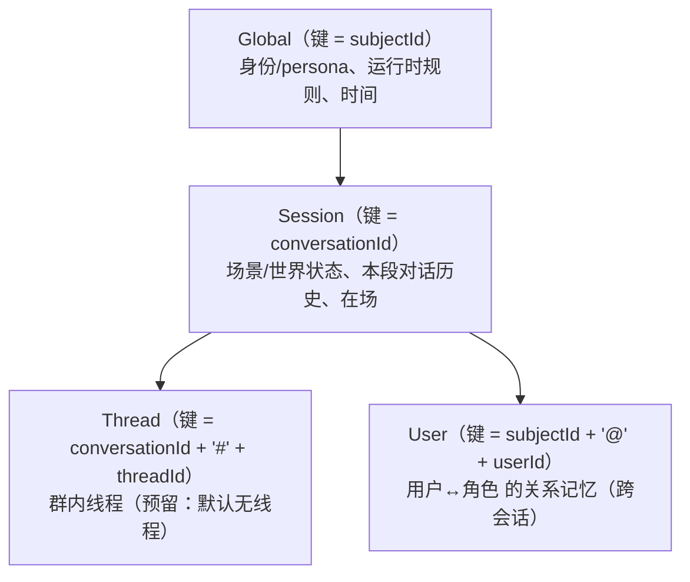
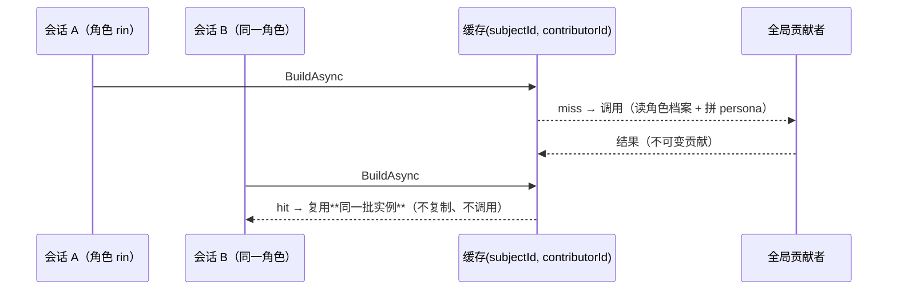

# 上下文域键（Global / Session / Thread / User）

> **状态**：步 1a（正确性）与步 1b（全局块缓存）**均已落地**：scope 契约 + 域键 + 身份落地 + 说话人稳定归因
> + 记忆的用户维度 + 全局块缓存与失效（§8）。
> **上游文档**：[`context-scope-risk.md`](context-scope-risk.md)（R1–R8 风险清单）、[`context-budget.md`](context-budget.md)（预算与裁剪）。
> 相关代码：`openLuo.AgentContext/Core/{ContextScope,ContextDomainKey,IContextContributor}.cs`、
> `openLuo.Application/Composition/ComposedAgentRuntime.cs`、`openLuo.Server/HubServer.cs`、`openLuo.Memory/**`。

---

## 1. 为什么

改造前上下文只有**一根隔离轴**（会话），于是三件事都表达不了：

| 症状 | 证据（改造前） |
| --- | --- |
| 群聊里"谁说的"没有稳定身份 | `DefaultAgentContextSession.CommitTurnAsync` 把**显示名**写进 `speaker_id`（`SpeakerId = SenderName ?? SubjectId`）→ 改名/同名即串味；`turn.request` 里的 `userId` 被 Hub 丢弃 |
| 记忆无法按"人"分区 | `MemoryBaselineContributor` 用 `GameId = sessionId`、`CharacterId = subjectId`；记忆表只有 `(game_id, character_id)` 两维 |
| 全局内容按会话重复 | 身份/persona/时间/规则每会话各存一份，改 persona 要失效所有会话快照（R2/R5） |

## 2. 四个域与键形状

| scope | 键 | 谁用它 | 语义 |
| --- | --- | --- | --- |
| `Global` | `subjectId`（角色） | 身份/persona、平台规则、时间块 | **所有局部推理共用同一份**；同一角色的所有会话共享 |
| `Session` | `conversationId`（缺省 = sessionId） | 场景/世界状态、对话历史、在场 | 一段对话（多端可共享同一 conversationId，见"多端共享会话"） |
| `Thread` | `{conversationId}#{threadId}` | 群内线程（**v1 预留**：无线程时为 null） | 会话内的子隔离级别 |
| `User` | `{subjectId}@{userId}` | **记忆**（跨会话） | "这个人相对于这个角色"的长期记忆；与具体会话无关 |

`ContextDomainKey`（`Scope` + `Key`）是唯一载体：谁要按域存取，就取对应 scope 的键。

## 3. 内容归属（谁属于哪个域）

| 内容 | 域 | 说明 |
| --- | --- | --- |
| 身份 / persona / 平台规则 / 时间 | **Global** | 贡献者声明 `Scope = Global`；内容只与 `subjectId` 有关 |
| 场景 / 世界状态 | **Session** | `WorldStateContributor`（扩展） |
| **长期记忆** | **User**（跨会话） | 召回时带 `userId` 则按用户分区；否则退化为 `(sessionId, subjectId)`（旧行为） |
| 对话历史 | **Session**（按 `userId`/`threadId` **归因**） | 不做"每人一份历史"——历史仍是一段对话，但每条带稳定说话人与线程标识 |
| 能力/技能/工作流清单 | **Global** | 与角色/会话无关（能力目录由 catalog 提供） |
| 在场（presence）| Session | 多客户端订阅，键为 sessionId |

## 4. 向后兼容规则（硬约束）

1. **新增字段一律可选**；未提供时的行为与改造前**逐字一致**（`userId` 为空 → 归因回退到 `subjectId`、记忆退回 `(sessionId, subjectId)` 分区）。
2. `IContextContributor.Scope` 用**接口默认实现**给出 `ContextScope.Session` → 既有扩展不用改也能编译（并在需要时显式声明 Global）。
3. `speaker_id` 语义修正为"稳定 id"：**老行不迁移**（它们是历史文本，语义偏差无害），新行写入稳定 id；`SpeakerName` 单独保留显示名。
4. 记忆表的用户维度是**新增列**（`user_id TEXT NOT NULL DEFAULT ''`），老库自动补列；老数据 `user_id=''` 视为"未分区"。

## 5. 落地清单（步 1a）

| 层 | 改动 | 兼容性 |
| --- | --- | --- |
| 内核契约 | 新增 `ContextScope`、`ContextDomainKey`（+ `ContextDomainKeys` 工厂）；`IContextContributor.Scope`（默认 `Session`）；`ContextBuildRequest.{ConversationId,UserId,ThreadId,Mentions}` 与 `DomainKey(scope)`；`ConversationTurn.ThreadId`；`TurnCompletion.{UserId,ThreadId}`；内核 `TurnRequest.{UserId,ThreadId,Mentions}` | 全部新增（兼容） |
| wire | `HubServer` 把 `turn.request` 的 `userId`/`threadId`/`meta`/`mentions` 映射进内核 `TurnRequest`；`message.append` 带 `userId`/`threadId`（群聊"看但不回"也要归因） | 新增字段；老客户端不带 → 旧行为 |
| 归因 | `CommitTurnAsync` 写稳定 `SpeakerId = userId ?? subjectId`、显示名进 `SpeakerName`、线程进 `ThreadId`；**渲染给模型仍用显示名**（`FormatChatLine` 优先 `SpeakerName`） | 语义修正（老行不迁移） |
| 贡献者 | 7 个贡献者显式表态：身份/persona、角色名册、时间、平台规则、能力清单 = `Global`；世界状态 = `Session`；长期记忆 = `User` | 未表态者仍按 `Session`（接口默认） |
| 执行上下文 | `CapabilityExecutionContext.{UserId,ThreadId,ConversationId}` 由运行时逐调用下传（能力写入方据此落域） | 新增 |
| 记忆 | `SemanticRecallQuery.UserId`、`MemoryRecord.UserId`、仓储读写带 `user_id` 列 + 索引；`memory:write` 落用户、`memory:search` 按用户过滤（`user_id = @UserId OR user_id = ''`） | 新增列 + 可选过滤 |

**桥侧不用改**：`QqRuntimeBridge` 早就把 `userId = QQ 号` 发到 wire 了（`openLuo.Qqbot/QqRuntimeBridge.cs`），是 Hub 端把它丢掉的——本次只是让它落地。

## 6. 验收

- 单测：域键派生（四个 scope 的键形状）；`IContextContributor.Scope` 默认值（老实现不改即 Session）；会话归因（同一会话两条不同 `userId` 的消息 → 历史两条各自带稳定 id 与显示名）；记忆按用户过滤（有 `user_id` 只召回该用户 + 共享；无 `user_id` 召回旧行为）。
- E2E：同一会话内两个不同 `userId` 依次发言 → 历史归属正确（两条不同 speaker id）、记忆写入/召回互不串味；**未带 `userId` 时行为与改造前一致**（回归）。
- 冷启动：老库（无 `user_id` 列）自动补列后仍可读写。

## 7. 刻意没做（留给后续）

| 项 | 为什么 |
| --- | --- |
| ~~**1b：全局贡献版本化快照**~~ | ✅ **已落地**，见 §8 |
| Thread 的独立历史 | 群内线程语义（每用户/每话题独立历史 vs 共享历史+线程标签）还没定；当前只**记录** `threadId`，不切分存储。 |
| 记忆的可见性细粒度（`MemoryScope` 扩维） | 与"公共/私有记忆"设计一起做（步 2），当前 `MemoryScope` 保持 `CharacterPrivate | Shared` 两档 |
| 域键纳入 `hub.db` 索引与调度键 | 调度/作业当前按 sessionId 寻址；等有真实需求（"给某个用户定时提醒"）再扩。 |

## 8. 全局块缓存（步 1b）

`DefaultContextAssembler` 实现 `IContextGlobalCache`，对**全局域**的贡献按 `(subjectId, contributorId)` 缓存：

| 规则 | 说明 |
| --- | --- |
| 只在 **Global** 域生效 | Session/User 域必须每回合新鲜（会话内容、记忆召回） |
| 只在**显式** `CacheTtl > 0` 时生效 | TTL 是"我确定内容稳定"的显式声明；默认 0 = 每回合重算 |
| **版本探针优先**（`CurrentVersion`） | 有探针时按**内容**判缓存：版本变了立刻重建（不受 TTL 限制）、版本没变就一直复用（不受 TTL 限制）；探针返回 null 或抛异常 → 退回 TTL。探针必须**廉价**（每回合都调）——例：人格档案只 stat 目录里文件的 mtime/size，不解析 |
| 键含 `subjectId` | 不同角色的人格绝不可互借 |
| 复用 = **引用** | 全局块只生成一份，所有会话共享**同一批不可变贡献**实例（解 R2） |
| 失效 | `IContextGlobalCache.Invalidate(subjectId?)`；宿主已在**配置热重载**时接好（探针覆盖不到的场景用它，例如内存里的目录索引） |
| 可观测 | 每回合 `[ctx]` 账目带 `cache=hit=n miss=m` |

**当前谁被缓存（逐个核实"内容是否只依赖 subject"后定的）**：

| 贡献者 | 域 | 缓存 | 依据 |
| --- | --- | --- | --- |
| companion 人格档案 | Global | **版本探针**（档案目录 mtime/size）+ 30s 兜底 TTL | 只依赖 `SubjectId`；`ContributeAsync` 会**枚举并逐个解析**全部档案——本步最贵的一块，也是最该缓存的一块 |
| 时间块 | Global | 不缓存 | 内容每回合都在变（给 TTL = 把时间冻结） |
| 能力清单 | Global | 不缓存 | 内容按本轮 `UserInput` 的相关度裁剪 |
| 平台规则 | Global | 不缓存 | 内容读 `request.Extras` |
| 角色名册 | Global | 不缓存 | 名册查询带 `sessionId`（是否真与会话无关未被证实之前不缓存） |
| 世界状态 / 记忆 | Session / User | — | 非全局域，不参与 |

> 教训一：**"声明了 Global ≠ 可以缓存"**——上面 6 个全局块里有 4 个的内容其实逐回合在变。所以 TTL/探针都是**显式开关**，而不是跟着 `Scope` 自动推导。
> 教训二：**"按时间失效"不如"按内容失效"**——纯 TTL 会留下 `[0, TTL)` 的陈旧窗口，逼使用者去猜何时该 `Invalidate`；一个廉价的版本探针能让"改了内容 → 下一回合立刻生效"成为默认行为（曾有一个 `ContextContribution.Version` 字段声明了却无人使用，已删除——机制改由贡献者探针承担）。
