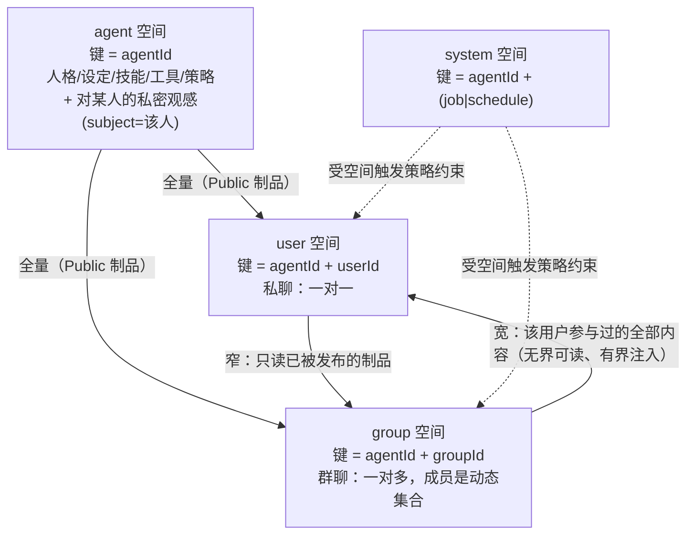

# 上下文空间（Spaces）：agent / user / group 的完整模块设计

> **状态**：**设计稿（本文不实施）**——只描述目标形态、冲突清单与迁移路径，不含任何代码改动。
> **上游文档**：[`context-scope-risk.md`](context-scope-risk.md)（R1–R8 风险清单，本文接管其中 **R4/R8** 的遗留部分）、
> [`context-domains.md`](context-domains.md)（已落地的四域与域键，本文是它的演进）、[`context-budget.md`](context-budget.md)（预算与裁剪机件）。
> 相关代码：`openLuo.AgentContext/Core/{ContextScope,IContextContributor,ContextRegionPolicies,Models/*}`、
> `openLuo.AgentContext/Infrastructure/{DefaultContextAssembler,DefaultAgentContextSession}`、
> `openLuo.Application/Composition/{ComposedAgentRuntime,CoreContextCapabilitySources,PlatformContextContributor}`、
> `openLuo.Capabilities/**`、`openLuo.Memory/**`、`extensions/{companion,memory,party,world}`、
> `openLuo.Server/{HubServer,HubConfirmationGate}`、`openLuo.Qqbot/QqRuntimeBridge`、`openLuo.Protocol/**`。
> **一句话**：现在的上下文只有**一根隔离轴**（会话），而"一个人 + 一个角色 + 一段关系"需要的是
> **多空间并存 + 空间间有方向的可见性 + 按主体授的信任**；把主键从「会话」换成「空间」，
> 会同时改动上下文装配、记忆键控、能力授权、回合下发与输出路由——因此它是重构，不是扩展。
> **执行面对偶**：[`workers-and-hooks.md`](workers-and-hooks.md)——本文划**数据面**边界（能读到什么），
> 那篇划**执行面**边界（谁在跑、被谁唤醒、能读写什么、hook 挂在哪）。两者接口 = **制品读写契约**。
> **模块归属**：[`runtime-modules.md`](runtime-modules.md)——本文 §4 的权限**策略**归 UAC 模块，
> context 只保留"读取闸门"（判定动作），不持有策略。
> **术语**：本文沿用的"装配器"就是 `runtime-modules.md` 的 **Builder**（取名以那篇为准，本文不改动历史措辞）。

---

## 0. 从项目目标推导出的需求

项目目标是「**可持续演进的洛天依式虚拟角色交互体验底座**」：通用 Agent 内核 + 领域扩展，四入口（CLI / TUI / QQ / GUI），
"陪伴"是核心体验。把目标拆成可验收的需求，再与现状对照，是本次设计的起点。

| # | 需求 | 它服务目标里的哪一块 |
| --- | --- | --- |
| **R1** | **每个用户 × 每个角色**拥有长期、独立、可累积的记忆（跨对话、跨入口、跨重启） | 陪伴的本质是"记得你"。今天记忆按会话分区，换个对话就不认识你了 |
| **R2** | 群空间里，角色知道**这个群有哪些用户**、每个人是谁 | 多人群聊是 QQ 主入口的常态；不知道有谁就谈不上"针对谁" |
| **R3** | 角色拥有**自己的**独立上下文：人格/设定/技能/工具/策略，以及对某个人的私密观感 | "角色"要成立必须有自我连续性；私密观感不能因为群聊而泄漏 |
| **R4** | 不同上下文区域有**权限分类**（可见性 + 可做性） | 陪伴对象的信任是分层建立的，不是全有全无 |
| **R5** | 空间之间的**方向性**上下文关系：个人空间可**全量读取**"包含该用户的群空间"内容；群空间只能**有限地**得到个人空间中被发布的部分 | 用户举的例子：换到私聊要能直达群里的共同经历；但个人对话的隐私不能泄漏到群 |
| **R6** | 群空间对能力/工具的权限**显著更窄**；控制类能力（IoT、健康监测等）**只有用户本人且只有 admin** 可用 | 未来智能家居/健康场景的安全底线 |
| **R7** | 上下文与**推理任务下发**都要按空间实例化：主动回合、定时作业、跨角色协作都带空间语义 | 四入口 + 多角色 + 主动陪伴（"角色主动找你说话"）都要求"任务属于某个空间" |

**范围声明**：本文只做"空间"这一层；**语音 / Live2D / 多模态**不在本文，但它们都要求"同一条消息属于某个空间",
所以空间模型是它们的前置。

## 1. 冲突清单（现状 vs 需求）

> 以下每条都是**实测事实**（附代码路径与类型/成员名）。"为什么补丁不行"一栏说明**为什么这不是加枚举/加贡献者能解决的**。

| # | 冲突 | 现状事实 | 冲突的需求 | 为什么补丁不行 |
| --- | --- | --- | --- | --- |
| **X1** | **只有"会话"一根轴，没有"空间"** | `ContextScope{Global,Session,Thread,User}` 是**缓存域**而不是**访问域**：`DefaultContextAssembler` 每回合**串行调用全部贡献者**，`Scope` 只决定"能否进全局块缓存"；群/私聊的区别只剩 `conversationId` 的字符串形状（`QqRuntimeBridge.ConversationOf` → `qq-group-{群号}`） | R2/R4/R5 | 缺的不是一个枚举值，而是**装配期的可见性检查点**——今天贡献者各自决定读什么（如 `MemoryBaselineContributor` 用 `request.UserId`），权限语义无处落笔 |
| **X2** | **记忆/历史的真值键绑在会话上** | `ComposedAgentRuntime` 把 `GameId = request.SessionId` 下传；`SessionId` 稳定复用于 `(subjectId, agentId, conversationId)`；`memories` 分区 = `(game_id, character_id, user_id)`；`conversation_turns` 主键 = `(session_id, turn_id)` | R1（跨对话记忆） | 同一用户在私聊、群 A、群 B 是**三个互不可见的世界**；"长期记忆"在跨对话层面根本不成立，只能在主键层修 |
| **X3** | **可见性今天只有一个粗略开关，且方向是错的** | `memories.user_id = ''` 视为"未分区"→ **对所有空间可见**（`SqliteMemoryRepository.QueryRecentAsync` 的 `user_id = @UserId OR user_id = ''`）；`MemoryScope{CharacterPrivate,Shared}` 存在但写入恒为 0、不参与语义 | R5 | 现状只有"全局可见/不可见"两档：要么泄漏私聊，要么群里的角色谁都不认识。R5 需要的是**三档 + 方向** |
| **X4** | **描述符里有完整的能力元数据，但授权面从未填充** | `CapabilityDescriptor` 已有 `Kind / SideEffect / Risk / RequiresConfirmation / Idempotency / AccessesResources`；`CapabilityPermissions{AllowedCanonicalIds, AllowedKinds, AllowMutation, AllowExternal, AllowDelegation}` 只被 `DefaultCapabilityCatalog` 的**快照过滤**消费，生产路径恒为"空集=全放行"；`AllowMutation/AllowExternal/AllowDelegation` **零消费者** | R4/R6 | 生效点（目录收窄）已经对了，缺的是**谁按什么规则填充它**——这需要"空间 × 主体 × 能力类"的策略数据，不是一行动态赋值 |
| **X5** | **确认闸门不看身份** | `HubConfirmationGate` 的应答由"该会话的订阅者谁先应答"决定，`confirm.response` 在 `HubServer` 里**不校验身份**即放行 | R6 | 群空间里任何成员都能替用户批准"开启 IoT"。空间权限必须建立在"确认绑到 principal"之上，否则上层全是漏的 |
| **X6** | **回合与空间强绑定，跨空间是特例** | 一次回合 = 一个 `SessionId`：装配器**整回合只跑一次**（`DefaultAgentContextSession.CreateTurnSnapshotAsync`），决策循环内工具结果只追加进内存对话、**系统块不重算**；唯一跨会话路径是 `extensions/party` 的 `ask_character`（同步嵌套另一个会话的完整回合） | R5/R7 | "私聊里读到群里的内容"需要装配器**输入面**就带第二个空间视图；今天这个面不存在，靠贡献者自己查库必然散落权限 |
| **X7** | **没有"派生"这个概念，而 R5 的必要条件是它** | 全仓无摘要器；`memories.is_compressed` 与 `GameConstants.MemoryCompression*` 零消费者；对话历史只是"最近 N 条（默认 24）+ 按预算从最旧截断"，被裁条数只记 `Budget.ConversationTurnsDropped`，**内容永久消失** | R5（+ 陪伴本身的"不失忆"） | "个人对话的一部分进入群空间"必须有**写时派生 + 脱敏 + 可撤回**的制品；读时过滤（在群空间读个人数据）等于把隐私押在一个过滤器上 |
| **X8** | **定时/主动下发没有空间语义** | `InMemorySchedulerService` 支持 at/cron；但 `HubServer.RunProactiveTurnAsync` **不读** `ScheduleDue.Kind/Payload`，以 `SourceId="hub"` / `ActorId="system"` / `Text=""` 发起、目标就是既有 `SessionId`；作业系统 `InMemoryJobService` 有持久化与重启恢复，但**全仓零个 `IJobHandler` 实现**、`HubStartup` 未传 handlers（`POST /v1/jobs` 必然失败），**调度与作业之间无任何连线** | R7（主动陪伴） | "角色主动找你说话"必须知道**对谁、在哪个空间、以什么权限说**；今天只能对既有会话空转，且没有任何作业能承载"定时摘要/记忆整理" |
| **X9** | **关系/信任状态有两套存储且不参与授权** | `RelationshipStage`（由 affection 派生，见 `GameConstants` 阈值）落在 `openLuo.Modules.WorldState`（game.db `state_values`，键 `char_status.relationship_stage`）；`hub.db.subject_state`（`IStateReader`/`IStatePersistence`/`IStateTransaction` 均已注册）**在生产路径上没有写入者**（只有端口、DI 与测试） | R4/R6 | 授权要读"关系"，但今天没有一个"Hub 级、跨入口、可被授权层引用"的真值；两套存储会立刻分叉 |
| **X10** | **成员关系与空间身份在 wire 上是空壳** | `openLuo.Protocol/Messages.Group.cs` 的 `MemberDto` / `MemberJoinedEvent` / `MemberLeftEvent` 与 `Features.Group` 已登记进闭合集合，但**零生产者、无表、无端点**；`turn.request.channelId` 到达内核 `TurnRequest` 后**零消费者**；`PlatformContextContributor` 读 `extras["scene"]`，而**没有任何客户端在发 `Meta`** → 该块恒为空 | R2/R5 | 角色今天**连自己在群/私聊都不知道**；"群里有谁"需要一个成员表 + 成员事件源，而"包含该用户的群"是一次**成员关系查询** |
| **X11** | **多端并发会分裂同一个空间** | `sessions` 表只有 `session_id` 主键，**没有 `(subject_id, agent_id, conversation_id)` 唯一约束**；内存反查表 `SessionStore` 由该表重建 | R1/R5 | 多空间并存后"同空间多端并发"是常态；一次分裂就把历史与记忆劈成两半，且事后不可合并 |

**要害**：X1/X2/X6 是同一条根——**"会话"这个主键被同时当成"隔离轴""存储键""下发目标""订阅键"用了四个角色**。
空间模型做的就是把这四个角色拆开。

## 2. 模型

### 2.1 五个定义（唯一来源）

| 概念 | 定义 | 今天的对应物（有/无） |
| --- | --- | --- |
| **主体 Principal** | 可识别、可被授予信任的实体：`user`（自然人，稳定 id = `userId`）/ `admin`（受控主体）/ 未来 `service` | `userId` 已在 wire 与 `speaker_id` 上（有）；`admin` 只在 HTTP 面与 QQ `/command`（半有） |
| **空间 Space** | 一段有边界的交互场域，id = `{agentId, kind, subjectId}`，`kind ∈ {agent, user, group, system}` | 无（只有会话字符串） |
| **视角 Viewer** | 本次推理"以谁的立场读"：由空间的触发者决定（私聊=该用户；群聊=说话人 + 群本身；主动回合=目标主体） | 无（只有 `UserId` 一个可选字段） |
| **制品 Artifact** | 任何进入上下文的内容单元，携带 `(ownerSpace, artifactClass, subject, sensitivity)` | 只有"贡献 + 区域"（有），无归属/主体/档位（无） |
| **视图 View** | `(spaceId, viewer, reachableSpaces)` 的函数产物 = 本次推理**可以**看到的内容集合 | 无（≈"当前会话"） |

**空间身份必须含 `agentId`**：多角色下，同一个群对每个角色是**各自的空间**（各自的关系、记忆、权限）。
这直接服务项目目标的"多角色协作"，也避免"角色 A 的记忆被角色 B 读到"。

### 2.2 四类空间（含 system）与它们的键



| 空间 | 键 | 语义 | 今天 |
| --- | --- | --- | --- |
| `agent` | `agentId` | 角色自身：人格/设定/技能/工具/策略（`sensitivity=Public`）+ **对某主体的私密观感**（`sensitivity=Private`, `subject=该主体`） | 对应当前 `ContextScope.Global` 的贡献者；**"私密观感"无处安放**（Global 对所有空间可见） |
| `user` | `agentId ⊕ userId` | 以人为边界的场域（私聊本体 + 该人的私有记忆/关系） | 对应 `ContextScope.User` 的键形状；但**存储未按它分区**（X2） |
| `group` | `agentId ⊕ groupId` | 以群为边界的场域：本群历史、本群成员、本群内发生的共同经历 | **不存在**（只有 `conversationId` 字符串约定 + wire 空壳） |
| `system` | `agentId ⊕ (job/schedule id)` | 定时作业与主动回合的"无对话"空间 | 不存在（`RunProactiveTurnAsync` 借用既有会话） |

> **为什么 `agent` 不是"父空间"**：把 agent 空间说成 user/group 的"父"会误导——可见性不是"继承"，而是**方向**（见 §2.4）。

### 2.3 制品四元组（这是权限与隐私的落点）

```
Artifact = (ownerSpace, artifactClass, subject, sensitivity, content, provenance?)
```

| 字段 | 取值 | 规则 |
| --- | --- | --- |
| `ownerSpace` | 空间 id | **写入时确定、之后不可变**。这条是"物理隔离"，也是 X3 的正解 |
| `artifactClass` | `Persona` / `Skill` / `Tool` / `Relation` / `Memory` / `Conversation` / `WorldState` /（未来 `Device` / `Health`） | 与 `ContextRegion` 对齐但**不等同**：区域是渲染位置，类别是权限单位 |
| `subject` | 该制品"关于谁"：`agent` / `userId` / `groupId` | **同空间内也要按主体过滤**：群里同处一室的 A 与 B 不能互看私事（今天记忆召回已有一半：按 `userId` 过滤） |
| `sensitivity` | `Public` / `Protected` / `Private`（沿用既有三档词汇） | **静态档位**，由写入方/策略给出；**模型只能申请提升，不能降低**（见 §4.3） |
| `provenance` | 来源空间 + 规则 + 时间（派生制品专用） | 让"群为什么知道这件事"可回答、可撤回 |

### 2.4 可见性：关系类 × 制品类（**方向性**，不是 OOP 继承）

OOP 的 `public/protected/private` 是**对称、静态、词法**的（"子类能看到父类的 protected"，但没有"谁在问"）。
这里需要的是**非对称、按主体、随时间变化**的可见性——用户自己的描述已经写出了方向：
个人空间可**全量读**群空间、群空间只能**有限读**个人空间。因此把关系写成**两个坐标的判定**，而不是"继承"：

**关系类 `relation(viewer, targetSpace)`**：`Own`（视角主体就是该空间的主体）/ `Shared`（视角主体是该空间成员）/ `Unrelated` / `System`。

| 视角 → 目标空间 | `Persona`/`Skill`/`Tool` | `Relation` | `Memory` | `Conversation` | `WorldState` | `Device`/`Health`（未来） |
| --- | --- | --- | --- | --- | --- | --- |
| `Own`（自己的空间） | 全量 | 全量 | 全量 | 全量 | 全量 | 全量（仍需 admin 策略） |
| `Shared`（用户 → 自己所在的群） | 全量 | 全量 | **全量，但按 `subject` 过滤** | **全量，按 `subject` 过滤** | 全量 | deny |
| `Shared`（群 → 该群的成员个人空间） | 全量 | **仅已发布** | **仅已发布** | **deny** | deny | deny |
| `Unrelated`（陌生人在群里） | 全量 | 仅本空间内该人自己的部分 | 仅 `Public` + 本空间该人部分 | 仅本空间 | 本空间 | deny |
| `System` | 全量 | 读 | 读 | 读 | 全量 | 触发策略约束 |

三条由此推出的硬规则：

1. **方向不对称**：用户 → 群 = 宽（`Shared` 可全量读**自己参与过**的内容）；群 → 用户 = 窄（**只能读已被发布的制品**）。
2. **同空间也要按 `subject` 过滤**：`Shared` 读群内容时，只放行"与该视角主体相关"的制品——否则私聊里的角色会把群友的私事说给用户听。
3. **`Unrelated` 不是"什么都不能读"**：陌生人在群里仍需人格、技能、本群上下文（否则角色没法正常工作）；被拒的是**别人的私有内容**与**控制类能力**。

### 2.5 发布（declassification）：写时派生，永不搬原文

R5 的"个人对话的一部分进入群空间"**不能**实现成"群空间的推理去读个人数据"（X7）。正确形态：

| 步骤 | 规则 |
| --- | --- |
| 触发 | 个人空间产出可发布制品时（关系等级变化、共同经历达阈值、用户显式授权） |
| 派生 | 按**类型白名单**生成**新的**制品：`ownerSpace = 群空间`、`provenance = {来自哪个 user 空间, 规则, 时间}`；**自由文本摘要永不跨空间**（自由文本不可审计、不可撤回、解释不了"为什么群知道"） |
| 档位 | 派生制品的 `sensitivity` ≤ 源制品档位；目标空间内可见 = `Protected`（同群成员可见）、跨群 = `deny` |
| 撤回 | 保留与源制品的关联；源侧删除/用户撤回 → 连带撤销派生制品 |
| 兜底 | 若派生失败/未发生 → 群空间**什么都看不到**（fail-closed），而不是"退回读原文" |

**为什么这是唯一安全的形态**：群空间的 prompt **物理上读不到**个人原文（不在同一 `ownerSpace`、不在同一张表），
隐私与泄漏之间不再只有"一个过滤器"这一层薄壁。

### 2.6 可读 ≠ 注入

| 概念 | 判定者 | 语义 |
| --- | --- | --- |
| **可读 Reachability** | 可见性（§2.4，静态关系 + 制品元数据） | 权限：能不能取到 |
| **注入 Injection** | 相关度 + 预算 + 区域策略（既有 `ContextRegionPolicies` / `ContextBudgetSnapshot`） | 成本：这次放多少进去 |

用户说"个人空间可以**自由访问**包含当前用户的群组空间上下文"——**访问**成立不代表**每回合全塞进 prompt**
（否则用户在第 20 个群里的历史会把预算打爆，而且模型会把私聊/群聊的话混着说，这是**正确性**问题）。
既有预算 / `[ctx]` 账目直接复用；但**裁剪顺序必须改**：今天是"保底全收 + 可裁按 `Priority` 贪心跳过"，
**可能裁掉中间块** ⇒ 与缓存稳定的"裁剪只动后缀"冲突，落地规则见 [`runtime-modules.md`](runtime-modules.md) §2.5 / M8。

## 3. 记忆与历史（主键重构）

### 3.1 今天的键挡住的场景

| 场景 | 今天 | 原因 |
| --- | --- | --- |
| 私聊里提起"我们上次在群里聊的那个" | ✗ 不记得 | 群空间与私聊是不同的 `game_id`(会话) |
| 换个入口（QQ → CLI）继续同一段私聊 | ⚠️ 仅当两边配同一个 `conversationId` | 会话寻址靠 `(subjectId, agentId, conversationId)` 复用 |
| 群里 A 说过的话，B 问起时角色不该乱说 | 部分成立 | 召回按 `user_id` 过滤（有），但**没有按空间/主体分层的制品模型** |
| 三个月前的对话 | ✗ **不再进上下文**（行仍在 `conversation_turns` 里、没有裁剪作业，但无摘要、无归档检索 ⇒ 等于失忆） | 只取最近 N 条（`contextConversationRetainCount`）+ 按预算截断；被裁条数只记数字 |

### 3.2 目标键

| 制品 | 键 | 说明 |
| --- | --- | --- |
| 记忆条目 | `(ownerSpace, artifactClass, subject)` | 替代 `(game_id=sessionId, character_id, user_id)`；`ownerSpace` 承载"产生于哪个空间" |
| 对话历史 | `(spaceId, threadId, 时间)` | 替代 `(session_id, turn_id)`：私聊 = user 空间的一段历史；群 = group 空间的一段历史 |
| 会话（Session） | 保留，但降级为**连接/绑定层**的 id | 不再当主键：会话是"某端在某段时间接入某空间"的记录 |

**跨空间检索**：一次推理的可读集合 = `own space ∪ {该视角主体参与过的空间}`（按 `subject` 过滤制品）。
这就是"私聊直达群里共同经历"的机制，且**无界可读、有界注入**（§2.6）。

### 3.3 detail / summary：两种制品，不是一种模式

| 制品 | 定义 | 生命周期 |
| --- | --- | --- |
| **detail** | 事件原文（append-only，永不重写） | 真值；用于"本回合工作集"与被追溯 |
| **summary** | **派生投影**：`(ownerSpace, 源水位线, generator 版本, 档位, provenance)` | 缓存；用于省成本与久远回忆 |

三条硬规则：

1. 摘要**只能在自己的可见性类内派生**（个人摘要永不进群）；
2. 摘要**只用来省成本，绝不用来做隐私判定**——"我们是否已经告诉过群这件事"必须查**群自己的制品**；
3. **失效按源水位线**（探针式，与 `context-domains.md §8` 的"按内容失效优于按时间失效"一致）：源变了就重算。

> 用户表述里的"情景对话用 detail、应用时用 summary"不是空间的模式开关，而是**两种制品的不同用法**；
> 把它实现成空间属性会立刻出现"这个空间的记忆是摘要版"这种无法回退的状态。
> **本条规则已被 [`runtime-modules.md`](runtime-modules.md) §3.1「派生继承」细化并取代**：派生产物必须把**源级别**记在制品上，
> 读取方按「自身 `r` 权限 ∩ 制品级别」判定（否则"可见性类内派生"挡不住"高权限 role 写出低级别制品再被低权限 role 读到"）。

### 3.4 迁移（保守，不重写历史）

1. **双读**：新键（`ownerSpace`）查不到时回退旧键（`game_id = sessionId`），直到旧数据自然过期；**不重写历史行**。
2. **补列不重建**：`memories` 增 `owner_space` / `artifact_class` / `subject` / `sensitivity`（默认值=旧语义），老库自动补列。
3. **回填是后台作业**（不是启动期）：由 X8 的作业机制在空闲时把"能确定的"旧记录升级到新键；不确定的保持双读。
4. **不可逆点显式化**：只有在"新键覆盖率 + 双读次数"都有观测（`[ctx]` 账目 + 轨迹）之后，才允许砍掉旧键。
5. **X11 先修**：给 `sessions` 加 `(subject_id, agent_id, conversation_id)` 唯一约束（或改为按空间寻址），否则迁移期会分裂数据。

## 4. 权限与信任

**可见性 ≠ 权限**：前者是"能读到什么"，后者是"能做什么"。两者都按空间判定，但机制不同。

### 4.1 三层

| 层 | 载体 | 变化频率 | 内容 |
| --- | --- | --- | --- |
| 静态上限 | 配置：**新增 `uac.jsonc`**（见 [`runtime-modules.md`](runtime-modules.md) M10；`security.jsonc` 只管入口治理，不再承载策略） | 部署时 | 空间类 × 能力类 → `allow/confirm/deny` 的**天花板**；"谁能拿到全量权限"（admin） |
| 关系授予 | 关系状态（§4.4） | 会话间累积 | 某个主体在当前空间被授予的能力集，**永远 ≤ 静态上限** |
| 本次判定 | 运行时（单点） | 每次调用 | `effective = min(上限, 授予) ∩ 本次调用上下文` |

### 4.2 生效点：能力面收窄（不是事后拦截）

`CapabilityPermissions` + `DefaultCapabilityCatalog` 的快照过滤**已经是正确的位置**（模型"看不见"被禁能力 ⇒ 从根上不会被诱导调用）。
需要补的是**填充规则**，且判据直接用既有描述符元数据：

| 描述符字段 | 用途 |
| --- | --- |
| `SideEffect`（`Pure/ReadOnly/External/Mutation/Delegation`） | 群空间默认只放 `Pure`/`ReadOnly`；`Mutation`/`External` 需 principal 确认；`Delegation` 群空间默认 deny |
| `Risk` | 与 `RequiresConfirmation` 组合决定"要不要走确认" |
| `AccessesResources` | **控制类能力的分类依据**（未来 `Device`/`Health` → 仅 `Own` + admin） |
| `Kind` | `Mcp`/`RemoteAgent` 天然属于"外部"，群空间默认更严 |

> 这条把 R6 变成"填一张策略表"，而不是"在每个能力里写 if"。

### 4.3 升级流程（模型提议 → 策略裁决 → principal 确认）

"关系亲密后解锁 TTS/语音"这类升级**不能让模型自己拍板**：模型正是被对方影响的那个对象
（群里被劝几句就"升级到能开语音"= 把授权交给被注入方）。流程：

1. **模型只能提议**（`request_upgrade(principal, capabilityClass)`）；
2. **策略裁决**：是否超过当前授予、是否在静态上限内、单调性（不允许"一次对话跳两级"）与迟滞（不因一次失望骤降）；
3. **principal 确认**：确认请求**必须绑定 principal**（修 X5；群空间的成员不得应答针对用户本人的升级）；
4. **落库**：关系状态更新 + 审计；未确认 → 保持原授予（fail-closed）。

### 4.4 关系状态的真值归属

现状是两套存储（X9）。设计建议：

| 方案 | 评价 |
| --- | --- |
| **落 `hub.db`（推荐）** | 信任状态是 **Hub 级**事实：跨入口（CLI/QQ/GUI）、跨游戏数据重置都应一致；`IStateReader/IStatePersistence/IStateTransaction` 端口已在，只需接生产者 |
| 落 game.db `state_values`（现状） | 改动最小；但授权层要跨库读游戏态，且"游戏数据重置"会顺手清掉授权 |

无论选哪个，**必须只有一个真值**；affection 之类的玩法数值可保留为派生**输入**，但不能作为授权依据。

### 4.5 审计

每次 `deny` / `confirm` / `grant` / `publish`（§2.5）都入既有轨迹（`hub.db` traces/trace_events），
理由与生效规则一并记录——否则"为什么这个群能用语音"事后无人能答。

## 5. 推理任务下发

### 5.1 今天的形状（实测）

```
客户端 turn.submit → HubServer 解析 → ComposedAgentRuntime.PrepareTurnAsync
  → DefaultAgentContextSession.CreateTurnSnapshotAsync（装配器**整回合只跑一次**）
  → DefaultCapabilityDecisionLoop：for decision = 1..MaxDecisions(默认 8)
        每次决策 = 一次 LLM 请求（原生 tools）
        产出 tool_calls → DefaultCapabilityDispatcher（并行 ≤ MaxConcurrentTools、单步超时、重试、确认闸门）
        → 结果以 assistant(tool_calls) + tool 消息追加进**内存**对话（系统块不重算）→ 下一轮决策
  → 7 类终止原因（`TerminationReason`：FinalReply / EmptyReply / TerminalCapability / OverallTimeout / MaxDecisionsReached / NoProgress / Cancelled）
  → CommitTurnAsync：只落 user 与 outbound 文本（工具消息不落库）
```

**四个绑定点**（都必须换掉）：快照取自 `SessionId`；决策模型输入 `CapabilityDecisionContext` 无空间；
执行上下文 `CapabilityExecutionContext` 的空间字段零消费者；输出回"发起连接 + 该会话订阅者"。

### 5.2 目标形状：任务带空间

| 概念 | 定义 |
| --- | --- |
| `TurnScope` | `{ agentId, spaceId, viewer, trigger }`——回合的**唯一寻址单位**，替代隐含的"会话即一切"；**含 `workerId` 的完整形态以 [`workers-and-hooks.md`](workers-and-hooks.md) §2.2 为准**（Run 身份 = `(workerId, spaceId, viewer, trigger, budgets)`），本文不重复定义 |
| `reachableSpaces` | 装配器按 §2.4 算出的**可读集合**（不含"读多少"，那是注入层的事） |
| `trigger` | `Message`（客户端消息）/ `Proactive`（调度）/ `Job`（作业）/ `Delegated`（跨角色、远程 Agent） |

触发源四类：

| 触发 | 空间 | 今天 | 目标 |
| --- | --- | --- | --- |
| 客户端消息 | `user`/`group` | 有（隐含空间） | 显式 `spaceId`；`meta.scene/groupId/成员` 真正上 wire（修 X10） |
| 主动回合 | `user`（对某人）或 `group` | `RunProactiveTurnAsync` 借既有会话、无 payload | 声明目标空间 + 原因 + **空间触发策略**（谁能触发、频率上限），否则会变成骚扰 |
| 定时作业 | `system` → 可能发布到某空间 | 零 `IJobHandler` 实现 | 作业声明 `ownerSpace` 与产出制品（摘要/记忆整理/发布） |
| 跨角色 / 远程 | 新空间（agent↔agent） | `ask_character` 同步嵌套回合（**名义 30s 默认超时，但 `AgentRuntimeHub` 实现忽略该参数 ⇒ 实际无超时；且全仓无递归深度限制**）；A2A 单次 `SendMessageAsync`（无 contextId、无调用方身份） | 委派**继承受控视角**（不能借另一角色绕过权限）、递归上限、A2A 需要"委托空间"与身份传递 |

### 5.3 贡献者契约的改动方向（单一检查点）

今天贡献者各自决定读什么。目标：

1. 贡献者**声明**它读哪个空间/主体（例如"我读 `ownerSpace` 的 `Memory`，`subject=当前视角主体`"）；
2. **装配器统一裁决**（§2.4 的 `Allow`）后才调用它，并把裁决结果记账（`[ctx]` 增 `reach=…` 字段）；
3. 贡献者不再自己拼 `game_id`/`userId`（今天 `MemoryBaselineContributor` 就是自己拼的）。

这样"权限散落"问题在结构上消失——**只有一处**做访问判定。

### 5.4 按需扩窗（关键机制，与技能引用展开同构）

装配器每回合只跑一次（X6）。若模型需要"别的空间"的内容，靠每回合全量装配不可行（预算）也不必要（噪声）。因此：

- 模型看到的是**可达清单**（类似 `[Skills]` 目录的形态：`[Spaces]`，列出"你在这些空间里有可读内容"）；
- 需要时调用 `core:recall { space, subject?, query? }`：沿 §2.4 判定 → 返回**该空间的制品**（detail 或 summary，按预算）→ 作为系统块注入；
- 这条能力**本身就要过权限**（不可达 = 拒绝，且告知模型"不可达"而不是"没找到"，避免模型把两者混淆）。

> 这与 D30（技能引用展开）是同一个模式：**目录常驻、正文按需**。空间只是把这个模式推广到"内容域"。

### 5.5 输出路由

| 项 | 目标 |
| --- | --- |
| 输出事件 | 带 `spaceId`（今天带会话）；QQ 桥据此把回复发回**正确的群/私聊**（今天靠桥自己记住目标） |
| `FlowMode`（`Discard/Inqueue/Respond`） | `Respond` = 投向本空间；`Inqueue` = 只记录（群聊"看但不回"）；**新增"投向另一个空间"必须显式**（跨空间发言要过发布规则 §2.5，不能直接说） |
| 多端 | 既有 `HubBroadcaster` 的 `targetClientId`/会话订阅继续用，但过滤键改成空间级 |

### 5.6 并发与隔离

| 项 | 设计 |
| --- | --- |
| 回合闸 | 从 per-session 改为 **per-(worker, space)**（定义与理由以 [`workers-and-hooks.md`](workers-and-hooks.md) §6 为准；今天二者恰好等价，空间模型下不再等价） |
| 跨空间写 | 同一角色在两个空间同时被触发是**常态**；`Relation`/`Memory` 的写入要走既有 `IStateTransaction` 乐观锁（已有），冲突策略 = 重试 + 审计 |
| 嵌套回合 | `ask_character` 是唯一先例；改为**异步 + 递归深度上限 + 继承受限视角**，避免"A 问 B 问 C"的死循环与权限绕过 |
| 快照一致性 | 装配器一次、回合内不重算（今天如此）继续保留；`core:recall` 是**显式**的第二次装配，必须记账 |

### 5.7 多角色

空间键含 `agentId` ⇒ 同一群里 N 个角色 = N 个空间 ⇒ 各自记忆/关系/权限互不串味；
"角色之间的对话"是 `agent↔agent` 空间（`ask_character` 的正式化）。

## 6. 契约与兼容

| 面 | 原则 |
| --- | --- |
| wire | 新增字段**一律可选**；老客户端不带 → 旧行为（沿用 `context-domains.md §4` 的硬约束）；`Features` 广播能力协商；`member.joined/left` 从空壳变为真实事件 |
| 常量归属 | 空间 id 形状、分隔符、区域/类别名、错误码：统一在 `openLuo.Protocol` 与 `openLuo.AgentContext`，**端点/客户端禁字面量**（沿用既有 `HttpSurface`/`WireEnumAlignmentTests` 做法） |
| 扩展兼容 | 贡献者新增的"声明式读取"用**接口默认实现**给出旧语义，既有扩展不改即可编译运行 |
| 配置 | 策略（空间类 × 能力类 × 关系类）经**闭包注入**，`openLuo.Server` 不读配置（沿用既有分层约束） |
| 迁移 | 双读 + 补列 + 后台回填；不做破坏性迁移；X11 的唯一约束要先补 |
| 文档 | **单一来源分工**：空间 / 制品 / 可见性 / 发布 → 本文 §2–§3；**容器属性、权限矩阵、模块边界 → [`runtime-modules.md`](runtime-modules.md)**；执行面（worker / hook / 触发）→ [`workers-and-hooks.md`](workers-and-hooks.md)；`context-domains.md` 保持"已落地四域"的记录身份 |

## 7. 冲突 → 设计映射

| 冲突 | 由哪个设计解决 |
| --- | --- |
| X1 只有会话一根轴 | §2.1–2.2（空间/视角/制品）+ §5.3（贡献者声明式读取 + 装配器单点裁决） |
| X2 记忆按会话分区 | §3.2（键改为 `(ownerSpace, class, subject)`）+ §3.4（双读迁移） |
| X3 可见性粗糙且方向错 | §2.3（`ownerSpace`/`subject`/`sensitivity`）+ §2.4（方向性关系类） |
| X4 授权面未填充 | §4.2（用描述符元数据填策略表，生效于目录快照） |
| X5 确认不看身份 | §4.3（确认绑定 principal） |
| X6 回合与空间强绑定 | §5.2（`TurnScope`）+ §5.4（按需扩窗 `core:recall`） |
| X7 无派生机制 | §2.5（写时发布）+ §3.3（detail/summary 两种制品 + 水位线） |
| X8 定时/主动无空间语义 | §5.2（触发源四类）+ §5.1 的作业缺口（`IJobHandler` + 调度↔作业连线） |
| X9 关系状态两套存储 | §4.4（单一真值，建议 hub.db） |
| X10 成员/空间身份是空壳 | §5.2（`meta` 上 wire）+ §5.7（成员表与名册） |
| X11 多端分裂空间 | §3.4 第 5 条（先补唯一约束） |

## 8. 里程碑与验收判据

> 顺序不可跳：**M1 是地基（换主键）**，M0 是它的身份前置，M2/M3 建立在地基上。

| 期 | 内容 | 验收判据（可观测） |
| --- | --- | --- |
| **M0 空间身份** | `conversation.kind`（`user`/`group`）；`meta`（scene/groupId/群名）真正上 wire 并消费；成员表 + 名册贡献者；`Features` 广播；X11 唯一约束 | 群聊里问"这都有谁"能答对；角色能区分群/私聊；同空间多端并发不再分裂 |
| **M1 主键重构** | 制品四元组落库；记忆/历史键改 `ownerSpace`；可见性关系类 + 装配器单点裁决；双读迁移 | 私聊能回忆起"群里的共同经历"；私聊内容**不出现在**群空间上下文；旧数据双读命中率可观测 |
| **M2 关系与授权** | 关系状态单一真值；策略表填 `CapabilityPermissions`（按 `SideEffect`/`Risk`/`AccessesResources`）；升级 = 提议 + 策略 + **principal 确认**（修 X5）；审计 | 群里默认拿不到 `Mutation`/`External`/`Delegation`；升级必须用户本人确认；轨迹里能查到每次 deny/grant 的理由 |
| **M3 发布与摘要** | 写时发布（类型白名单 + provenance + 撤回）；摘要制品 + 水位线失效；`IJobHandler` + 调度↔作业连线 | 群空间只出现声明过的类型化事实；用户能列出并撤回已发布内容；定时摘要作业真实跑起来 |
| **M4 主动与跨角色** | 主动回合带目标空间 + 空间触发策略；`ask_character`/A2A 的委托空间与递归上限 | 角色能主动找某个用户说话且不会被打扰式触发；跨角色委派不能绕过权限 |

## 9. 风险与刻意不做

| 项 | 说明 |
| --- | --- |
| **不做"读时过滤"** | 群空间读个人数据 + 过滤器剔除隐私 = 隐私只剩一层薄壁（X7）。发布必须写时完成 |
| **不做"继承式"可见性** | OOP 可见性无方向、无主体概念；实现成继承会让"谁在问"无处表达（§2.4） |
| **不做"每回合全量注入可达空间"** | 预算不可控 + 模型混淆空间来源（§2.6、§5.4） |
| **不把模型当授权主体** | 模型可提议、不可决定（§4.3） |
| **不让摘要参与隐私判定** | 摘要只省成本（§3.3 规则 2） |
| **风险：迁移期双读复杂度** | 双读要显式记账与退出条件（§3.4 第 4 条），否则会长期并存两套语义 |
| **风险：跨空间写入的竞态** | 乐观锁 + 重试 + 审计；关系状态是"读多写少"，用版本化不可变快照（沿用 `context-domains.md §8` 的思路） |
| **风险：隐私事故不可逆** | 发布层 fail-closed + 撤回能力 + 审计；宁可"群里的角色不认识你"，也不要"群里说漏了" |

## 10. 开放问题（待裁决，含推荐）

> 这些问题的**登记与关闭状态**在 [`../todos.md`](../todos.md) §3；本节只给设计与推荐。

| # | 问题 | 推荐 | 代价 |
| --- | --- | --- | --- |
| Q1 | 记忆真值键：`(agent, principal)` 全局 vs 按空间分区 vs 双层（user 层 + space 层） | **双层**：user 层对所有空间可见、space 层仅本空间可见——最能表达"群里的共同经历在私聊也能想起"（**层级是制品的属性**，制品仍按 `ownerSpace` 归属，两者不冲突，见 [`runtime-modules.md`](runtime-modules.md) §2.1/§2.2） | 每次写入要判定层级（多一个决策点） |
| Q2 | 群空间能拿到个人的什么 | **只允许类型化事实**（关系等级、公开经历、用户可审阅字段） | 信息量小；关系推进要靠更多显式授权 |
| Q3 | 升级批准人 | **principal 本人 + admin**（模型只提议） | 需要确认交互（可设计为"下次见面时询问"，避免打断对话） |
| Q4 | 关系状态真值归属 | **`hub.db`** | game.db 的 affection 需降级为派生输入 |
| Q5 | 主动回合的触发策略 | 按空间配置上限 + 用户可静音某空间 | 需要一份"空间首选项"数据 |
| Q6 | `core:recall` 的返回形态 | 返回**制品**（带 `provenance`），不是拼好的文本 | 提示构造层要理解 provenance（否则模型分不清出处） |
| Q7 | 跨空间发言（角色把私聊内容带到群里说） | **默认禁止**，需要发布规则显式放行 | 少一种"自然"的体验，换隐私安全 |
| Q8 | `system` 空间是否要独立存在 | 是（作业与主动回合都需要一个"不属于任何对话"的归属） | 多一类空间的策略与测试 |
