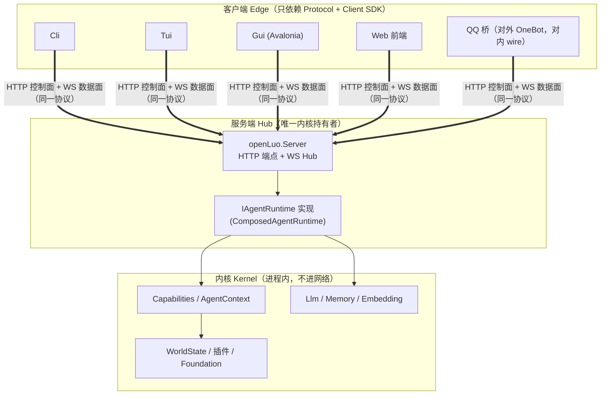
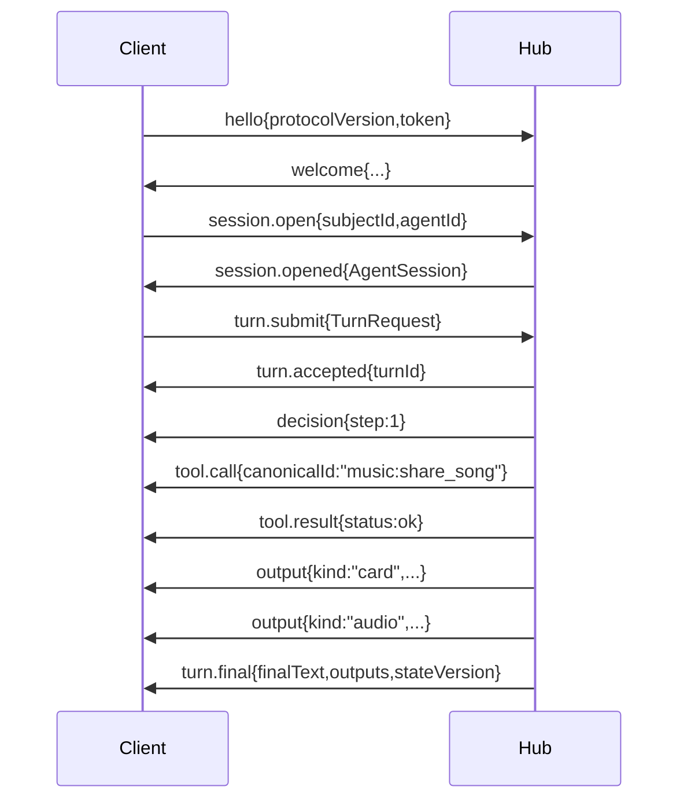

# openLuo 中心服务架构 & Wire 协议 v1

> **状态（2026-10-12）**：中心 Hub + 瘦客户端**已落地**——`./openLuo --serve` 是唯一内核持有者，
> 四个客户端（`openluo-cli` / `-tui` / `-gui` / `-qq`）是**各自独立的程序**，两侧只经本协议通信
> （HTTP 控制面 + WebSocket 数据面）；Hub↔Hub 联邦（§10）仍是规划。
>
> 本文是**单一来源**：既是 wire 契约，也是实施记录。凡规范内未实现者就地标 **v1 未实现**（可 grep），
> 已声明但未处理的命令回 **`2004`**、规范外类型回 **`2003`**；契约与代码不一致时以本文为准并同步修正。

---

## 1. 目标与约束

| 目标                    | 说明                                                                                           |
| ----------------------- | ---------------------------------------------------------------------------------------------- |
| 严格 server/client 分离 | 内核（能力/记忆/世界/插件/LLM）只存在于 Hub；客户端只做 I/O 与渲染                             |
| 两类通信                | **HTTP**（控制面：会话/管理/目录，请求-响应）+ **WebSocket**（数据面：回合流、事件、输出推送） |
| 同一套协议              | 客户端↔Hub、Hub↔Hub、以及未来 Web 前端，全部走同一 `Envelope` + 同一消息类型表                 |
| 中心服务式              | 一个 Hub 服务 N 个客户端连接 / M 个用户（subject）/ K 个并发会话                               |

**非目标（v1）**：客户端离线自治、协议二进制编码（MessagePack 留待 v2）、客户端插件加载。

---

## 2. 分层总览



**边界规则（硬性）**

1. 客户端**不得**引用任何内核程序集（`Capabilities`/`AgentContext`/`Llm`/`Memory`/`Embedding`/`Foundation`）；只引用 `openLuo.Protocol` + `openLuo.Client`。
2. `openLuo.Protocol` **零业务依赖**（仅 DTO/枚举/常亮），是唯一的跨边界契约。
3. 内核**不感知**网络：Hub 负责把内核的 `TurnEvent`/`OutputItem` 映射为 wire 消息。
4. Hub 可同时扮演客户端（联邦/A2A 场景），因为两侧同一协议。

---

## 3. 程序集划分（目标）

| 层     | 程序集                                                                                                       | 职责                                                                       | 依赖              |
| ------ | ------------------------------------------------------------------------------------------------------------ | -------------------------------------------------------------------------- | ----------------- |
| 协议   | **`openLuo.Protocol`（新）**                                                                                 | Envelope、消息类型表、DTO、错误码、版本常量                                | 无                |
| 服务端 | `openLuo.Server`                                                                                             | Kestrel 宿主、HTTP 端点、WS Hub、`IAgentRuntime`→wire 适配、鉴权、会话路由 | Protocol + Capabilities |
| 应用层 | `openLuo.Application`                                                                                        | 内核装配：组合根、配置/作业/调度/日志/资产/会话存储、启动编排（`KernelStartup` / `HubStartup`） | Server + 内核     |
| 服务端 | `openLuo`（**可执行**）                                                                                      | **纯入口**（`Program.cs` 50 行）：解析参数 → 启动内核 → 运行 Hub → 关闭（**不含任何 UI 驱动**） | 仅 `openLuo.Application` |
| 客户端 | `openLuo.Client`                                                                                             | 连接管理、重连、会话句柄、协议编解码、请求-响应关联                        | Protocol          |
| 客户端 | `openLuo.Cli` / `openLuo.Tui` / `openLuo.Gui` / `openLuo.Qqbot`（**各为可执行**）                            | 入口 UI，产物分别为 `openluo-cli` / `openluo-tui` / `openluo-gui` / `openluo-qq` | Protocol + Client（+ 自己的 UI 驱动） |
| 内核   | `openLuo.Foundation`（拆） / `Capabilities` / `AgentContext` / `Llm` / `Memory` / `Embedding` / `WorldState` | 见 §11 迁移                                                                | —                 |

**实际依赖边（由 `tests/openLuo.E2E.Tests/ArchitectureBoundaryTests.cs` 守护，越界即测试失败）**

- `openLuo.Protocol` → **零本仓依赖**（仅 BCL）——它是所有层的公共契约，不得反向依赖任何东西。
- `openLuo.Client` → 仅 `openLuo.Protocol`。
- `openLuo.Server` → `openLuo.Protocol` + `openLuo.Capabilities`。后者是**第二公理**：为把能力元数据与回合事件
  映射为 wire DTO，用到 `CapabilityKind` / `SideEffectClass` / `CapabilityResult` / `CapabilityDescriptor` 等类型。
  Server **不**依赖宿主 `openLuo`，也不依赖 `Domain` / `AgentContext` / `Persistence` 等内核其余部分——
  内核只经 `IAgentRuntime` 注入（见 §11）。若将来要让 Hub 成为"纯网关"，把这批 wire 映射搬回宿主即可。
- 扩展（`openLuo.Extension.*`）→ **不得依赖宿主 exe**（`openLuo`），只经契约程序集交互。

**已落实（本轮拆分）**

- 四个客户端已是**独立可执行**：`openluo-cli` / `openluo-tui` / `openluo-gui` / `openluo-qq`（`OutputType=Exe` + 各自 `Program.cs`），
  服务端 `openLuo` 不再引用它们（连带删掉了宿主里 16 个零使用的驱动包 pin，见其 csproj 注释）。
- 服务端只认 `--serve`；其余旧入口（`--cli/--tui/--gui/--qq`）会明确报错并提示对应客户端程序。
- Makefile：**服务端与客户端是两个独立构建目标**（`build-server` / `build-clients`，`publish-server` / `publish-clients`）；
  `publish` 产出 **n+1 份独立程序**（1 服务端 + N 客户端）平铺在 `publish/linux-x64/`，共享同一份 `config/`；
  客户端不需要内核、不需要 `extensions/`，用 `OPENLUO_HUB_URL` 即可连远端 Hub（多机部署）。
- 上述边界由 `tests/openLuo.E2E.Tests/ArchitectureBoundaryTests.cs` 反射断言（8 例）：
  「服务端 exe 只依赖 Application（内核代码不得回流进 exe）」「Application 是内核装配层：不反向依赖宿主 exe、
  不引客户端、不拉任何 UI 驱动」「服务端不含客户端与 UI 驱动」「客户端不带内核且不互相暴露」。
- **wire 契约的唯一来源 = `openLuo.Protocol`**：envelope / 消息与事件类型 / 错误码 / 全部 DTO / 枚举取值常量都在这里
  （107 个公开类型、零本仓依赖）；客户端侧只有 `HubClient` + 3 个异常类，**不自带任何 wire DTO**；服务端入站只反序列化
  Protocol 类型，出站经 `WireMapper` 只产出 Protocol DTO。
- **枚举对齐**由 `tests/openLuo.E2E.Tests/WireEnumAlignmentTests.cs` 守（4 例）：内核枚举（`CapabilityKind` /
  `SideEffectClass` / `CapabilityStatus` / `RiskLevel` / `TerminationReason`）与 Protocol 常量
  逐成员一一对应、取值 = `camelCase(成员名)`，且 `WireMapper` 的显式 `switch` 覆盖每个成员——改名 / 增删成员会立刻失败，
  不再让 wire 值静默漂移（客户端是按字符串判成败的）。（内核 `DeliveryState` 只在输出队列内部使用、**未上 wire**，
  故 Protocol 侧不再保留对应常量集。）
- **HTTP 面常量与 REST 形状**由 `tests/openLuo.E2E.Tests/HttpSurfaceTests.cs` 守（5 例）：路径 / 查询键 / 响应 `type` /
  资源 id 白名单全部取自 `HttpPaths` / `HttpQueryKeys` / `HttpResponseTypes` / `HttpRules`（**禁止字面量**）；
  路径以 `/v1` 开头、**不含动词**、模板与具体路径分工明确且唯一；`ErrorCodes.HttpStatusOf` 映射逐条断言。
- 删除类端点统一回 `DeletedResponse`（`{deleted:true}`；带 id 的域回 `{deleted:true,id}`）——此前两处是匿名对象，
  形状只活在代码里。
- 启动编排（内核连接 MCP/A2A、加载扩展、装配 Hub）从 exe 移入应用层：`KernelStartup` / `HubStartup`。
- 10 个测试工程全部位于 `tests/`，命名空间与工程名一致。

---

## 4. 协议总则

### 4.1 传输

| 面     | 传输                                              | 用途                                                  | 生命周期 |
| ------ | ------------------------------------------------- | ----------------------------------------------------- | -------- |
| 控制面 | `HTTP/1.1` + `application/json`                   | 会话增删查、目录、健康、鉴权、轮询 fallback、资产拉取 | 短连接   |
| 数据面 | `WebSocket` 文本帧（JSON，与 HTTP 同一 Envelope） | 回合提交、事件流、输出推送与 ack、状态变更            | 长连接   |

**职责划分（互补，非重叠）**

| 判据 | 传输 | 典型 |
| --- | --- | --- |
| 高频 / 实时 / **单向推送** | **WS** | 表现流 `avatar.*`（Live2D）、`output`、`notification`、`state.updated` |
| **双向 / 流式往返** | **WS** | `turn.submit` → `decision`/`tool.*`/`output`/`turn.final` |
| 请求-响应 / 低频 / 管理 | **HTTP** | 会话 CRUD、目录、配置、调度、作业提交、观测 |
| 二进制 / 大对象 | **HTTP** | 资产上传 / 下载（multipart / `Range` / `Content-Type`） |
| 探针 / 无状态 | **HTTP** | `/v1/health`、`/v1/metrics` |

**规则**：WS = 数据面（高频 / 实时 / 单向推送、双向流式回合）；HTTP = 控制面 + 二进制面（请求-响应管理、资产、探针）。
**重叠处（回合提交）以 WS 为主，HTTP 仅 fallback**（§5.5）。二者互补，非二选一。

> 所有 JSON 字段名 `camelCase`；时间为 RFC3339 UTC（`2026-10-09T16:39:17.677Z`）；id 为 ULID 字符串。

### 4.2 统一信封 Envelope

HTTP body 与 WS 帧**共用同一结构**：

```jsonc
{
  "v": 1,                          // 协议版本（major），必须匹配
  "id": "01J8Z...",                // 本条消息 id（ULID）
  "type": "turn.submit",           // 消息类型（点分命名空间）
  "ts": "2026-10-09T16:39:17.677Z",
  "sessionId": "sess_01J8Z...",    // 可选：会话域消息携带
  "traceId": "01J8Z...",           // 可选：链路追踪
  "replyTo": "01J8Z...",           // 可选：响应/结果指向请求 id
  "data": { },                     // 类型特定载荷
  "errorCode": 1000,               // int：1000=成功；错误见 §4.5 码表
  "errorMsg": ""                   // 成功为空串；错误为可读消息
}
```

- **状态一律由 `errorCode`（int）+ `errorMsg` 表达**：成功固定 `1000` / `""`，与是否携带 `data` 无关。
- 请求/响应式消息：服务端以 `replyTo = 请求id` 回填；HTTP 端点直接返回 Envelope。
- 事件式消息：服务端主动推送，`type` 为事件类型。
- 未知 `type`：接收方**必须忽略**（前向兼容），并可选回 `2003`（`protocol.unknown_type`）。

### 4.3 版本协商

- 客户端首帧 `hello` 携带 `protocolVersion`（major 整数）与 `features[]`（能力开关）。
- 服务端 `welcome` 返回 `protocolVersion`、`serverVersion`（semver）、`features[]`（交集）、`heartbeatIntervalSec`。
- major 不匹配 → 服务端回 `protocol.version_mismatch` 并关闭；minor/feature 通过 `features` 协商。

### 4.4 鉴权

| 阶段      | 方式                                                                                |
| --------- | ----------------------------------------------------------------------------------- |
| 取 token  | HTTP `POST /v1/tokens`（clientId + secret，或 API key）→ `201` + `{ token, expiresAt }` |
| HTTP 调用 | `Authorization: Bearer <token>`                                                     |
| WS 握手   | 连接后**首帧** `hello` 必须携带 `token`；未通过前服务端不处理其它消息，超时关闭     |

- 角色：`admin`（管理/目录全量）、`user`（自有会话）、`edge`（平台桥，代表多用户）。
- v1 允许 `auth.anonymous` 开关用于本机开发（配置项 `server.allowAnonymous`）。

**实现状态（已落地）**

- `POST /v1/tokens`（**REST：创建 token 资源**，替代早期的动作式 `POST /v1/auth/token`；成功回 **201**）：
  校验 `apiKey` → 角色映射（`OPENLUO_HUB_API_KEYS`），或 `sharedSecret` → `admin`；失败回 **401 + `3001`**。
- HTTP **admin-only** 路径：`/v1/config*`、`/v1/logs*`、`/v1/metrics`、`/v1/schedules*`、`POST|PATCH /v1/jobs`。
  未鉴权 → **401 + `3001`**；角色不足 → **403 + `3002`**。
- WS：`hello.token` 校验，失败回 `3001` 并以 `PolicyViolation` 关闭。
- 配置经环境变量（后续迁 `server.jsonc`）：`OPENLUO_HUB_ALLOW_ANONYMOUS`（默认 `true`）、`OPENLUO_HUB_ANONYMOUS_ROLE`、
  `OPENLUO_HUB_SECRET`、`OPENLUO_HUB_API_KEYS`（`k1:admin,k2:user`）、`OPENLUO_HUB_TOKEN_TTL_MINUTES`；
  客户端经 **`OPENLUO_HUB_TOKEN`** 携带 token（`HubClient` 自动读取）。
- token 为不透明令牌（`olt_<ULID>`）；**已落 `hub.db` 的 `tokens` 表**（决策 #3）——重启后已签发 token 仍有效，
  回载时按 `expires_at_ms` 过滤过期项；过期即在内存与库中同时剔除（`TokenRegistry.Resolve/ResolveInfo` → `ITokenStore.Remove`）。
  **暂无显式吊销端点**（v1 未实现）。

### 4.5 错误模型

状态由 **`errorCode`（int）+ `errorMsg`（string）** 表达（见 §4.2）。码值**分段**，段内递增；
`errorMsg` 为人读消息，客户端**不得**依赖其文本，应依据码值/段判断。每个码的稳定标识
（如 `protocol.version_mismatch`）由 `ErrorCodes.NameOf(code)` 提供，用于日志/文档/调试，**不入 wire**。

**码值分段**

| 段   | 区间      | 领域                                                                                             |
| ---- | --------- | ------------------------------------------------------------------------------------------------ |
| 1xxx | 1000–1999 | 通用 / 成功（`11xx` 配置 / `12xx` 调度 / `13xx` 作业 / `14xx` 设备 / `15xx` 在场 / `16xx` 表现 / `17xx` 观测） |
| 2xxx | 2000–2999 | 协议                                                                                             |
| 3xxx | 3000–3999 | 鉴权                                                                                             |
| 4xxx | 4000–4999 | 会话                                                                                             |
| 5xxx | 5000–5999 | 回合                                                                                             |
| 6xxx | 6000–6999 | 能力                                                                                             |
| 7xxx | 7000–7999 | 资产                                                                                             |
| 8xxx | 8000–8999 | 限流                                                                                             |
| 9xxx | 9000–9999 | 服务端                                                                                           |

**码表**

| code | 标识                             | 语义                                | retryable |
| ---- | -------------------------------- | ----------------------------------- | --------- |
| 1000 | success                          | 成功（`errorMsg` 为空串）           | —         |
| 1001 | unknown                          | 未分类                              | —         |
| 1101 | config.namespace_not_found       | 配置命名空间不存在                  | false     |
| 1102 | config.invalid_value             | 配置值非法（类型/结构）             | false     |
| 1103 | config.read_only                 | 该命名空间只读                      | false     |
| 1104 | config.persist_failed            | 配置落盘失败                        | true      |
| 1201 | schedule.not_found               | 调度条目不存在                      | false     |
| 1202 | schedule.invalid                 | 调度定义非法（cron / 时间）         | false     |
| 1301 | job.not_found                    | 作业不存在                          | false     |
| 1302 | job.invalid                      | 作业参数非法                        | false     |
| 1303 | job.failed                       | 作业执行失败                        | false     |
| 1401 | device.not_found                 | 设备不存在                          | false     |
| 1402 | device.report_rejected           | 设备上报被拒（未知设备 / 校验失败） | false     |
| 1501 | presence.unavailable             | 在场信息不可用                      | true      |
| 1601 | avatar.unsupported | 不支持该表现（客户端 / 服务端） | false |
| 1701 | trace.not_found | 回合轨迹不存在 | false |
| 2001 | protocol.version_mismatch        | 协议 major 不符                     | false     |
| 2002 | protocol.bad_envelope            | Envelope 结构非法                   | false     |
| 2003 | protocol.unknown_type            | 未知消息类型（可忽略）              | —         |
| 2004 | protocol.not_implemented         | 类型已定义但本版本未实现（勿重试）  | false     |
| 3001 | auth.unauthorized                | token 缺失/无效                     | false     |
| 3002 | auth.forbidden                   | 无该会话/角色权限                   | false     |
| 4001 | session.not_found                | 会话不存在或已关闭                  | false     |
| 4002 | session.limit_exceeded           | 超过并发会话上限                    | true      |
| 4003 | session.invalid                  | 会话 id 非法（入口治理 §4.9）       | false     |
| 5001 | turn.busy                        | 该会话已有进行中回合（内核默认**排队串行**；仅超队列上限时回此码）                | true      |
| 5002 | turn.cancelled                   | 回合被取消                          | false     |
| 5003 | turn.budget_exceeded             | 决策预算耗尽                        | false     |
| 5004 | turn.invalid                     | 回合请求非法（文本超长 / 含 NUL / 严格模式命中启发式，§4.9） | false     |
| 6001 | capability.confirmation_required | 需用户确认（见 §8）                 | —         |
| 6002 | capability.failed                | 能力执行失败                        | true      |
| 7001 | asset.not_found                  | 资产引用失效                        | true      |
| 7002 | asset.too_large                  | 资产超出大小上限                    | false     |
| 7003 | asset.invalid                    | 资产格式非法                        | false     |
| 8001 | rate.limited                     | 限流                                | true      |
| 9001 | server.internal                  | 未分类服务端错误                    | true      |

### 4.6 幂等与顺序

- `turn.submit` / `message.append` **可**携带 `data.idempotencyKey`。
  **v1 未实现**：Hub 当前**不做**去重——既无幂等表，也未把该字段传给内核（`TurnRequestDto.IdempotencyKey`
  全仓无消费者）；重复提交会**重复执行**，客户端须自行保证不重发。
- 输出类事件带 `data.sequence`（**全局单调**，会话内亦单调；**不保证连续**——客户端应以 `>` 比较，
  不得用 `seq+1` 推断丢失）。
- `output` 类的回执是**可选**的：投递成功后 SHOULD 发 `output.ack{sequence}`（多端下**任一端 ack 即视为已投递**，
  不阻塞其它端）；失败发 `output.fail{sequence, permanent}`。不 ack 也不会实时重发——只有
  `session.resume{sinceSequence}` 续传时才以"未确认投递"为依据补发（见 §6.4）。
- 同一会话的回合由内核 **per-session 闸串行**执行（`turn.submit` 默认排队；`turn.busy` 仅用于超队列上限）。

### 4.7 身份模型

| 标识 | 域 | 含义 | 来源 |
| --- | --- | --- | --- |
| `clientId` | 连接 | 一个客户端实例 / 连接（设备、进程） | `hello` |
| `clientType` | 连接 | 形态：`cli\|tui\|gui\|web\|qq\|hub` | `hello` |
| `subjectId` | 会话 | 会话主体（用户 / 玩家）；**记忆与状态的 owner（隔离键）** | `session.open` |
| `agentId` | 会话 | 角色 / Agent 身份 | `session.open` |
| `userId` | 回合 | 频道 / 群内**说话人**稳定 id（平台用户 id） | `turn.submit` |
| `actorId` | 回合 | 回合发起人（`player` 或角色 id）；表现层语义 | `turn.submit` |
| `threadId` | 回合 | 会话内线程（群内每用户 / 每话题） | `turn.submit` |

**关系**

- 一个 `clientId` 可开/订阅**多个**会话；一个会话可被**多个** `clientId` 订阅（多端同看）。
- `subjectId` 是记忆 / 状态的**隔离键**；`userId` 是会话内的**说话人身份**（一个会话可有多个）。
- `token.role`（§4.4）决定可访问范围，见 §4.8。
- 群聊场景：`subjectId` = 角色（如 `builtin-rin`），`userId` = 群成员 —— 二者的笛卡尔积才是「用户 × 角色」维度（当前内核仅按 `subjectId` 键控，见 `context-scope-risk.md` R3）。

### 4.8 权限矩阵

| 资源 / 操作 | `admin` | `user` | `edge` |
| --- | --- | --- | --- |
| 健康 / 版本 | ✓ | ✓ | ✓ |
| 目录（agents / capabilities） | ✓ | ✓ | ✓ |
| 会话（自有） | ✓ | ✓ | ✓（代表多用户） |
| 会话（任意） | ✓ | ✗ | ✗ |
| 回合（已订阅会话） | ✓ | ✓ | ✓ |
| 配置读写（§5.7） | ✓ | ✗ | ✗ |
| 调度（§5.8） | ✓ | ✗ | ✗ |
| 作业（§5.9） | ✓ | ✓（自有） | ✓ |
| 资产（§5.10 / §9） | ✓ | ✓（归属会话） | ✓ |
| 观测 traces / metrics（§5.11） | ✓ | ✗ | ✗ |
| 审计订阅（`audit.subscribe`） | ✓ | ✗ | ✗ |

> 越权统一回 `3002 auth.forbidden`；未鉴权回 `3001 auth.unauthorized`。

### 4.9 入口治理（限流 + 输入校验）

Hub 在**任何鉴权判断之前**先做一层入口治理（实现于 `openLuo.Server`：`HubRequestGuard` + `Security/{RateLimiter,InputValidator}`；
策略由宿主从 `security.jsonc` 的 `security` 段映射传入，配置热加载后每 30 次检查自动跟随）：

| 面 | 检查 | 超限结果 |
| --- | --- | --- |
| HTTP | 每 key 请求速率（1 分钟窗口 + 10 秒突发窗口）；key = Bearer token → 客户端 IP | `429 + 8001 rate.limited` |
| HTTP | 路径里的资源 id（`/v1/{sessions,assets,traces}/{id}`）须匹配 `[A-Za-z0-9_-]+` | `400 + 4003 session.invalid` |
| WS | 单条文本帧字节数 | `2002 protocol.bad_envelope`，随后断开 |
| WS | 每条命令计入同一套速率窗口（`hello` 必须放行，否则客户端连不上） | `8001 rate.limited`（不断开） |
| WS | `session.subscribe` / `session.resume` 的 `sessionId` 白名单 | `4003 session.invalid` |
| WS | `turn.submit` 文本：**空文本放行**（支持"仅媒体块"回合）、含 NUL 或超长拒绝；严格模式下再过启发式 | `5004 turn.invalid` |

**开关与默认值**（`security.jsonc`，模板见 `openLuo/data/config/security.example.jsonc`）：

| 键 | 默认 | 含义 |
| --- | --- | --- |
| `hubEnabled` | `true` | 总开关（false 时整层不拦截） |
| `hubRequestsPerMinute` | `600` | 每 key 每分钟请求上限 |
| `hubBurstLimit` | `60` | 每 key 每 10 秒突发上限 |
| `hubMaxInputLength` | `32768` | 回合文本字符上限（正常聊天远达不到） |
| `hubMaxFrameBytes` | `1048576` | 单条 WS 文本帧字节上限 |
| `hubStrictInputValidation` | `false` | 严格模式：把启发式（SQL 关键字 / `{}<>` 计数）也用于回合文本 |

> **默认值取舍**：必须"真实生效但不误伤"——启发式对正常聊天会误判（聊到 `SELECT`、贴一段代码即中招），
> 故只在对抗性接入场景打开；限流默认值则足以拦住脚本级滥用。同段的 `rateLimitPerMinute`/`burstLimit`/`maxInputLength`
> 仍是**插件总线**那套配额，与 Hub 入口互不影响。
> **尚未纳入**：插件权限强制、按 subject/租户的细分配额（见 §10 与 README 路线图）。

---

## 5. HTTP 控制面接口

**REST 约定（硬性）**

1. **路径只用资源名词**：`/v1/<复数集合>` + `/{id}` + 子资源（如 `/v1/sessions/{id}/state`）。**路径里不出现动词**
   ——动作由方法表达（读 `GET`、建 `POST`、部分更新 `PATCH`、删 `DELETE`）。
2. **创建回 `201 Created` + `Location`**（`POST /v1/sessions`、`/v1/schedules`、`/v1/jobs`、`/v1/assets`、`/v1/tokens`）；
   其余成功回 `200` + Envelope。
3. **查询串只承载过滤 / 分页 / 视图选项**，不承载资源身份（身份走路径；文件名走标准 `Content-Disposition` 头）。
4. **路径与查询键、响应 `type`、资源 id 白名单都是 Protocol 常量**（`HttpPaths` / `HttpQueryKeys` / `HttpResponseTypes` /
   `HttpRules`），禁止在端点或客户端里手写字面量；`tests/openLuo.E2E.Tests/HttpSurfaceTests.cs` 守形状与唯一性。
5. 错误码 → HTTP 状态码的映射由 **`ErrorCodes.HttpStatusOf`** 单点定义（Protocol 持有，服务端与文档同源）。

统一前缀 `/v1`；响应体为 Envelope（`data` 承载结果）。错误用 HTTP 4xx/5xx 状态码 + Envelope 顶层 `errorCode` / `errorMsg`（§4.2 / §4.5）双写。
业务错误码**按分段映射为 HTTP 状态**：`404` 不存在（会话/资产/作业/调度/配置命名空间/设备/轨迹）、
`403` 越权或只读、`413` 过大、`429` 限流/超会话上限、`409` 冲突（回合忙/取消/需确认）、
`503` 在场不可用、`500` 失败（作业/落盘/服务端），其余 `400`（实现见 `ErrorCodes.HttpStatusOf`）。

**实现状态约定**

本文档同时是**协议规范**与**实现现状**的单一来源。凡**已写入规范但 v1 尚未实现**的条目，一律就地标注
**`v1 未实现`**（可 `grep -n "v1 未实现" docs/architecture/hub-protocol.md` 列出全部）：

- 此类条目对客户端**不是可用契约**，不要据此实现；服务端行为：
  **已声明但未处理**的命令 → `2004 protocol.not_implemented`（`data`/`errorMsg` 说明 `type not handled: <type>`）；
  **规范里也没有**的 type → `2003 protocol.unknown_type`（`unknown type: <type>`）。
- 客户端**不得**依赖标注为 `v1 未实现` 的字段（例如 `TurnRequest.budgets`、`presence.subscribe.sessionIds`），
  服务端当前会静默忽略。
- 反向要求：实现若先于规范落地，必须同步补本文档（禁止"只有代码知道"的行为）。

### 5.1 系统

| 方法 | 路径          | 说明                                                                 |
| ---- | ------------- | -------------------------------------------------------------------- |
| GET  | `/v1/health`  | 存活/就绪；`data: {status, uptimeSec, mcpHealthy, mcpTotal, extensionsLoaded}` |
| GET  | `/v1/version` | `data: {serverVersion, protocolVersion, features[]}`                 |

### 5.2 鉴权

| 方法 | 路径             | 请求 `data`                    | 响应 `data`                |
| ---- | ---------------- | ------------------------------ | -------------------------- |
| POST | `/v1/tokens` | `{clientId, secret?, apiKey?}` | `201` + `{token, expiresAt, role}` |

### 5.3 目录

| 方法 | 路径                 | 说明                                         | 响应 `data`                                                  |
| ---- | -------------------- | -------------------------------------------- | ------------------------------------------------------------ |
| GET  | `/v1/agents`         | 可用角色/Agent 目录（**v1 未实现**：暂无枚举接口，客户端须由配置得知 `agentId`） | `{agents: [{agentId, displayName, avatar?, tags[]}]}`        |
| GET  | `/v1/capabilities`   | 能力目录（可带 `?sessionId=` 过滤权限/场景） | `{version, capabilities: [CapabilityDescriptor]}`（见 §7.4） |
| GET  | `/v1/config/summary` | 非敏感配置摘要（admin；**v1 未实现**，配置读取见 §5.7）                      | `{llm: {...}, server: {...}}`                                |

### 5.4 会话

| 方法   | 路径                        | 请求 `data`                                                          | 响应 `data`                                                         |
| ------ | --------------------------- | -------------------------------------------------------------------- | ------------------------------------------------------------------- |
| POST   | `/v1/sessions`              | `{subjectId, agentId, clientType, clientId, conversationId?, meta?}` | `201` + `AgentSession`（§7.1）。带 `conversationId` 且已存在同 `(subjectId, agentId, conversationId)` 的会话时**复用**该会话 |
| GET    | `/v1/sessions/{id}`         | —                                                                    | `AgentSession`                                                      |
| DELETE | `/v1/sessions/{id}`         | —                                                                    | `{closed: true}`                                                    |
| GET    | `/v1/sessions/{id}/context` | `?region=&format=`                                                   | `{summary, regions: [{region, content, priority, source, status}]}` |
| GET    | `/v1/sessions/{id}/state`   | —                                                                    | 世界状态只读投影 `{version, values: {...}}`。**按 subject 分区**（端点按会话取 subjectId，与会话解耦）；状态快照**落 `hub.db` 的 `subject_state` 表**（值按 JSON 往返），**重启后版本与值保留**；未接入状态端口时不注册该端点 |

### 5.5 回合（**仅无 WS 客户端的 fallback**；**v1 未实现**）

> 有 WS 的客户端应一律走 `turn.submit`（§6.1）。此节供 QQ 桥 / 脚本等**无 WS** 客户端使用：
> 提交后 `202 + turnId`，结果经 `GET /v1/turns/{turnId}` 轮询（因无 WS 无法接收流）。
>
> **实现现状（v1）**：本节的 4 个端点**全部未实现**（无 WS 客户端目前无法提交回合；QQ 桥走的是 WS，
> 见 §6.5）。轮询语义还依赖回合状态持久化，属独立排期项。

| 方法 | 路径                         | 请求 `data`                           | 响应                                                          |
| ---- | ---------------------------- | ------------------------------------- | ------------------------------------------------------------- |
| POST | `/v1/sessions/{id}/turns`    | `TurnRequest`（§7.2）                 | `202` + `data: {turnId, accepted: true}`                      |
| GET  | `/v1/turns/{turnId}`         | —                                     | `{turnId, status: running\|done\|failed, result?, outputs[]}` |
| POST | `/v1/turns/{turnId}/cancel`  | —                                     | `{cancelled: true}`                                           |
| POST | `/v1/sessions/{id}/messages` | `{senderName?, text, blocks?, meta?}` | `{appended: true}`（`.AppendMessage`：看但不回）              |

### 5.6 资产（二进制解耦，见 §9）

| 方法 | 路径                   | 说明                                                             |
| ---- | ---------------------- | ---------------------------------------------------------------- |
| GET  | `/v1/assets/{assetId}` | 返回原始字节（`Content-Type` 由资产决定），用于 image/audio/file |
| HEAD | `/v1/assets/{assetId}` | 元数据（size/mime/checksum）                                     |

### 5.7 配置（管理，需 `admin`）

配置命名空间对应 `config/{ns}.jsonc`；有效值 = **default ⊕ file ⊕ runtime**（后者覆盖前者，
来源见 `ConfigSources`）。

| 方法   | 路径              | 请求 `data`           | 响应 `data`            | 说明                                 |
| ------ | ----------------- | --------------------- | ---------------------- | ------------------------------------ |
| GET    | `/v1/config`      | —                     | `ConfigListResponse`   | 列出命名空间（来源 / 是否覆盖）      |
| GET    | `/v1/config/{ns}` | —                     | `ConfigGetResponse`    | 获取有效值（**敏感字段掩码 `***`**） |
| PATCH  | `/v1/config/{ns}` | `ConfigSetRequest`    | `ConfigSetResponse`    | JSON **合并写入**覆盖层（REST：部分更新） |
| DELETE | `/v1/config/{ns}?persist=` | —（无请求体）         | `ConfigDeleteResponse` | 删除覆盖 → 回退默认；`persist=true` 同时删盘 |

**语义**

- `persist=false`（默认）：仅写**运行时**覆盖（进程内，重启丢失）。
- `persist=true`：写回磁盘 `config/{ns}.jsonc`（失败回 `1104 config.persist_failed`）。
- POST 为**递归合并**（对象按键递归；数组整体替换）；值为 `null` 表示删除该键（回退下层）。
- DELETE 后 `source` 回退到 `file` 或 `default`；关键命名空间（如 `server`）标记只读，写操作回 `1103 config.read_only`。
- 变更经 `RuntimeConfigCenter` 热加载生效。
  **v1 未实现**：当前**不广播** `config.updated`（§6.2 中该事件无生产者），客户端不得依赖配置变更推送。

### 5.8 调度（管理，需 `admin`）

| 方法   | 路径                 | 请求 `data`             | 响应 `data`            |
| ------ | -------------------- | ----------------------- | ---------------------- |
| GET    | `/v1/schedules`      | —                       | `ScheduleListResponse` |
| POST   | `/v1/schedules`      | `CreateScheduleRequest` | `201` + `ScheduleDto`  |
| DELETE | `/v1/schedules/{id}` | —                       | `DeletedResponse`（`{deleted:true}`） |

触发时 Hub 以 `turn.started{origin:"scheduled"}` 发起主动回合（§6.4）。

`POST /v1/schedules` 的 `at`（一次性，ISO-8601）与 `cron`（周期）二选一：

- `cron` 为**标准 5 段**（分 时 日 月 周），支持 `*`、`N`、`a-b`、`*/n`、`a-b/n` 与逗号列表；周字段 `0`/`7` 均为周日。
- 无效表达式回 **`1202 schedule.invalid`**；缺 `at` 与 `cron` 同样回 `1202`。
- 周期项触发后按 `Next(now)`（分钟精度）重排下次触发；一次性项触发后置 `enabled:false`。
- 重启恢复：周期项重算下次触发，一次性项维持宽限期语义（§13 #3）。

### 5.9 作业（长任务）

| 方法   | 路径            | 请求 `data`        | 响应 `data`         |
| ------ | --------------- | ------------------ | ------------------- |
| POST   | `/v1/jobs`      | `CreateJobRequest` | `201` + `JobDto`    |
| PATCH  | `/v1/jobs/{id}` | `JobUpdateRequest`（`{status:"cancelled"}`；取消是**状态迁移**，非删除） | `JobDto`（`status: cancelled`；不存在/不可取消回 `1301`，非法迁移回 `1302`） |
| GET    | `/v1/jobs/{id}` | —                  | `JobDto`（**已实现**；早期规范写的 `JobStatusResponse` 形状从未上线） |

进度 / 完成经 WS `job.progress` / `job.completed` 推送。用于 CG 生成、批量 TTS、Live2D 构建等长任务。

### 5.10 资产上传（客户端 → 服务端）

| 方法   | 路径              | 说明                                                                             |
| ------ | ----------------- | -------------------------------------------------------------------------------- |
| POST   | `/v1/assets` | 上传二进制（请求体即原始字节，`Content-Type` = MIME），返回 `201` + `UploadAssetResponse`（含 `assetRef`），`Location` 指向该资产 |
| POST   | `/v1/sessions/{id}/assets` | 同上，但把资产**归属到会话**（REST：父资源子集合；替代早期的 `?sessionId=` 查询参数） |
| DELETE | `/v1/assets/{id}` | 删除资产，返回 `DeletedResponse`（`{deleted:true, id}`；`ttl` 到期由清理任务回收，见 §5.11） |

**实现现状（v1）**：文件名走标准 **`Content-Disposition: attachment; filename="…"`** 头
（`HubClient.UploadAssetAsync` 即如此）；早期的 `?fileName=` 与自定义头 `X-File-Name` **已废弃并移除**。
资产身份走路径（`/v1/assets/{id}` 或 `/v1/sessions/{id}/assets`），查询串不再承载身份。
规范早期设想的 JSON 元数据体（`UploadAssetRequest`）从未启用，已从协议类型中移除。

补齐 §9 的反向链路：客户端上传的图片 / 语音 / 文件经 `assetRef` 出现在 `TurnRequest.blocks`。

### 5.11 观测（admin）

| 方法 | 路径                  | 说明                                   |
| ---- | --------------------- | -------------------------------------- |
| GET  | `/v1/traces/{turnId}` | 回合决策轨迹（`TurnTraceDto`，回放用） |
| GET  | `/v1/metrics`         | 运行指标（`MetricsDto`）               |
| GET  | `/v1/logs`            | 热库日志检索（`from`/`to`/`level`/`module`/`category`） |
| GET  | `/v1/logs/archive`    | 冷文件（归档 JSONL）检索：`date`（`yyyyMMdd` 或 `*`）、`category`、`keyword`、`level`、`limit` |
| GET  | `/v1/logs/stats`      | 按时间桶统计各级别条数（`from`/`to`/`bucket`） |

审计事件经 WS `audit.event` 推送（`audit.subscribe`）。

**实现状态（已落地）**

- `/v1/metrics`：Hub 计数（uptime / 在线连接 / 回合数 / 失败回合数 / 活跃会话）。
- `/v1/traces/{turnId}`：**回合轨迹**入 `hub.db`（`traces` + `trace_events`），记录
  `decision`/`tool.call`/`tool.result`/`output`/`turn.final` 事件序列（JSON 载荷，>4KB 截断）
  与结果摘要（success / terminationReason / finalText）；保留 **14 天 / 20 万事件**（超窗裁剪）。
- 两个端点均为 **admin-only**（接入 §4.8 守卫）。
- 未知回合回 **`1701 trace.not_found`**。
- **冷文件检索已落地**：`/v1/logs/archive` 按 `{logDir}/{archive.Dir}/{date}/*.jsonl` 目录扫描（无索引），
  命中达 `limit` 提前返回，结果按 `ts` 倒序（单测 + 冒烟：`date`/`category`/`keyword`/`level` 过滤生效）。
  日志裁剪（`Trim`）后执行 FTS5 `optimize` 合并段、回收索引空间。
- **`audit.event` 审计流已落地**：`audit.subscribe`（需 admin）后收关键管理动作事件（`auth.token` /
  `session.open|close` / `config.set|delete` / `job.submit` / `schedule.add` / `asset.upload|delete`），
  含发起方 `clientId`、目标与结果。
- **资产 TTL**：`OPENLUO_ASSET_TTL_MINUTES > 0` 时每 10 分钟清理超期资产（`IAssetStore.PurgeExpired`）。

---

## 6. WebSocket 数据面协议

- 端点：`GET /v1/stream`（`Upgrade: websocket`）。
- 一条连接可**订阅多个会话**；服务端按 `sessionId` 路由事件。
- 客户端命令（C→S）需 `id`；服务端事件（S→C）携带 `replyTo`（若由命令触发）或独立。
- **回环直连**：`openLuo.Client.HubClient` 对 `127.0.0.1`/`localhost`/`::1` 显式禁用 HTTP 代理
  （`ClientWebSocket.Options.Proxy = null`、Hub HTTP 用 `UseProxy=false`）——系统级 `http_proxy`
  会把本地连接交给代理，代理到不了该端口时只报 `response ended prematurely`，极易误判为 Hub 崩溃；
  非回环地址仍按环境变量走代理。连接失败抛 `HubConnectException`（含目标地址与「先起 `--serve`」提示）。
  同一约定也适用于 OneBot 腿（`openLuo.OneBot.OneBotWebSocketClient`）：`ws://localhost:3001`
  若不直连，代理抖动会表现为「消息没发出去」，与 Hub 无关。

### 6.1 客户端 → 服务端（命令）

| type                                          | `data`                                                       | 说明                                             |
| --------------------------------------------- | ------------------------------------------------------------ | ------------------------------------------------ |
| `hello`                                       | `{protocolVersion, token, clientId, clientType, features[]}` | 必须首帧                                         |
| `session.open`                                | `{subjectId, agentId, conversationId?, meta?}`               | 开会话（等价 HTTP POST /sessions）。**给了 `conversationId` 且已存在同 `(subjectId, agentId, conversationId)` 的会话时复用该会话**（多端共享同一段对话：PC 客户端与手机 QQ 私聊配同一值即可）；未给则每次新建 |
| `session.subscribe`                           | `{sessionId}`                                                | 订阅某会话的 output/state 事件（多客户端可共订；由 **Hub 分发**——内核队列为单消费者，见 §11） |
| `session.unsubscribe`                         | `{sessionId}`                                                | 退订                                             |
| `session.close`                               | `{sessionId}`                                                | 关闭会话（**v1 未实现**；HTTP `DELETE /v1/sessions/{id}` 已实现） |
| `turn.submit`                                 | `TurnRequest` + `{idempotencyKey}`                           | 提交回合（流式结果经事件返回）                   |
| `turn.cancel`                                 | `{turnId}`                                                   | 取消进行中回合：命中即取消（**无直接回复**，该回合以 `turn.final{success:false, terminationReason:"cancelled"}` 收尾）；未在运行则回 `5002 turn.cancelled`（"turn not running"） |
| `message.append`                              | `{sessionId, senderName?, text, blocks?, meta?}`             | 写入历史不触发回合                               |
| `output.ack`                                  | `{sequence}`                                                 | 已成功投递 → 转发到内核 `IOutputQueue.AckAsync`。多端下**任一端 ack 即视为已投递**（不阻塞其它端）；不回复 |
| `output.fail`                                 | `{sequence, permanent}`                                      | 投递失败 → `FailAsync`；`permanent=true` 放弃该条（以固定失败消息占位），`false` 保留可重试 |
| `confirm.response`                            | `{requestId, approved, reason?}`                             | 高危能力确认结果（§8）                           |
| `config.get` / `config.set` / `config.del`    | `ConfigGetCommand` / `ConfigSetCommand` / `ConfigDelCommand` | 配置读取 / 修改 / 删除（§5.7，需 `admin`；**v1 未实现**——配置只走 HTTP） |
| `session.resume`                              | `{sessionId, sinceSequence}`                                 | 重连续传（补发未收输出，§6.4）                   |
| `presence.subscribe` / `presence.unsubscribe` | `{sessionIds?}`                                              | 订阅在线状态（多客户端）。给了 `sessionIds` 即只收**与这些会话有交集**的连接的在场变化（"我关心的会话里还有谁"）；不传则收全量 |
| `device.report`                               | `{deviceId, kind?, state}`                                   | 边缘 / 网关上报设备状态（智能家居；**v1 未实现**） |
| `avatar.command`                              | `{agentId, motion?, state?}`                                 | 客户端请求角色表现（点击 / 触碰互动；**v1 未实现**） |
| `audit.subscribe`                             | `{}`                                                         | 订阅审计事件（需 `admin`）                       |
| `ping`                                        | `{}`                                                         | 心跳                                             |

### 6.2 服务端 → 客户端（事件）

| type                                                             | `data`                                                                           | 对应内核                                                      |
| ---------------------------------------------------------------- | -------------------------------------------------------------------------------- | ------------------------------------------------------------- |
| `welcome`                                                        | `{protocolVersion, serverVersion, features[], heartbeatIntervalSec, clientId}`   | 协商结果                                                      |
| `session.opened`                                                 | `AgentSession`                                                                   | `OpenSessionAsync`                                            |
| `session.closed`                                                 | `{sessionId, reason}`                                                            | 会话结束                                                      |
| `turn.accepted`                                                  | `{turnId, sessionId}`                                                            | 回合受理                                                      |
| `decision`                                                       | `{turnId, step, modelToolName?, note?}`                                          | `TurnEvent.kind=decision`                                     |
| `tool.call`                                                      | `{turnId, callId, canonicalId, arguments}`                                       | 工具发起                                                      |
| `tool.result`                                                    | `{turnId, callId, status, preview?}`（`status` ∈ `CapabilityStatuses`：`ok` / `failed` / `conflict` / `rejected` / `timeout` / `cancelled`） | `TurnEvent.kind=tool_result`                                  |
| `output`                                                         | `OutputItem`（§7.3）                                                             | `IOutputQueue` 推送（**即发**，D50）                          |
| `turn.final`                                                     | `TurnResult`（§7.5）                                                             | `TurnEvent.kind=final`                                        |
| `context.updated`                                                | `{sessionId, regions[]}`                                                         | 上下文快照变更（可选/调试；**v1 未实现**）                    |
| `state.updated`                                                  | `{sessionId, version, patch}`                                                    | 世界状态变更：**回合结束后按需推送**（该 subject 的状态版本推进才发；`patch` 只含相对上次广播变化的键，首次为全量）。新订阅者用 `GET /v1/sessions/{id}/state` 取快照 |
| `confirm.request`                                                | `{requestId, turnId, canonicalId, risk, summary, argsPreview}`                   | 高危能力需确认                                                |
| `config.updated`                                                 | `ConfigUpdatedEvent`                                                             | 配置已变更（**v1 未实现**：见 §5.7）                          |
| `notification`                                                   | `NotificationEvent`                                                              | 非回合绑定的服务端通知（提醒 / 告警；**v1 未实现**）          |
| `turn.started`                                                   | `TurnStartedEvent`                                                               | 服务端发起的回合（`origin: scheduled\|event\|presence\|hub`） |
| `presence.updated`                                               | `PresenceUpdatedEvent`                                                           | 在线状态变化（多客户端）                                      |
| `member.joined` / `member.left`                                  | `MemberJoinedEvent` / `MemberLeftEvent`                                          | 群成员变更（**v1 未实现**）                                   |
| `device.state`                                                   | `DeviceStateEvent`                                                               | 设备状态变化（**v1 未实现**）                                 |
| `job.accepted` / `job.progress` / `job.completed` / `job.failed` | `JobAcceptedEvent` / `JobProgressEvent` / `JobCompletedEvent` / `JobFailedEvent` | 长任务生命周期                                                |
| `avatar.state` / `avatar.motion` / `avatar.lipsync`              | `AvatarStateEvent` / `AvatarMotionEvent` / `AvatarLipsyncEvent`                  | 角色表现（Live2D / 3D；**v1 未实现**）                        |
| `audit.event`                                                    | `AuditEventDto`                                                                  | 审计事件（admin 订阅）                                        |
| `error`                                                          | 顶层 `errorCode` / `errorMsg`（§4.2 / §4.5）                                     | 关联 `replyTo`                                                |
| `pong`                                                           | `{ts}`                                                                           | 心跳应答                                                      |

### 6.3 典型时序（流式回合）



> 注意：`output` 事件在回合进行中**即发**（对应现有"音频生成即入队"），不等 `turn.final`。
> **v1 未实现**：`output.ack` 回执（§6.1）——故上图不画回执；客户端收到 `output` 即视为已投递。

### 6.4 扩展域语义

**群聊 / 多用户**（**v1 未实现**：`userId`/`mentions`/`threadId` 均未接入内核，见 §7.2；`OutputDto.recipient` 与成员事件也无生产者）：`TurnRequestDto.userId` 是稳定身份（区别于平台显示名 `senderName`）；`mentions[]` 表被 @；`threadId` 在会话内切分线程（群内每用户 / 每话题独立上下文与记忆）。`OutputDto.recipient` 定向投递（`@某人`、私聊），`mentions[]` 随输出 @，`threadId` 回填所属线程。成员变更走 `member.joined` / `member.left`。

**多客户端 / 在场**：一条连接可订阅多会话；Envelope `targetClientId` 把事件定向到某个客户端（null = 广播给订阅者）；`presence.subscribe` 后收 `presence.updated`。断线重连用 `session.resume{sinceSequence}` 补发未收输出（依赖 `output` 的 `sequence`，全局单调、不保证连续）。

**多端共享同一段对话（会话寻址）**：以同一 `(subjectId, agentId, conversationId)` 调 `session.open` 即**复用同一会话**（§5.4 / §6.1）——PC 客户端与手机 QQ 私聊配同一 `conversationId` 就落在同一段对话里（两端都能看到彼此的消息，回合按会话串行）；不同 `conversationId` 仍各自独立。会话是**寻址单位**，记忆/世界状态的所有者仍是 `subjectId`（后续的用户认证与公共/私有记忆划分挂在 subjectId/actor 这一层，不需要改 client/hub）。

**多端看到的状态**：世界状态按 `subjectId` 分区（与会话解耦，端点/事件都按会话解析出 subject）。回合结束后，Hub 只在该 subject 的状态**版本推进**时向「发起连接 + 该会话订阅者」推送 `state.updated`（`patch` 为相对上次广播变化的键）；新接入的一端用 `GET /v1/sessions/{id}/state` 取一次全量快照对齐即可（协议没有"订阅即快照"语义，也不每回合推全量）。

**连接内并发**：`turn.submit` **脱离连接循环**投递（回合期间该连接仍能处理后续命令，例如 `turn.cancel`、`ping`、`output.ack`）；发送方向按连接串行化（`ClientWebSocket` 不允许并发 Send）；同一会话的多个回合由内核 per-session 闸串行执行。

> **投递与 ack（多客户端关键语义）**：`output` 事件由 Hub **广播给该会话的所有订阅客户端**；`output.ack` 记录「**某一端**已成功投递」，**不因个别端未 ack 而阻塞**（内核队列已解耦，`Enqueue` 永不等待 ack，见 §11）。需「确保某端收到」用 `session.resume{sinceSequence}` 补读。
>
> **客户端现状**：内置客户端（CLI / QQ 桥）**尚未**主动上报 ack，因此 `session.resume` 会按"未确认投递"补发；
> 是否接上 ack（例如 QQ 桥在 OneBot 投递成功后 ack）是后续的小项，协议与 Hub 侧已就绪。

**实现状态（已落地）**

- `session.subscribe` / `session.unsubscribe` 生效：**非回合事件**（作业 / 调度 / 通知）仅投给**已订阅该会话**的连接；未订阅不收到。
- **回合事件**投给「**发起连接 + 该会话订阅者**」（多端同看同一会话）。
- `session.resume{sinceSequence}` → `IOutputQueue.ReadSince` 补发**同会话**未 ack 输出（内存 ring；跨重启不保留，与决策 #3 一致）。
- `presence.subscribe` / `presence.unsubscribe`：订阅后收在线快照与上下线 `presence.updated`。
- Envelope `targetClientId` **定向优先**（只投给匹配 `clientId` 的连接）。
- 未订阅时的跨会话泄漏已消除（冒烟实测：B 未订阅 A 时收不到 A 的回合事件）。

**主动 / 调度**：`/v1/schedules` 注册定时 / 条件触发；到期 Hub 自主发起回合并发 `turn.started{origin}`（`client|scheduled|event|presence|hub`），后续事件与普通回合一致；非回合的轻量提示走 `notification`（**v1 未实现**：该事件当前无生产者）。

> **投递目标**：`notification` / `device.state` / `job.*` / `avatar.*` / `member.*` 等**非回合事件**默认
> **广播给已订阅相关会话的客户端**；无 `sessionId` 的全局通知广播给所有已鉴权连接；需点对点时用 Envelope `targetClientId`。

> **离线策略**：`turn.started`（主动回合）**不等客户端在线**照常执行；其 `output` 留存于会话日志，
> 客户端上线后用 `session.resume{sinceSequence}` 补读（超出会话日志保留窗口的内容不可补，见 §9/§11）。

**设备（智能家居）**（**v1 未实现**）：边缘 / 网关用 `device.report` 上报状态，Hub 广播 `device.state`；模型经能力（MCP / 内建）控制设备，高危操作（开锁 / 燃气）应声明 `requiresConfirmation`（§8）。

**长任务 / 作业**：`POST /v1/jobs` 提交（CG 生成 / 批量 TTS / Live2D 构建），`job.accepted`→`job.progress`→`job.completed|failed`；产出复用 `OutputDto`（大内容走 assetRef）。作业与回合并行，不阻塞对话。

**角色表现（Live2D / 3D）**（**v1 未实现**）：`avatar.state`（表情 / 参数）、`avatar.motion`（动作）、`avatar.lipsync`（音频 assetRef + viseme 时间轴）；客户端渲染，`avatar.command` 支持点击 / 触碰互动回传。

**观测 / 审计**：`/v1/traces/{turnId}` 回放决策轨迹，`/v1/metrics` 取指标；`audit.subscribe` 后收 `audit.event`（配置变更、会话操作、能力调用等）。

### 6.5 断连与重连（长期客户端）

连接可能被**硬断**（Hub 重启、链路 RST）而非正常关闭。客户端侧契约：

| 情况 | `openLuo.Client.HubClient` 行为 |
| --- | --- |
| 对端发 `Close` 帧（正常关闭） | `ReceiveAsync` 返回 `null`，回合流正常结束 |
| 传输层被 abort（RST / Aborted 状态） | `ReceiveAsync` / `SendAsync` 抛 `HubDisconnectedException`（含目标地址），**不再**返回 `null` 让上层把断连当成回合结束（会静默丢消息） |
| 已断连后再发送 | 抛 `HubDisconnectedException`（此前是底层 `InvalidOperationException: The WebSocket is in an invalid state ('Aborted') ...`，措辞误导） |
| `IsConnected` | `false`（不能只看 `WebSocketState`：abort 后它可能仍读到 `Open`，直到下一次 IO；故客户端一旦发生过断连即标记不可用） |

**长期客户端负责重连**（`HubClient` 本身不自动重连，避免与顺序请求-响应语义冲突）：

- **QQ 桥**（`openLuo.Qqbot.QqBotApplication`）：进程内单例连接，Hub 未起/中途重启都自建连——
  启动时后台重试（1s→30s 退避，桥不因 Hub 未起而退出）；每条消息前校验 `IsConnected`，必要时重建。
  回合在**尚未产出任何片段**前断连时重连并重试一次（避免重复回复）；已发出部分则中断并记录，不重放。
- CLI / TUI / GUI 为交互式短连接，断连直接报错即可（未做自动重连）。
- 会话连续性：桥以 `conversationId = qq-{scene}-{targetId}` 开会话，重连后 Hub 复用同一会话（§5.4 持久化）。

Hub 侧：连接循环内的异常不再**静默**终止连接，而是打印 `[hub] connection <id> failed: <type>: <message>`
（此前只表现为客户端 socket 被 abort，服务端无任何痕迹）。

---

## 7. 领域对象 Wire 映射

### 7.1 AgentSession

```jsonc
{ "sessionId":"sess_…", "subjectId":"u_…", "agentId":"companion", "conversationId":"conv_…", "clientType":"cli", "clientId":"client_1", "createdAt":"…" }
```

### 7.2 TurnRequest

```jsonc
{
  "turnId":"01J…",            // 可缺省，服务端生成
  "actorId":"player",          // 或角色 id
  "sourceId":"cli",            // 来源：cli|tui|gui|qq|web|hub
  "channelId":"…",
  "senderName":"…",
  "text":"…",
  "blocks":[],                 // 多模态块（image/audio/file/card）
  "meta":{ },                  // **v1 未实现**：不透传内核上下文（当前被丢弃）
  "budgets":{ },               // **v1 未实现**：不映射到内核 DecisionBudgets（当前被丢弃）
  "userId":"u_10001",          // **v1 未实现**：不参与身份/记忆隔离（隔离键是会话 `subjectId`）
  "mentions":["rin"],          // **v1 未实现**：@ 识别目前在 QQ 桥侧完成，Hub 丢弃
  "threadId":"t_…",            // **v1 未实现**：不参与线程隔离（当前被丢弃）
  "idempotencyKey":"…"         // **v1 未实现**：无幂等表，见 §4.6
}
```

> **实现现状**：Hub 只把 `turnId / actorId / sourceId / channelId / senderName / text / blocks` 映射进内核
> `TurnRequest`（`HubServer.RunTurnStreamAsync`）；上面六个字段**只被反序列化、不被使用**，传入不报错也无效果。

### 7.3 OutputItem（`output` 事件 / `turn.final.outputs[]`）

```jsonc
{
  "id":"out_…",
  "sequence":2,                // 全局单调，会话内亦单调；不保证连续（§4.6）
  "kind":"audio",              // text|image|audio|file|card|asset
  "payload":null,              // 仅 text/card 内联（text=字符串，card=对象）；二进制为 null
  "assetRef":{ "id":"ast_…", "mime":"audio/wav", "size":183402 },  // image/audio/file/asset 必填（§9）
  "recipient":"u_10001",       // 定向投递（群聊回某人）；null = 频道广播
  "mentions":["u_10001"],      // 随输出 @ 的目标
  "threadId":"t_…",            // 所属线程
  "sourceCapability":"tts:speak",
  "conversationId":"conv_…",
  "fingerprint":"…",
  "createdAt":"…"
}
```

`kind` 语义与现有 `ReplyItemKind` 一一对应；`card.payload` 为结构化不透明对象，未知结构客户端**必须降级**为文本。

### 7.4 CapabilityDescriptor（`/v1/capabilities`）

```jsonc
{
  "canonicalId":"music:share_song",
  "displayName":"分享歌曲",
  "summary":"…", "usage":"…",
  "kind":"builtin",             // builtin|mcp|workflow|remoteAgent（对齐内核 CapabilityKind）
  "providerId":"music",
  "version":"1.0.0",
  "sideEffect":"external",      // pure|readOnly|external|mutation|delegation（对齐内核 SideEffectClass）
  "risk":"medium",              // low|medium|high
  "requiresConfirmation":false,
  "inputSchema":{ "type":"object", "properties":{…} }  // JSON Schema（前端可渲染表单/确认 UI）
}
```

### 7.5 TurnResult（`turn.final`）

```jsonc
{
  "turnId":"01J…", "success":true,
  "finalText":"…",
  "outputs":[ OutputItem… ],
  "terminationReason":"finalReply",  // finalReply|maxDecisionsReached|overallTimeout|terminalCapability|noProgress|cancelled|emptyReply
  "terminationDetail":null,
  "stateVersion":42
}
```

> `steps`（决策轨迹）只走 `decision`/`tool.*` 事件，不塞进 `turn.final`，避免大帧。

---

## 8. 确认与权限（高危能力）

现有内核已有 `CapabilityDescriptor.RequiresConfirmation` / `RiskLevel` / `CapabilityPermissions`。协议化：

1. 决策循环遇 `requiresConfirmation` 能力 → Hub 发 `confirm.request{requestId, turnId, canonicalId, risk, summary, argsPreview}`。
2. 客户端渲染确认 UI → 回 `confirm.response{requestId, approved}`。
3. 未在超时内响应 → 该能力视为拒绝（`capability.failed`，`retryable:false`）。
4. 客户端需声明 `features:["confirm"]`；不支持确认的客户端所连会话，Hub 对高危能力**直接拒绝**（安全默认）。

> **实现状态**：内核端口 `IConfirmationGate`（`openLuo.Capabilities.Core`）+ `DefaultCapabilityDispatcher`
> 派发前拦截（未批准 → `CapabilityStatus.Rejected` / `"confirmation denied"`，且**不执行**能力）；
> Hub 侧 `HubConfirmationGate`（`openLuo.Server`）由 `HubServer.RunAsync` 接入：向会话订阅者推
> `confirm.request` 并等待 `confirm.response`，**超时（默认 60s，`HubServerOptions.ConfirmTimeoutSeconds`）
> 或未接入一律拒绝**（安全默认）。冒烟实测：批准 → `true`、拒绝 → `false`、超时 → `false`。
>
> **仍无触发者**：现有 6 个扩展的能力全部 `RiskLevel.Low` / `requiresConfirmation=false`，需能力侧
> （插件 / MCP / 内建）声明 `RequiresConfirmation=true` 后走此流程。

---

## 9. 资产与二进制（避免大帧）

| 内容类型                                       | 传输                                                                    |
| ---------------------------------------------- | ----------------------------------------------------------------------- |
| `text` / `card`（结构化小内容）                | 内联 `payload`（字符串 / JSON 对象）                                    |
| `image` / `audio` / `file` / `asset`（二进制） | **一律** asset store：消息携带 `assetRef`，客户端 `GET /v1/assets/{id}` |

> **v1 既定（决策 #2）**：二进制不内联 data URL，全部走 assetRef。

- asset store：`{ assetId, mime, size, checksum(sha256), createdAt, ttl }`；**SQLite 持久化**（决策 #3）。
- **访问控制**：`GET/DELETE /v1/assets/{id}` 需 Bearer token 并校验资产归属会话（越权 → `3002 auth.forbidden`）；`ttl` 到期清理。
- **上传上限**：单资产大小由 `server.jsonc` 的 `assetMaxBytes` 控制，超限回 `7002 asset.too_large`。
- 好处：WS 帧恒定小、支持断点/重试、多客户端共享同一资产、便于缓存、Hub 重启资产不丢。

**实现状态（已落地）**

- 存储：`IAssetStore`（Foundation 端口）+ `FileAssetStore`（宿主）：元数据入 SQLite（`assets/assets.db`，WAL），
  字节落 `assets/blobs/{id[0..2]}/{id}`，内容寻址（`ast_<sha256 前 32>`）。
- 端点：`POST /v1/assets`（原始体 + `Content-Type`；文件名走标准 `Content-Disposition` 头）与
  `POST /v1/sessions/{id}/assets`（父资源形态，URL 即归属）、`GET`（返回字节，`Content-Type` 为资产 MIME）、
  `HEAD`（元数据）、`DELETE`（回 `DeletedResponse`）；创建回 `201` + `Location`。
- 输出切换：内核产出为 data URL 的 `image/audio/file/asset` 项，经 Hub **自动转存为 `assetRef`**
  （`payload=null`），超限则降级保留内联、不阻塞回合。
- 输入解析：`TurnRequest.blocks` 支持内联 `dataUri` **或** `assetRef`（后者按 id 拉取字节还原为内核 Block）。
- 归属：资产记录上传时 `sessionId`；请求显式携带不同 `sessionId` 时回 `3002`（未携带则不校验）。
- 权限：`/v1/assets` 需**已鉴权**（角色 ≥ `user`，见 §4.8）。
- 客户端：`HubClient.UploadAssetAsync/DownloadAssetAsync`；QQ 桥对 `assetRef` 输出按 id 拉取字节后再发段。

> 仍未做：冷 / 热分离（**资产 TTL 清理已落地**，见 §5.11）。

---

## 10. Hub ↔ Hub 联邦（**v1 未实现**：本节为规划，复用同一协议）

中心服务式不等于单点。多个 Hub 之间以**客户端角色**互连，复用同一 Wire 协议：

- 发现：`GET /v1/agents` + Agent Card（现有 A2A 能力映射为"远程 Hub 的 session.open + turn.submit"）。
- 调用：Hub A 对 Hub B 执行 `session.open` + `turn.submit`，消费 B 的 `output`/`turn.final`。
- 现有 `openLuo.Capabilities.A2A` 从"skill 映射"升级为"**协议级联邦**"，但对外仍是 `RemoteAgent` 能力，内核无感。

---

## 11. 与现有内核的映射 / 迁移路径

| 现有                                               | 去向                                                                                                                                              |
| -------------------------------------------------- | ------------------------------------------------------------------------------------------------------------------------------------------------- |
| `IAgentRuntime`                                    | **保留**为 Hub 内部门面；`openLuo.Server` 做 wire 适配                                                                                            |
| `TurnEvent{decision · tool_call · tool_result · output · final}` | ✅ **已映射**为 `decision` / `tool.call` / `tool_result`→`tool.result` / `output` / `final`→`turn.final`                                |
| `IOutputQueue`(Enqueue/Read/Ack/Fail)              | ✅ **已解耦**：每会话日志 + `Enqueue` 永不阻塞 + `ReadSince` 续传；`Read` 循环 → 推 `output` 事件；`Ack/Fail` ← `output.ack/fail` 命令             |
| `StreamTurnAsync`                                  | ✅ **已还原真流式**：`ICapabilityDecisionLoop.RunStreamAsync` 逐事件（`decision`/`tool_call`/`tool_result`/`output`）；回合以 per-session 闸串行化 |
| `CapabilityCatalogSnapshot`/`CapabilityDescriptor` | ✅ `GET /v1/capabilities`（含 `CapabilityKind` / `SideEffectClass` 映射）                                                                        |
| `SessionStore`（内存）                             | ✅ **已落 SQLite**（`hub.db.sessions`，`openLuo.Application/Composition/SessionStore.cs`）：含 `(subjectId, agentId, conversationId)` 反向索引 → **多端共享同一段对话** |
| `IStateTransaction` / `IStateReader`（内核状态）    | ✅ **已投影并持久化**：`GET /v1/sessions/{id}/state` + `state.updated`（按 subject 分区）；快照落 `hub.db.subject_state`（端口 `IStatePersistence`） |
| `openLuo.Cli/Tui/Gui/Qqbot`（进程内直连）          | ✅ 改为 `openLuo.Client`（经 protocol 连 Hub）；QQ 桥另加 `openLuo.OneBot`                                                                        |
| 宿主 `openLuo`（多入口 exe）                       | ✅ 拆为 `--serve`（Hub 服务端）与四个客户端可执行（`openluo-cli/tui/gui/qq`）；宿主不再聚合 UI 框架（`Program.cs` 50 行、零包依赖）                |

**实施顺序（全部已完成）**：

1. ✅ 建 `openLuo.Protocol`（纯 DTO + Envelope + 错误码，零本仓依赖）。
2. ✅ 建 `openLuo.Server`（Kestrel：`/v1/health` + `/v1/sessions` + WS `hello`/`turn.submit`/`output`/`turn.final`），用 Cli 验证闭环。
3. ✅ 建 `openLuo.Client` SDK + 改造 `Cli` 走协议。
4. ✅ 依次迁移 `Tui` / `Gui` / `Qq 桥`（四端各自独立可执行）。
5. ✅ 程序集切分：内核契约独立、扩展断开宿主 exe 依赖、抽 `openLuo.Application`、测试归位 `tests/`。
6. ✅ assetRef（§9）已落地；Hub 联邦（§10）仍是规划。

---

## 12. 部署形态

| 形态       | 描述                                                                                         |
| ---------- | -------------------------------------------------------------------------------------------- |
| 单机       | `openLuo --serve` 起 Hub（默认 `127.0.0.1:8674`）；本机客户端连接；开发可用 `allowAnonymous` |
| 远程       | Hub 部署服务器（TLS + token）；多客户端跨网连接                                              |
| 中心服务式 | 单 Hub 多用户/多角色/多会话；客户端仅 I/O                                                    |
| 联邦       | 多 Hub 互连，各自持有本地内核与状态                                                          |

**端口/配置**（`server.jsonc`）：`listen`（`host:port`）、`tls`（cert/key 或反代）、`allowAnonymous`、`maxSessionsPerClient`、`heartbeatSec`、`assetTtlSec`、`assetMaxBytes`。

---

## 13. 已确认决策（2026-10-09）

| #   | 决策项         | 取值                                                                                                                                                                                                                                                                                                                                                                         |
| --- | -------------- | ---------------------------------------------------------------------------------------------------------------------------------------------------------------------------------------------------------------------------------------------------------------------------------------------------------------------------------------------------------------------------- |
| 1   | QQ 桥定位      | **客户端 edge**：对内走本协议连 Hub，对外仍是 OneBot 服务端（LLBot 接入）                                                                                                                                                                                                                                                                                                    |
| 2   | 二进制策略     | **v1 直接上 assetRef**：二进制一律走 asset store + `GET /v1/assets/{id}`，不内联 data URL                                                                                                                                                                                                                                                                                    |
| 3   | 持久化         | ✅ **已实现（hub.db）**：会话元数据 / 作业 / 调度 / 已签发令牌落 SQLite（WAL，独立于业务 `game.db`）；重启**保守恢复**——会话恢复、进行中作业标记 failed、过期一次性调度超 5 分钟跳过（宽限期内补发）、令牌仍有效；输出日志不落盘（跨重启 `session.resume` 不保证） |
| 4   | 实施顺序       | **先建 `openLuo.Protocol`（纯契约，零依赖）**，再 `openLuo.Server` 最小闭环                                                                                                                                                                                                                                                                                                  |
| 5   | 端口           | `127.0.0.1:8674`（避让 LLBot 的 3001/3010）                                                                                                                                                                                                                                                                                                                                  |
| 6   | 流式实现       | **内核真流式**：`ComposedAgentRuntime.StreamTurnAsync` 还原为逐事件产出（改 `DefaultCapabilityDecisionLoop` + `ComposedAgentRuntime`），Server 直接消费；不做 Server 层近似流式                                                                                                                                                                                              |
| 7   | 错误模型       | **`errorCode`(int) + `errorMsg`**：码值分段（1000=成功；2xxx 协议 / 3xxx 鉴权 / 4xxx 会话 / 5xxx 回合 / 6xxx 能力 / 7xxx 资产 / 8xxx 限流 / 9xxx 服务端）；稳定标识经 `ErrorCodes.NameOf` 提供，**不入 wire**                                                                                                                                                                |
| 8   | 配置协议       | **`get` / `post` / `del`** 三类（HTTP `/v1/config`；WS `config.get`/`set`/`del` + `config.updated` 广播）：有效值 = default ⊕ file ⊕ runtime，删除即回退默认；支持 `persist` 落盘；需 `admin`，敏感字段掩码                                                                                                                                                                  |
| 9   | 协议域补全     | **补全 7 域**：群聊（`userId`/`mentions`/`threadId`/`recipient`/`member.*`）、多客户端（`targetClientId`/`presence.*`/`session.resume`）、主动调度（`/v1/schedules`/`turn.started`/`notification`）、设备（`device.report`/`device.state`）、作业（`/v1/jobs`/`job.*`）、表现（`avatar.*`）、观测（`/v1/traces`/`/v1/metrics`/`audit.event`）；新增码段 12xx–16xx、7002/7003 |
| 10  | 内核流式与队列 | ✅ **已实现**：`InMemoryOutputQueue` 解耦（每会话日志、`Enqueue` 永不阻塞、`ReadSince` 续传）；`ICapabilityDecisionLoop.RunStreamAsync` 真流式（单写者 channel）；`ComposedAgentRuntime` per-session 回合闸串行化。上下文「全局 + 局部」改造风险另见 `docs/architecture/context-scope-risk.md`                                                                                |
| 11 | 传输职责 | **HTTP + WS 互补双轨（非全 WS）**：WS = 数据面（高频 / 实时 / 单向推送、双向流式回合）；HTTP = 控制面 + 二进制面（请求-响应管理、资产上传下载、探针）；重叠处（回合提交）以 WS 为主、HTTP 为 fallback。理由：二进制大对象、探针 / 无状态运维、无实时需求的客户端（QQ 桥 / 脚本）都更适合 HTTP；全 WS 需把大对象与探针塞进 WS，得不偿失 |
| 12 | 本轮加固（2026-10-10） | ✅ **已实现**：**FTS 优化**（裁剪后 `optimize`）、**周期调度**（`cron` 标准 5 段，无效 → `1202`，触发后重排 `Next(now)`）、**冷文件检索**（`/v1/logs/archive` 目录扫描 + `keyword`/`level`/`category`/`date` 过滤）、**确认握手接线**（内核 `IConfirmationGate` → 派发前拦截；Hub `HubConfirmationGate` 推 `confirm.request` / 等 `confirm.response`，超时 60s 或未接入一律拒绝）。QQ 桥真机测试待用户接入 LLBot |
| 13 | 多端上下文（2026-10-11） | ✅ **已实现**：会话按 `(subjectId, agentId, conversationId)` 复用（**多端共享同一段对话**）；会话世界状态投影（`GET /v1/sessions/{id}/state` + `state.updated`，按 subject 分区、只推变化键）；`output.ack`/`output.fail` 回执转发到内核输出队列；`turn.cancel`（回合脱离连接循环 + 发送串行化）；`presence.subscribe{sessionIds}` 按会话过滤在场 |
| 14 | 收尾（2026-10-12） | ✅ **已实现**：世界状态**持久化**（端口 `IStatePersistence` → `hub.db.subject_state`，重启后版本与值保留）；四端上报投递回执（QQ 桥**在 OneBot 投递成功后**才 ack）；`openluo-tui`/`openluo-gui` 接入 `OPENLUO_CONVERSATION_ID`；架构检视产物 `docs/architecture/layers.md`（分层 / 依赖边 / 边界守卫 / 技术债） |
| 15 | 入口治理（2026-10-12） | ✅ **已接线**：`RateLimiter`/`InputValidator` 由 `openLuo.Application` 移入 `openLuo.Server`（改为纯值构造，Server 不读配置），新增 `HubRequestGuard` + §4.9 —— HTTP/WS 限流（`8001`）、路径与 WS 会话 id 白名单（`4003`）、WS 帧上限（`2002`）、回合文本上限与严格模式（`5004`）；策略由 `security.jsonc` 的 `hub*` 键映射且热加载。测试 `HubSecurityGuardTests` 7 例 |
| 16 | HTTP 面 REST 化 + 常量集中（2026-10-12） | ✅ **已实现**：路径只用**资源名词**、动作交给方法 —— `POST /v1/tokens` 取代动作式 `/v1/auth/token`；`PATCH /v1/config/{ns}` 取代 `POST`（部分更新）；`PATCH /v1/jobs/{id}`（`{status:"cancelled"}`）取代语义错位的 `DELETE`；上传改 `POST /v1/sessions/{id}/assets` + 标准 `Content-Disposition`，废弃 `?sessionId=` / `X-File-Name` / `?fileName=`。创建类回 **201 + `Location`**。路径 / 查询键 / 响应 `type` / id 白名单全部收敛到 `HttpPaths` / `HttpQueryKeys` / `HttpResponseTypes` / `HttpRules`（**禁止字面量**）；错误码 → HTTP 状态映射由 `ErrorCodes.HttpStatusOf` 单点持有；无生产者的 `DeliveryStates` 删除 |

仍开放：TLS 终结方式（Hub 直出 vs 反向代理）——实施 Server 时再定。
