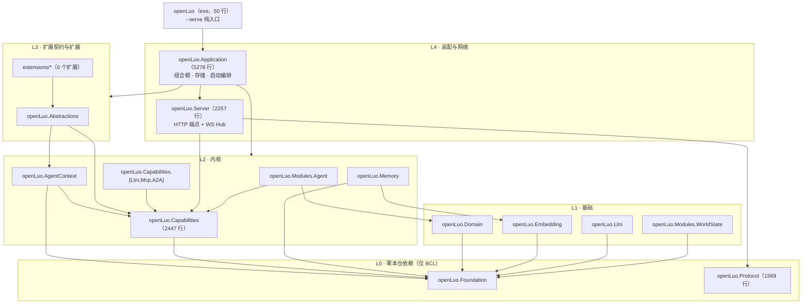
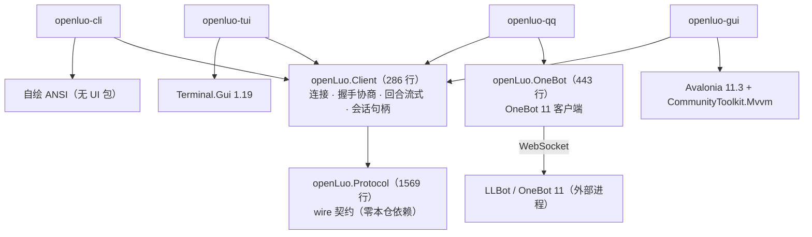

# 分层与边界（架构检视）

> 本文是**定期检视产物**：把当前的程序集分层、依赖边、硬性边界与已知技术债固化在一处，
> 供后续改动对照。**边界由 `tests/openLuo.E2E.Tests/ArchitectureBoundaryTests.cs` 反射守护，越界即测试失败**——
> 本文与测试不一致时，以测试为准并修本文。
>
> 检视时点：2026-10-12（`dfbc362`；§1 于同日的图拆分后同步）。规模数字为 `*.cs`（排除 `obj/`、`bin/`）实测。
> 2026-10-13 内核优化步 0 追加：§5.1 的 T9–T11（配置假旋钮 / game.db 死 schema / 上下文预算失真），
> 相关机制见 [`context-budget.md`](context-budget.md)。
> 2026-10-14：新增四份设计稿（`context-spaces` / `workers-and-hooks` / `runtime-modules` / `../todos.md`）后的**新一轮文档漂移审计**，复发项见 `../todos.md` D2/D3 与 hub-protocol 本轮订正。

---

## 1. 进程与分层图

运行期只有**两类进程**，二者**不共享任何运行时对象**（内存、句柄、内核一概不通）：

| 进程 | 可执行 | 持有什么 | 与对方的关系 |
| --- | ----- | ----- | -------- |
| **服务端** | `openLuo`（`--serve`） | **唯一**内核 + 扩展 + Hub（HTTP 控制面 / WS 数据面） | 监听端口，接受客户端连接 |
| **客户端** | `openluo-cli` / `-tui` / `-gui` / `-qq`（各自独立进程） | 只做 I/O 与渲染（**不含内核、不含扩展**） | 经 `OPENLUO_HUB_URL` 连 Hub |

两侧唯一的公共程序集是 **`openLuo.Protocol`**（同一份 wire 契约，各自编译进自己的进程）；
它**不是**连接两进程的东西——连接靠 HTTP/WS。`openLuo.Client` 只是**客户端侧**的协议实现，
服务端相应部分是 `openLuo.Server`。因此下面按进程分成两张图：

### 1.1 服务端进程（`./openLuo --serve`）

> **读图约定**：`Application` 对下层是"层层都用"的扇出，逐条画会让十余条线横穿全图（实测 30 边 / 18 处交叉），
> 故**层间**用层箭头（`APP → L3 / L2`），**层内**仍逐程序集绘制；精确到程序集的依赖边见 §3。
> mermaid 按最长路径自动排层：内核里有 `Capabilities → Foundation`、`AgentContext → Foundation` 这类**跨层捷径**，
> 因此 `Capabilities` 在图上会落到与「基础」同排——这是排层算法所致，不是依赖关系变化（`Capabilities` 仍属 L2，见其层框）。

> 开发用 `openLuo.playground`（不发布）与扩展同一套边界：`Application` + 内核，**不依赖宿主 exe**。

### 1.2 客户端进程（4 个各自独立的可执行）

**可执行程序 6 个**（发布 5 个 + 开发用 playground）：`openLuo`（服务端）/ `openluo-cli` / `openluo-tui` / `openluo-gui` / `openluo-qq` / `openLuo.playground`（Demo，不发布）。

---

## 2. 硬性边界规则

| # | 规则  | 内容  | 守护 |
| - | -- | -------------------------- | --------- |
| B1  | **协议零依赖** | `openLuo.Protocol` 只依赖 BCL：Envelope / 消息类型表 / DTO / 错误码是唯一跨边界契约 | `Protocol_零本仓依赖`                                                     |
| B2  | **客户端不含内核** | 客户端只引用 `openLuo.Protocol` + `openLuo.Client`（+ 自有 UI 驱动、QQ 桥另加 `openLuo.OneBot`）；客户端之间不互相暴露 | `Client_只依赖_Protocol`、`客户端不带内核且不互相暴露`|
| B3  | **服务端不自带内核实现** | `openLuo.Server` 只依赖 `Protocol` + `Capabilities`（第二公理：把能力元数据/回合事件映射为 wire DTO 需要 `CapabilityKind`/`CapabilityResult` 等类型）；内核经 `IAgentRuntime` 注入 | `Server_不依赖宿主与内核其余部分` |
| B4  | **exe 只做入口** | `openLuo`（服务端）只依赖 `openLuo.Application`（外加 `Protocol` 的编译期常量），不含内核代码、不含 UI 驱动  | `服务端exe只依赖Application_内核代码不得回流`、`服务端不含客户端与UI驱动` |
| B5  | **扩展不引宿主 exe** | `openLuo.Extension.*` 只经 `openLuo.Abstractions` + 模块工程交互 | `扩展_不依赖宿主exe`|
| B6  | **装配层不反向** | `openLuo.Application` 不依赖宿主 exe、不引客户端、不拉 UI 驱动 | `Application_是内核装配层_不反向依赖宿主与客户端` |
| B7  | **常量集中在 Protocol；HTTP 面 REST** | HTTP 面的**路径 / 查询键 / 响应 `type` / 资源 id 白名单 / 标准头与媒体类型**全部取自 Protocol 的 `HttpPaths` / `HttpQueryKeys` / `HttpResponseTypes` / `HttpRules`，端点与客户端**不得**写字面量；错误码 → HTTP 状态码映射单点在 `ErrorCodes.HttpStatusOf`；语义遵循 REST：路径只放资源名词（动作交给方法）、创建回 `201 + Location`、查询串不承载资源身份 | `HttpSurfaceTests`（5 例） |

---

## 3. 实测依赖边（ProjectReference）

| 程序集 | 依赖 | 规模 |
| -------------- | --  | ------ |
| `openLuo.Protocol` | —（零本仓依赖） | 12 文件 / 1569 行 |
| `openLuo.Foundation` | — | 14 / 765 |
| `openLuo.OneBot` | — | 2 / 443 |
| `openLuo.Domain` / `openLuo.Llm` / `openLuo.Embedding` / `openLuo.Modules.WorldState` / `openLuo.Capabilities` | `Foundation` | 3/145、19/1508、7/303、15/957、34/2447 |
| `openLuo.Memory` | `Foundation` + `Embedding` | 21 / 1354 |
| `openLuo.AgentContext` | `Foundation` + `Capabilities` | 12 / 657 |
| `openLuo.Modules.Agent` | `Capabilities` + `Domain` | 3 / 165 |
| `openLuo.Capabilities.Llm` | `Capabilities` + `Llm` | 2 / 314 |
| `openLuo.Capabilities.Mcp` / `.A2A` | `Capabilities` | 3/393、3/199 |
| `openLuo.Client` | `Protocol` | 1 / 286 |
| `openLuo.Abstractions` | `AgentContext` + `Capabilities` | 4 / 376 |
| `openLuo.Server` | `Protocol` + `Capabilities` | 19 / 2257 |
| `openLuo.Application` | `Foundation`/`Llm`/`Embedding`/`Memory`/`AgentContext`/`Capabilities`/`.Llm`/`.Mcp`/`.A2A`/`Abstractions`/`Server`/`Modules.WorldState`/`Domain`/`Modules.Agent` | 35 / 5278 |
| `openLuo`（exe） | `Application`（+`Protocol`） | 1 / 50 |
| `openluo-cli` / `-tui` / `-gui` | `Client` + `Protocol` | 4/231、2/139、4/176 |
| `openluo-qq` | `Client` + `OneBot` + `Protocol` | 5 / 775 |
| `openLuo.Extension.{Memory,Companion,World,Party,Sticker,Music}` | `Abstractions`（+ 各自模块：`Memory`/`Llm`、`Memory`、`Modules.WorldState`、`Modules.Agent`+`Domain`、`Embedding`） | 6 个 / 976 |
| `openLuo.playground` | `Application` + `AgentContext` + `Capabilities`(+`.Llm`) + `Llm`（**不引宿主 exe**） | 1 / 89 |

**唯一允许的跨层"捷径"**：`openLuo`（exe）→ `openLuo.Protocol`（仅取 `ProtocolInfo.DefaultPort` 常量，const 编译期内联，实际引用集合恰为 `["openLuo.Application"]`）。

---

## 4. 本次检视实测结论

| 检查 | 结果 |
| ---------------------------- | ----------------- |
| B1–B6 全部边界 | ✅ 通过（`ArchitectureBoundaryTests` 8 例全绿） |
| `openLuo`（exe）残留内核代码 | ✅ 无（只有 `Program.cs` 50 行 + `data/`、`native/`） |
| 客户端是否夹带内核 | ✅ 无（Cli/Tui/Gui/Qqbot 均未引用内核程序集） |
| 宿主是否夹带 UI 驱动 | ✅ 无（`openLuo.csproj` 零 PackageReference） |
| 扩展是否经契约交互 | ✅ 全部合规（含 `playground`——已改为引用 `openLuo.Application`，不再指向宿主 exe） |
| 文档与代码一致性 | ⚠ 见 §5 T7（本次已修 README / hub-protocol / log-store / context-scope-risk；后续漂移见 `../todos.md` D2/D3） |

---

## 5. 技术债

### 5.1 已解决（2026-10-12）

| #   | 债 | 处置 |
| --- | ------ | ----------------- |
| T2  | `playground` 半成品（≈2100 行不参与编译的历史 Demos + 唯一引用宿主 exe 的非测试工程 + 目录名拼写错误） | ✅ 删除 `Demos/**` 与 `Infrastructure/**`（15 个 `.cs` + 2 个 python 演示插件）；目录改名 `openLuo.playgraound` → `openLuo.playground`；`ProjectReference` 由宿主 exe 改为 `openLuo.Application`；`make run-playground` 冒烟通过 |
| T3  | 安全端口未接线（`InputValidator` / `RateLimiter` 只有定义） | ✅ 两个类型移入 `openLuo.Server/Security`（改为纯值构造，Server 不读配置）；新增 `HubRequestGuard` 接线到 HTTP/WS 入口；新增错误码 `4003` / `5004`；新增 `HubSecurityGuardTests` 7 例覆盖限流、帧上限、id 白名单、文本上限、严格模式（详见 hub-protocol §4.9） |
| T7  | 文档漂移 | ✅ 本次修正（README / hub-protocol / log-store / context-scope-risk / 本文件；后续漂移见 `../todos.md` D2/D3） |
| T8  | 空目录 `openLuo.Application/Infrastructure/Runtime/` | ✅ 已删（本地未跟踪项）；`IGameStreams` 仍留在 `Core/Interfaces`（在用，后续挪 `Hosting/` 更顺） |

### 5.1b 已解决（2026-10-13，内核优化步 0「预算 + 真值轴 + 清渣」）

| #   | 债                           | 事实 → 处置 |
| --- | ---------------------------- | ----------- |
| T9  | **配置假旋钮**（改了不生效） | `executors`（7 槽）/`timeouts`/`resilience`/`lifecycle`/`inter-agent`/`pluginRuntime` 六段 + `memoryRetrieval`/`memoryStore`（8 键）+ `security` 段 9 个旧键 + `agent.taskDispatchTimeoutSeconds`/`invocationConfirmTimeoutSeconds` **零消费者** → 全部删除（含 6 个 `.example.jsonc` 与 `ConfigLoader` 合并/`Config` 门面）。**接上**真值：`agent.chatRoundTimeoutSeconds`→`DecisionBudgets.OverallDeadline`、`agent.pendingAbilityConfirmTimeoutSeconds`→`HubServerOptions.ConfirmTimeoutSeconds`（闭包→热加载） |
| T10 | **game.db 死 schema** | 26 张表里 20 张零读写（旧插件宿主遗骸：`agent_contexts`/`agent_context_turns`/`game_state`/`inventory`/`party_tasks`/`asset_*` 等）+ 15 条死索引 + 13 条启动期空跑 `ALTER`（全 try/catch 吞异常）+ `memories_fts`（触发器维护但零查询，且每次启动 DROP 重建全表 seed）→ `DatabaseInitializer` 954 → 459 行；**不做破坏性迁移**（旧库的表保留，新库不再创建） |
| T11 | **上下文预算失真** | 硬编码 24000 + 贡献者自报 `Length/4`（中文低估约 4 倍）+ 按区域序 `break`（后面区域的平台规则/能力说明被整段丢弃且无信号）+ 对话历史不入预算 → `ITokenCounter`/`IContextLimitsProvider`/`ContextRegionPolicies`(Pinned/Droppable)/`ContextBudgetSnapshot`；裁剪改"保底 + 优先级贪心跳过"，历史按剩余预算从最旧截断。详见 [`context-budget.md`](context-budget.md) |
| T12 | **旧 python 插件宿主遗骸**   | `openLuo/data/plugins/**`（20 个 `builtin_*` 目录 + `shared` + 合并说明，73 文件 / 544K）自初始提交起未再演进；全仓**无任何宿主机实现**能加载它（`IPluginRuntime` 零引用），Makefile 只对它跑 `black` → 已删除（仓库与 `publish` 里的同份副本；后者 `data/` 不在 `KEEP_ENTRIES`，下次发布自然消失）。替代品：`extensions/`（C# 进程内扩展）+ `mcp/`（MCP server）；`format-python` 目标改指向 `mcp` |
| T13 | **data/ 树里的死资产目录**   | 逐目录做"读者核实"后发现 12 个子目录只有 4 个有真实读取路径（`archetypes` 角色卡 / `stickers` 表情库 / `tts` 音色库 / `config` 模板），其余 8 个（`capabilities`、`commands`、`item-packs`、`schedules`、`skills`、`state-defs`、`subagents`、`tools`，共 15 文件 / ~64K）零读取路径——全属已删的旧插件宿主与旧 agent shell 遗骸，其功能已由「扩展代码注册的能力/处理器」与「sqlite 表（hub.db `schedules`、game.db `state_defs`）」取代或彻底消失 → 已删除（仓库 + `publish` 副本）。注意 `data/**` 会被原样发布（`openLuo.csproj` 的 `Content` + `Makefile` 的 `cp -r`），所以"发布目录里有"不能当读者证据 |

### 5.2 仍在的债（均未阻塞当前功能）

> 登记与关闭判据统一在 [`../todos.md`](../todos.md)；本表只保留**技术债视角**的总检视。
| #   | 债                             | 事实 | 建议 |
| --- | ------------------------------ | -- | ------- |
| T1  | `openLuo.Application` 集中度高 | 5278 行 / 35 文件 / 14 条依赖边；`Infrastructure/Database`（954 行）、`Infrastructure/Logging`（727 行）、`Persistence/HubStore`（484 行）、`Modules/AppShell`（1332 行）同处一工程 | 等出现"内核多宿主复用/进程分工"需求时按 `Infrastructure → openLuo.Persistence` 之类再拆；现在拆只增噪音 |
| T4  | 两套"世界状态"概念 | ① 插件视角：`openLuo.Modules.WorldState`（SQLite，`WorldState` 存储）；② 内核事务视角：`IStateTransaction` + `hub.db.subject_state`（按 subject 分区，已持久化） | 命名上区分（如"角色状态快照"vs"世界状态库"），或在做"公共/私有记忆"时统一键控（唯一登记：`../todos.md` T3；归属 `runtime-modules.md` §3） |
| T5  | 客户端 UI 依赖不齐 | `openLuo.Tui` 用 `Terminal.Gui`；`openLuo.Cli` 无 UI 包（自绘 ANSI）；`openLuo.Gui` 用 Avalonia 5 包；三者互不复用渲染代码 | 可接受（各自轻量）；若要统一观感再抽共享渲染层 |
| T6  | 测试工程引用 exe | `openLuo.Tests` 引 `openLuo.Application`；但 `E2E` **必须**引 `openLuo`（边界测试用 `Assembly.Load("openLuo")`，需要该 DLL 落在测试输出目录），`Assets`/`Logging`/`Persistence`/`Cli` 也沿用了 `openLuo`（其实只需 `Application`） | 后四者可逐步改引 `openLuo.Application`；`E2E` 保持不变（并在注释里写明 why）                            |

---

## 6. 修改边界时怎么做

1. 改 `ProjectReference` 前先想清楚新边属于哪条规则（B1–B6）；越界要么改设计，要么在 `ArchitectureBoundaryTests` 里显式放宽并说明理由。
2. 动扩展或其依赖程序集后：`dotnet build openLuo.slnx -c Release`（E2E 从 `extensions/*/bin/Release/net10.0/` 加载扩展）。
3. 提交前 `dotnet test openLuo.slnx`；发布形态变更再跑 `make publish` + 冒烟。
4. 本文的规模数字与依赖表随之更新（检视时点写在文首）。
