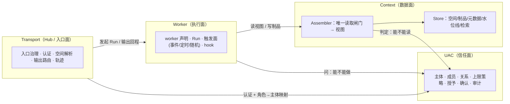
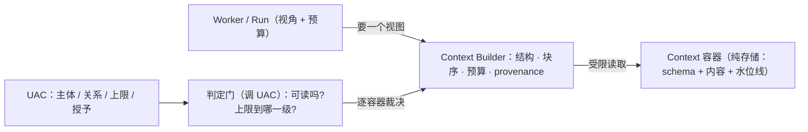
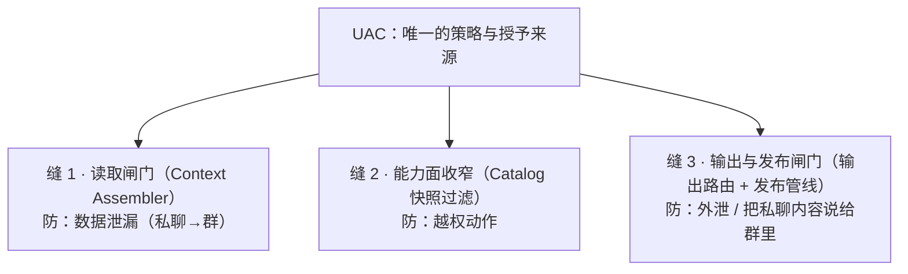

# 运行时模块划分：Transport / Context / UAC / Worker

> **状态**：**设计稿（本文不实施）**——模块边界与依赖方向的**单一来源**，不含代码改动。
> **配套文档**：数据面语义见 [`context-spaces.md`](context-spaces.md)（空间/制品/可见性），执行面语义见
> [`workers-and-hooks.md`](workers-and-hooks.md)（worker/触发/hook），分层与依赖实测见 [`layers.md`](layers.md)。
> 相关代码：`openLuo.Server/{HubAuth,HubEndpoints.System,HubConfirmationGate}.cs`、
> `openLuo.Qqbot/{QqBotConfig,QqBotApplication}.cs`、`openLuo.Capabilities/Core/Models/CapabilityPermissions.cs`、
> `openLuo.Capabilities/Infrastructure/DefaultCapabilityCatalog.cs`、`openLuo.AgentContext/**`、
> `openLuo.Application/Composition/{ComposedAgentRuntime,PlatformContextContributor}.cs`、
> `openLuo.Foundation/Core/{Models/RelationshipStage.cs,GameConstants.cs}`、`openLuo.Modules.WorldState/**`。
> **一句话**：`context + UAC + worker` 的三分法**方向正确**——它把"数据 / 信任 / 执行"三件事拆开；
> 但要落地必须补三处精确化：**context 要拆成"存储"与"视图构造"**、**UAC 要拆成五个子职责且零依赖**、
> **触发面要显式命名**（否则"谁唤醒 worker"又变成散落的隐式逻辑）。

---

## 0. 判定：方向对，三处需要精确化

| 你的表述 | 判定 | 精确化 |
| --- | --- | --- |
| context 只是**存储上下文的容器**，不负责权限控制与执行 | ✅ 对（执行已归 worker） | **"不持有策略" ≠ "不执行判定"**。context 应拆成三段：**容器**（纯存储：schema/内容/水位线/投影定义，零策略）+ **判定门**（调 UAC 逐容器裁决，是**唯一的读取检查点**）+ **Builder**（在 UAC 给的上限内构造视图）。策略来自 UAC，判定动作发生在读取点 |
| 用户权限独立成 **UAC**，保存权限与关系 | ✅ 对，且是本仓真实缺口 | UAC 内部要拆成**五个子职责**（状态 / 策略 / 授予 / 确认 / 审计），否则会长成一个"什么都装"的模块；且 UAC **必须零依赖**（不得反向依赖 context/worker） |
| **worker** 负责执行 | ✅ 对 | worker 是"声明 + 参数化调用者"（复用同一装配器与决策循环）；**触发面（事件 / 定时 / 随机）要显式归属**，不能隐含在 worker 里 |
| （未提及） | — | 补**第四块 Transport（Hub）**：入口治理、认证、空间解析、输出路由。你的三分法把它隐含了，但它今天承担着**全部**现有权限判定（见 §3） |

**为什么这个三分法是本仓的正确方向**（证据）：今天的权限判定**全部散在边界层**——
`HubAuth`（`HubRoles.Admin/User/Edge`，secret→admin）、`HubEndpoints.System`（admin 前缀守卫）、
`QqBotConfig.AdminUsers`（平台侧，仅 `/command`）——而**内核（Capabilities / AgentContext）里几乎没有角色概念**
（唯一命中是无关的 `SpeakerRole`）。也就是说：**判定的位置不对**（按 API key 在边界判，而不是按"主体 × 空间 × 能力"在内核判），
所以"群空间权限更窄""只有 admin 能控制 IoT"这类需求今天无处表达。

## 1. 四模块与依赖方向



| 模块 | 职责 | 允许依赖 | **不得依赖** | 今天最接近的东西 |
| --- | --- | --- | --- | --- |
| **Transport** | 入口治理、认证、空间解析、输出路由、轨迹落库、协议 | Protocol、Context（键形状）、UAC（端口）、Worker（端口） | 具体存储实现、UAC 策略实现 | `openLuo.Server`（`HubServer`/`HubEndpoints.*`/`HubAuth`/`HubBroadcaster`） |
| **Context** | 制品存储（空间/类别/主体/档位/水位线）+ 检索 + **装配视图** + 读取闸门 | UAC 的**判定端口** | 不得依赖 Transport、不得依赖 Worker | `openLuo.AgentContext` + `openLuo.Memory` + 会话/历史仓储 |
| **UAC** | 主体、成员、关系（信任状态机）、上限策略、授予、确认、审计 | **零依赖**（自身的配置与存储） | Context、Worker、Transport | **不存在**（碎片在 `HubAuth` / `HubEndpoints.System` / `QqBotConfig` / `CapabilityPermissions` / `HubConfirmationGate` / `RelationshipStage`） |
| **Worker** | worker 声明、Run 生命周期、触发面、hook、决策循环、能力调度 | Context（读写契约）、UAC（能力上限）、Capabilities（手段） | 不得绕过 Context 直读存储；不得执行 UAC 判定 | `DefaultCapabilityDecisionLoop` + `DefaultCapabilityDispatcher` + `ComposedAgentRuntime` + `ISchedulerService`/`IJobService` |

**DAG 是可强制的**：`UAC ← Context ← Worker`、`UAC ← Worker`、`Transport → {Context, UAC, Worker}`，无环。
本仓已有先例（`ArchitectureBoundaryTests` 用 `assembly.GetReferencedAssemblies()` 断言边界），
所以"UAC 不许依赖 Context"这类规则可以**用测试守住**，而不是靠自觉。

## 2. Context 的三段：容器 / 判定门 / Builder



| 段 | 内容 | 允许知道什么 | **绝不知道什么** |
| --- | --- | --- | --- |
| **容器（Container）** | 一类数据的独立空间：schema、内容、水位线/新鲜度、写者白名单、投影规则 | 自己的 schema 与"raw → detail/summary 怎么投影" | **谁可以读它**（权限不是存储该知道的事） |
| **判定门（Gate，调 UAC）** | 逐容器裁决：可不可读、上限到哪一级 | 主体 / 空间 / 关系 / 授予 | 制品内容（只看元数据与规则，不解析数据） |
| **Builder** | 结构、块序、去重、预算、provenance 标记、缓存稳定 | 如何构造提示词 | **谁该被允许**（只执行裁决结果） |

**硬规则**：worker 与贡献者**不得直接访问容器**——读入口只向 Builder 开放（或由 Builder 注入"受限读取器"），
**读路径必须唯一**。今天 `MemoryBaselineContributor` 自己拼 `gameId`/`userId` 直读记忆库；
一旦有了判定门，这种写法就等于把它旁路掉。

> **术语**：本篇统一用 **Builder**。旧文档（`context-*`、`workers-and-hooks`）与代码里的"上下文装配器 / `IContextAssembler` / `DefaultContextAssembler`"是它的今天形态，指同一件事。

### 2.1 容器模型（今天已有雏形）

`state_defs`（`id/namespace/key/owner_kind/value_type/default_value/enum_values/retirement_policy/source_kind`，
消费者 `Modules.WorldState/StateDefStore`）+ `state_values`（内容，按 `owner_kind/owner_id/namespace/key` 寻址）
**已经是一个容器模型**（schema + 内容 + 主体寻址 + 生命周期策略）。容器化**不是从零发明**，而是把它推广到所有数据类
（对话、记忆、关系、**设备（米家）**、**健康（手环/手表）**…）：

| 容器属性 | 含义 | 为什么必要（反例） |
| --- | --- | --- |
| `kind` / `schema` | 容器类型与字段定义（文本 / 时序 / 设备状态） | 没有 schema，Builder 无法回答"心率该怎么看" |
| `direction` | 双向（对话）/ 只读（设备、健康）/ 只写（遥测） | 对话容器 agent 可写；**健康容器 agent 绝不可写** |
| `writers` | 允许写入的主体白名单 | 无白名单 ⇒ 谁能写容器，谁就能**毒化 agent 的记忆** |
| `freshness` | 水位线 + 新鲜度策略（TTL / 衰减 / 过期即不注入） | 3 小时前的心率与此刻不是一回事；过期数据不该进提示词 |
| `projections` | `raw → detail / summary` 的**定义** | 若把投影定义放进 UAC ⇒ 每接一种新数据源都要改权限层 |
| `sensitivity` | 档位（Public / Protected / Private） | 决定默认可见上限 |

**非文本容器是硬约束**：心率/睡眠这类是**时序**数据（一天上万个样本），**不能"读出来塞进提示词"**——
必须先由容器 schema 定义聚合/投影（例如"最近 24h 均值 + 异常段 + 最近一次"），
Builder 注入的是**投影后的制品**（带单位与时间语义），而不是原始样本。

### 2.2 三个决定，必须分开归属

| 决定 | 归属 | 形式 |
| --- | --- | --- |
| **能访问哪些容器** | **UAC** | 按 `(主体, 空间, 关系类)` → 容器集合 |
| **什么算 detail / summary** | **容器 schema** | 每种容器自带投影定义（自由文本摘要 / 聚合窗口 / 采样策略） |
| **最多能看到哪一级** | **UAC（ceiling）** | `deny / summary-only / detail-allowed` —— 这是**上限**，不是选择 |
| **这次实际注入哪一级、多少条** | **Builder** | 在**授予级别之内向下投影**（有 `detail` 可产出 summary），**永不向上**；条数按预算裁 |

> 这条归属是本设计的关键：**若 UAC 定义"summary 是什么"，UAC 就变成数据语义仓库**（每接一种新数据源都要改权限层）；
> 若 Builder 决定"能看什么"，权限就形同虚设。**上限由 UAC 给，选择由 Builder 做。**

### 2.3 Builder 的职责边界（受约束，不是被指挥）

| Builder 拥有 | UAC 拥有 |
| --- | --- |
| 块序、分块、去重、预算分配、裁剪顺序、provenance 标记、缓存稳定性 | 判定与上限：可读/不可读、级别 ceiling、能否发布 |

**UAC 只否决与限级，不指挥内容**——若 UAC 开始告诉 Builder"把关系等级放进去"，UAC 就变成了 prompt 工程模块。

### 2.4 跨容器融合只发生在 Builder

"用户这周睡不好 + 昨天在群里说压力大"需要**同时**读健康容器与群容器——这种 join **只允许在 Builder 里发生**；
容器之间**不互相引用**（否则容器会连成网状，边界消失）。融合结果必须带 **provenance 标记**，
让模型与审计都知道每段来自哪个容器——否则模型会把心率数据当对话内容说出来。

### 2.5 缓存稳定性（结构必须稳定）

**实测问题（今天）**：块序 = 先按 `ContextRegion` 枚举序分组、**区域内按 `Priority` 降序**；`TimeContext` 排在第 2 位，
时间块**每回合都在变**（`host.time` 贡献者刻意不设 `CacheTtl`，注释写明"给 TTL 等于把时间冻结在缓存里"）；
且 `[Capabilities]` 块被单独剥出、**工具目录块插在全部 SystemBlocks 之后**（大而稳定的东西反而落在易变内容之后）。
⇒ **易变块落在前缀、稳定块靠后 ⇒ provider 侧 KV cache 几乎不可能命中**。

| 规则 | 说明 | 反例 |
| --- | --- | --- |
| **固定前缀** | 人格/设定/技能目录/工具目录在前（几乎不变） | 把"当前时间 / 在场名单"塞进前缀 |
| **易变置后** | 时间、空间数据、记忆召回、工具结果在后 | 时间块排第 2 位（**今天如此**） |
| **空块占位** | 空块保留**固定占位**，不改变后续块的位置 | "这块为空就跳过" ⇒ 后面全部前移，整段前缀失效 |
| **块内稳定排序** | 按 id/时间排序；**按相关度分数排序的内容单独放最后一块** | 分数每回合抖动 ⇒ 块内顺序变化 ⇒ 前缀失效 |
| **裁剪动后缀** | 可裁（Droppable）块排在末尾，裁剪优先动后缀 | 裁剪中间块 ⇒ 前缀与后缀同时位移 |
| **指纹可观测** | 每回合记录**前缀指纹**（hash）与命中统计 | 不观测 ⇒ 缓存退化无人察觉 |

> 既有机制可直接复用：`ContextRegionPolicies`（Pinned/Droppable）、全局块缓存与版本探针、`[ctx]` 账目日志。
> 需要新增的只有**块序策略**与**前缀指纹**两项。

## 3. UAC 的五个子职责（防止它长成万能模块）

| 子职责 | 内容 | 今天在哪 | 隐患 |
| --- | --- | --- | --- |
| **状态（关系）** | 主体身份、群/成员关系、关系等级（信任状态机） | `RelationshipStage` 由 affection 派生（`Foundation/GameConstants`）+ 持久化在 game.db（`Modules.WorldState`） | **游戏数据重置会顺手清掉授权**；且授权层要跨库读游戏态 |
| **策略（上限）** | 静态上限：空间类 × 关系类 × 能力类 → `allow/confirm/deny` | 无（`CapabilityPermissions` 从不填充） | 目前等于"全放行" |
| **授予（数据）** | 某主体在某空间的实际授权（**永远 ≤ 上限**） | 无 | 关系变化无法体现为权限变化 |
| **确认（流程）** | 升级与高危操作的主体确认 | `HubConfirmationGate` ✓ 但**不看身份**（谁先应答谁生效） | 群成员可代用户批准"开 IoT" |
| **审计（日志）** | 每次 `deny/confirm/grant/publish` 的理由 | 部分（轨迹） | "为什么这个群能用语音"事后无法回答 |
| **判定接口（端口）** | `Decide(viewer, artifact) → Allow/Deny/Derive`；`Capabilities(agent, space, principal) → 能力上限` | 无 | 需要**纯函数式**形态，便于缓存与测试 |

**真值归属**：UAC 的状态与授予建议落 **`hub.db`**（跨入口一致；不被 game 数据重置清掉、不被 publish 流程重拷）。
gameplay 的 affection 数值可保留，但**只是 UAC 的输入**，不是授权依据。

### 3.1 权限矩阵：`<容器>.<级别>` × 角色 × `rwx`（位运算 + 最小化）

> 这一节把"UAC 如何表达它的裁决"具体化。核心动机（用户提出）：**即使 Builder 是代码写的，
> 也存在"只被允许读 summary 的 Builder 却拿到了 detail"的风险**——所以级别必须是**授权键的一部分**，
> 而不是 Builder 运行时的自由选择。原则：**能读就是能读，不能读就是不能读**（显式、封闭）。

**格子键** = `<容器>.<级别>`（例 `user.detail`、`group.summary`、`health.summary`、`iot.control`）；
**主体侧用角色（role）**——运行时把 `(workerId, spaceId, viewer)` 解析为一个 role，静态矩阵只写 role。
（否则"同一 worker 在私聊与群聊权限不同"无法表达，且矩阵会随 worker × 空间 数量爆炸。）

| 位 | 含义 | 边界 |
| --- | --- | --- |
| `r` | 读取该容器该级别的制品 | 读到的是**投影**（detail/summary 由容器 schema 定义），不是原始样本 |
| `w` | 写入 / 修改 | 只能写**不高于自身授予级别**的制品，且写入时把级别**记在制品上**（见"派生继承"） |
| `x` | 执行 / 控制（**资源级副作用**） | 例：对 `iot.control` 发控制指令。**与能力面取交集**——动作级授权（能力目录收窄）**且**资源级 `x` 位都允许才放行，避免出现两个真值 |

```jsonc
// uac.jsonc（示意，非最终语法）——未列出的格子一律 ---
{
  "roles": {
    "chat/main":       { "user.detail": "rw-", "user.summary": "r--", "group.detail": "rw-", "health.summary": "r--" },
    "chat/group":      { "group.detail": "rw-", "group.summary": "r--", "health.summary": "---", "iot.control": "---" },
    "summary/worker":  { "user.summary": "r--", "user.detail":  "---", "group.summary": "r--" },
    "admin/operator":  { "iot.control": "r-x" }
  }
}
```

| 规则 | 说明 |
| --- | --- |
| **逐位 AND（最小化）** | 同 `(role, 资源)` 多条规则 ⇒ 每位取 `-` 者胜：`rw-` ∩ `r-x` = `r--` ✓。AND 满足交换律 ⇒ **配置顺序无关**（可审计性好） |
| **未定义即 `---`**（格级） | 默认拒绝；策略里不出现黑名单，只有显式授权；未写出的格子即无权限。**位级同理**：格子里未出现的位一律为 `-` |
| **逐位独立** | 三个位各自独立判定：只读授权写作 `r--`；"某一类权限没有显式声明"就是那一位为 `-`（与"未定义即 `---`"是同一条默认规则的位级 / 格级两种说法） |
| **家族内取最严**（补充） | `detail` 与 `summary` 属同一资源族（级别是偏序：detail ⊇ summary）。同一 role 同时命中族内多行时**取更严的一行**，禁止"子集提升"——否则 `user.summary r--` 与 `user.detail r--` 谁更大会有歧义 |
| **派生继承**（补充，堵泄露的下一层） | 由 `detail` 派生的产物（摘要/聚合/事实条目）**必须把源级别记在制品上**（`level=detail` 或更严）；读取方按"自身 `r` 权限 ∩ 制品级别"判定。否则：role A 有 `detail` 权 → 写出一份"summary" → role B 只有 `summary` 权却读到了 detail 派生的事实 ✗ |
| **审计** | 每次 `deny` 记录 `(role, 资源, 命中的规则)`；每次 `grant` 记录来源（静态配置 / 关系授予） |

**与上一版"ceiling + Builder 自由选"的关系**：本节的表述**更稳**——授权表达的是**最高可读级别**，
Builder **只能在授予级别内向下投影**（有 detail 可产出 summary），**永远不能向上**（有 summary 拿不到 detail）。
向下安全、向上不可能；而"给上限再让 Builder 自己选"一旦代码有 bug 就可能越级。

> **只借位运算，不借三段式**：Linux 文件系统还有 `owner/group/other` 的属主模型——
> 那套与 UAC 的关系模型冲突（这里的"属主"是空间还是主体？），**不要引入**。

## 4. 一个策略源，三个执行缝



| 缝 | 位置（今天对应的类型） | 失败语义 |
| --- | --- | --- |
| 读取 | 判定门在 Builder 取数之前（今天没有这一步） | **fail-closed**：判定不了就不注入 |
| 能力 | `DefaultCapabilityCatalog` 快照过滤（**钩子已对**，只是从不填充） | fail-closed：不出现在目录里 ⇒ 模型看不见 ⇒ 不可能被诱导调用 |
| 输出/发布 | 输出路由 + 发布管线（发布管线尚无） | fail-closed：不可发布就不发布 |

**三个缝必须在同一条数据路径上**（存储 → 视图 → 模型 → 动作 → 输出 → 发布），任一处缺失就等于没有权限。

## 5. 今天的代码 → 未来模块

| 今天 | 归属 | 备注 |
| --- | --- | --- |
| `HubAuth`（角色/凭据）、`HubEndpoints.System`（admin 前缀守卫） | **Transport** 认证 + **UAC** 角色→主体映射 | 今天的角色只在 HTTP 控制面，进不了回合与工具 |
| `QqBotConfig.AdminUsers`、`QqBotApplication` 的 `/command` 判定 | **UAC** 的一个**平台来源** | 平台侧 admin 不应是第二套真值 |
| `CapabilityPermissions` | **UAC** 的"本次判定"输出（由 Runtime 填进快照） | 钩子位置正确，裁决权要移给 UAC |
| `HubConfirmationGate` | **UAC** 的确认子职责 | 必须绑 principal（修"谁先应答谁生效"） |
| `RelationshipStage` + affection + `Modules.WorldState` 的 state_values | **UAC** 的信任状态（affection 降为输入） | 真值迁 `hub.db` |
| `ContextScope`/`ContextDomainKeys`、装配器、贡献者、全局块缓存 | **Context**（容器 + 判定门 + Builder） | 今天 `Scope` 是缓存域；可见性判定未来在判定门，构造在 Builder；`ContextRegion` 枚举序 = 今天的块序（也是缓存不友好的来源，见 §2.5） |
| `DefaultCapabilityDecisionLoop` + `DefaultCapabilityDispatcher` + 能力源（扩展/MCP/A2A/技能/工作流） | **Worker** 运行时 | worker 复用，不新建引擎 |
| `ISchedulerService` / `IJobService`（零实现、无连线） | **触发面**（Worker 运行时的一部分） | 定时/主动/随机都从这里进 |
| `MessageTagPipeline`、输入治理（`HubGuard`） | 前置 hook 的实现（**Transport** 与 **Worker** 各一段） | 见 [`workers-and-hooks.md`](workers-and-hooks.md) §2.5 |

## 6. 会破坏这个划分的做法（反例）

| 反例 | 为什么会坏 |
| --- | --- |
| 把策略塞进 Context（如"`user_id=''` 表示对所有人可见"） | 存储开始懂权限 ⇒ 策略有了第二个真值，且不可审计（今天已有此味道） |
| Context 先全量取出、由调用方过滤 | 任何一个新贡献者/worker 都能绕过闸门 |
| UAC 反向依赖 Context/Worker（"顺便读一下上下文再判"） | 依赖成环；判定不再纯净，无法缓存/复现/单测 |
| Worker 直接读写存储（不经 Assembler/发布管线） | 越权写入与泄漏都无从拦截；"谁写的"也无法还原 |
| 关系真值留在 game.db | 游戏重置/数据重拷 ⇒ 授权被清空或被绕过 |
| Hook 或扩展直接持仓储 | 同上：闸门形同虚设（hook 必须是"在某个视角下、受判定约束"的参与者） |
| 把 UAC 做成"什么都装"的模块 | 关系/策略/授予/确认/审计混在一起 ⇒ 无法独立演进与测试（§3 就是拆解方案） |

## 7. 待裁决

| # | 问题 | 推荐 | 代价 |
| --- | --- | --- | --- |
| M1 | Context 的 Store 与 Assembler：两个程序集还是两个命名空间 | **先命名空间**（`Context.Store` / `Context.Assembler`），程序集边界等"多进程 / 联邦"需要时再拆 | 短期内仍是同一程序集，靠测试守边界 |
| M2 | UAC 判定接口形态 | **纯函数 + 端口**：`Decide(viewer, artifact)`、`Capabilities(agent, space, principal)`；授予状态注入，不由 UAC 自己去读库 | 调用方需传入授予上下文（但可缓存、可复现） |
| M3 | 关系（affection/stage）是否完全迁出 game.db | **迁**：UAC 持信任状态，game 数值降为输入（与 [`context-spaces.md`](context-spaces.md) Q4 同源） | 需要一次性迁移与双读 |
| M4 | UAC 策略的配置面 | 新建 `uac.jsonc`（与 `security.jsonc` 分工明确：前者策略、后者入口治理） | 多一份配置与守卫测试（沿用 `ConfigExampleSurfaceTests` 做法） |
| M5 | UAC 自身是否需要独立存储 | **复用 `hub.db`**（新表，与既有 `subject_state` 分工写清） | 需定义与 `subject_state` 的边界（后者目前无生产写入者） |
| M6 | Transport 是否承担"空间解析" | 是，但**键形状定义在 Context**（避免两处定义） | 需要一条"Transport 不复制键规则"的测试 |
| M7 | 容器 schema 的归属与版本化（谁定义、如何演进、旧值怎么办） | 容器 schema 归 **Context**（附版本号 + 兼容规则）；UAC 只引用容器/级别，不引用字段 | 需要 schema 版本与迁移策略 |
| M8 | 块序策略的落地方式（配置 vs 代码常量） | **代码常量 + 单一来源**（`ContextRegion` 序重排为"稳定前缀 → 易变后缀"），配置只调次序上限；**裁剪顺序也要一起改**（今天"保底全收 + 可裁按 `Priority` 贪心跳过"可能裁掉中间块 ⇒ 改为优先动后缀） | 需要一条"前缀指纹稳定性"测试 |
| M9 | 前缀指纹的观测面（`[ctx]` 账目 / 轨迹 / 指标） | 进 `[ctx]` 账目（每回合 `pfx=<hash8>` + 是否变化）+ 轨迹 | 需要定义"异常变化率"的判据 |
| M10 | 权限矩阵的配置形态与角色定义面（新 `uac.jsonc` vs `security.jsonc`） | **新建 `uac.jsonc`**（策略）与 `security.jsonc`（入口治理）分工明确；role 定义在 `uac.jsonc` 的静态段 | 需要配置守卫测试（沿用 `ConfigExampleSurfaceTests` 做法） |
| M11 | `x` 位与能力面（`CapabilityPermissions` / 目录快照）的交集落点 | **动作级（能力允许）∩ 资源级（`x` 位允许）**，二者都在快照生成时求交集，避免两个真值 | 需要定义"资源"到"能力"的映射（如 `iot.control` → 控制类能力） |
| M12 | 权限矩阵与"关系授予"的合成规则 | 静态矩阵给 role 上限；关系授予只能是其**子集**；合成取 AND（与最小化规则一致） | 需要一条"授予不可越上限"的测试 |
