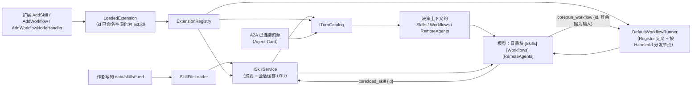

# 技能与工作流：目录注入 + 按需使用

> **状态**：**已接线**（此前机制齐全但从未接线：`LoadedExtension` 里一直带着 `Skills`/`Workflows`，
> `ISkillService` 的注释写着"完整内容按需加载（core:load_skill）"，`IWorkflowNodeHandler` 的注释写着
> "由扩展注册"，但三条目录列表恒空、模型看不到、没有能力入口、也没有处理器注册入口）。
> **两条已确认的设计决定**（见 §9）：① 技能**只在启动期装载**，不做热加载；② 技能正文在上下文里以
> **引用**保存、在构造请求时展开（不把正文当成对话内容）。
> 相关代码：`openLuo.Application/Composition/{CoreContextCapabilitySources,TurnCatalog,ExtensionRegistry}.cs`、
> `openLuo.AgentContext/Core/ISkillService.cs`、`openLuo.Capabilities*/…`、`openLuo.Capabilities.Llm/LlmCapabilityDecisionModel.cs`、
> `openLuo.Application/Infrastructure/Skills/SkillFileLoader.cs`。

---

## 1. 一句话设计

**目录每轮都带，正文按需拉取**：

- **技能（Skill）**＝"怎么做某件事"的操作指南（正文可以很长）。每轮只注入 `id + title + whenToUse` 的**目录**；
  模型判断"这次要照做"时调 `core:load_skill` —— 该能力**只登记引用**（`id`），正文随后出现在
  `[LoadedSkills]` 块里（见 §4），用完可调 `core:unload_skill` 释放预算。
- **工作流（Workflow）**＝封装好的**多步编排**，是**黑盒能力**：模型只给 `id` + 扁平输入，
  内部节点由确定性 runner 执行，模型看不到也控制不了中间步骤。
- 这套做法的意义：目录可以一直小到每轮都带得起，而想做复杂事时又能拿到完整做法——
  不必把几百字的步骤常驻在每轮上下文里。

## 2. 链路



- 目录以**独立 system 消息**注入（在内核提示词与 `[Capabilities]` 等块之后、对话之前）；集合为空时**不出块**。
- 目录块里给的"用哪个工具"会优先写**模型可见的函数名**（`cap_…`），拿不到时才退回 canonical id。

## 3. 能力契约

| 能力 | 参数 | 行为 | 失败语义 |
| --- | --- | --- | --- |
| `core:load_skill` | `{ "id": "<skillId>" }`（也接受位置参数） | **只登记引用**（本对话已加载集）+ 返回一句确认；正文由 `LoadedSkillsContributor` 在后续请求里展开 | 缺 id / 未知 id → `Rejected`（确定性错误，不触发派发器重试） |
| `core:unload_skill` | `{ "id": "<skillId>" }` | 从已加载集移除 → 正文从后续请求消失（省预算）；未加载过也算成功（幂等） | 缺 id → `Rejected` |
| `core:run_workflow` | `{ "id": "<workflowId>", …其余键为工作流输入 }` | 交给 `IWorkflowRunner` 黑盒执行；回填"走到哪一步 + outputs"，**不外泄节点细节** | 缺 id / 未知工作流 → `Rejected`；执行失败 → `Failed`（**Error 原文**来自 runner） |

> **输入为什么是扁平标量**：wire 侧只承载标量（嵌套对象在参数解析时会被丢弃）。handler 需要结构化输入时，
> 自己把字符串当 JSON 解析。这条限制写在能力目录块的提示里，也在 `WorkflowCapabilitySource` 的注释里。
>
> **副作用声明**：`core:load_skill` = `Pure`；`core:run_workflow` = `Mutation` 且 `ParallelSafe = false`
> （工作流可能改状态/发消息，保守声明让策略层有据可依）。

## 4. 怎么加一条技能（**不需要重编译**）

在 `config/` 同级的 `data/skills/` 放一个 `.md`：

```md
---
id: comfort               # 可省略，缺省用文件名
title: 安慰
summary: 一句摘要（进目录）
whenToUse: 用户情绪低落、受挫、需要被理解时   # 目录里给模型判断"该不该用"的依据
relatedTools: [memory:write]                  # 可选
relatedWorkflows: []                          # 可选
constraints: [不要提及自己是 AI, 不要说教]     # 可选
---
正文（= 加载后才进入对话的内容）：先接住情绪，再问发生了什么；不要急着给建议……
```

容错（详见 `data/skills/README.md`）：目录不存在/为空 → 空表；无 frontmatter → 整个文件当正文、id = 文件名；
缺 `title` → 回落为 `id`；单行解析失败只跳过该行；单文件读取失败只跳过该文件；重复 id → 按文件路径字典序后者覆盖前者。
`README.md` 与其它非 `.md` 文件被忽略。

**技能来自两处并集**：扩展 `AddSkill(...)`（代码侧，id 会被命名空间化为 `ext:id`）+ `data/skills/*.md`（文件侧）。

### 4.1 正文以**引用**保存、在构造请求时展开

`core:load_skill` **不回填正文**，只在 `ILoadedSkillSet` 里登记一个 `id`（引用）；每个请求构造上下文时，
`LoadedSkillsContributor` 从技能库把该 id 的正文取出来、拼成 `[LoadedSkills]` 系统块注入。好处：

1. **永远是当前版本**——不存在"某个会话手里握着半个旧正文"这类需要持续维护的一致性问题；
2. **正文不是对话内容**——不进对话历史、不参与对话预算（走系统块预算，且 `LoadedSkills` 声明为**可裁**）；
3. **可随时收回**——`core:unload_skill` 或上限淘汰即从后续请求消失。

配套的两条约束：

| 项 | 取值 | 理由 |
| --- | --- | --- |
| 分区维度 | **对话**（`conversationId`，缺省 `sessionId`） | 多端共享同一段对话时，加载状态也应共享；不同对话互不影响 |
| 上限 | **3**（超过淘汰最久未用） | 加载过的技能不该永远占着上下文预算；用的是 LRU（再次加载即刷新为最近使用） |

> 早期实现把"已加载集合"放在 `ISkillService`（单例）里，于是它是**全局的、会跨会话串味**，而且
> `ListLoaded` 零消费者。本步把它挪到按对话的 `ILoadedSkillSet`——**把已有但空转的机制接通**，而不是再加一层。
## 5. 怎么加一个工作流（扩展侧）

```csharp
builder
    .AddWorkflow(new WorkflowDefinition { Id = "gift.accept", Description = "收下礼物并回礼", StartNodeId = "ack",
        Nodes = [ new() { Id = "ack", HandlerId = "gift:ack" }, new() { Id = "back", HandlerId = "gift:back", Kind = "terminal" } ],
        Edges = [ new() { FromNodeId = "ack", ToNodeId = "back" } ] })
    .AddWorkflowNodeHandler(new GiftAckHandler())     // HandlerId = "gift:ack"
    .AddWorkflowNodeHandler(new GiftBackHandler());   // HandlerId = "gift:back"
```

> ⚠ 工作流与处理器**必须成对注册**：只声明工作流而没注册节点处理器，就是"能被看到却跑不动"。
> 为此本次给 `ExtensionBuilder` 补了 `AddWorkflowNodeHandler`（此前根本没有这个入口）。

## 6. 目录里的远程 Agent

`[RemoteAgents]` 来自**已连接成功**的 A2A 源（`A2ACapabilitySource.AgentCard` 的 `Name`/`Description`）。
连接失败/未配置时该源不出现在目录里——避免模型去调一个连不上的远端。

## 7. v1 边界（诚实清单）

| 项 | 现状 |
| --- | --- |
| 技能的权限/可见性 | 没有单独的技能权限模型；能否调用受**能力权限**（`Capabilities` 过滤）约束 |
| 工作流的输入 | 只有扁平标量；结构化输入要 handler 自己解析字符串 |
| 工作流的中间步骤 | 对模型不可见（黑盒）；要在界面展示进度需另做事件通路 |
| 技能正文的预算 | 正文进的是**系统块**（`[LoadedSkills]`，可裁）；单对话同时最多加载 3 个技能（LRU），模型可主动卸载 |
| 版本/依赖 | 技能与工作流没有版本号、没有跨技能依赖校验 |
| 热改 | **只启动期装载**（重启即更新，**有意不做热加载**）——技能文档在 DI 首次解析时读入一次；扩展侧技能/工作流同样是启动期注册 |

## 8. 验收与测试

| 层 | 覆盖 |
| --- | --- |
| 能力行为 | `tests/openLuo.Tests/Skills/SkillWorkflowCapabilityTests.cs`：正文+约束拼接、未知/缺 id → Rejected、工作流输入扁平化与"不外泄节点细节"、失败 → Failed、副作用/并行声明 |
| 目录汇总 | `tests/openLuo.Tests/Skills/TurnCatalogTests.cs`：技能来自 `ISkillService`、工作流来自注册表、未连接的 A2A 不出现在目录、`NullTurnCatalog` 保持旧行为 |
| 运行时装填 | `ComposedAgentRuntimeTests.Turn_FillsSkillAndWorkflowCatalogIntoDecisionContext`：目录真的出现在传给决策循环的上下文里 |
| 提示渲染 | `tests/openLuo.Tests/Llm/LlmCatalogInjectionTests.cs`：真实 HTTP 请求体里出现 `[Skills]/[Workflows]/[RemoteAgents]` 块、空集合不出块、能力名回退 |
| 文件化技能 | `tests/openLuo.Tests/Skills/SkillFileLoaderTests.cs`（14 例：格式、容错、重复 id、CRLF、忽略 README…） |
| 引用方案 | `tests/openLuo.Tests/Skills/LoadedSkillsTests.cs`（集合：按对话分区、上限 LRU 淘汰、重复加载不重复登记、幂等卸载、键规则；贡献者：未加载不占预算、已加载展开正文+约束、**每个请求重新展开最新正文**、失效引用静默跳过） |
| 真机 | 冒烟：运行中新增 `data/skills/*.md` **不影响** `[ctx] … skills=N`（证明没有热加载）；**重启后**才生效（启动期装载是唯一更新点） |

## 9. 决策记录

| # | 决定 | 理由 |
| --- | --- | --- |
| 1 | 技能**只在启动期装载**，不做文件热加载（重启即更新） | 内容版本与进程生命周期绑定，避免"同一段对话里出现半旧半新正文"这类需要**持续维护**的一致性问题；少一层探针/节流/失效逻辑。热加载曾实现过一版（探针驱动、秒级生效）并已按此决定移除 |
| 2 | 技能正文以**引用**保存、在构造请求时展开（不写进对话内容） | 上下文里永远是最新版本；正文不被当成模型说过的话；不吃对话预算（走可裁的系统块预算）；可随时卸载。早期把正文当工具结果回填 → 只存在于当回合、且下一回合要重新加载（多一次往返），同时把"外部提示词"混进了对话语义 |
| 3 | 已加载集按**对话**分区、上限 3、可显式卸载 | 与"多端共享同一段对话"一致；上限避免"加载过就永远占预算"；`core:unload_skill` 把预算控制权交给模型 |

> 附带效果：这两条决定让 `ISkillService` 变回**纯文档库**（删掉了它身上那份单例级、跨会话串味的
> `_loaded` 记账与零消费者的 `ListLoaded`/`UnloadAsync`），"已加载"只剩一个概念、一个归属。
