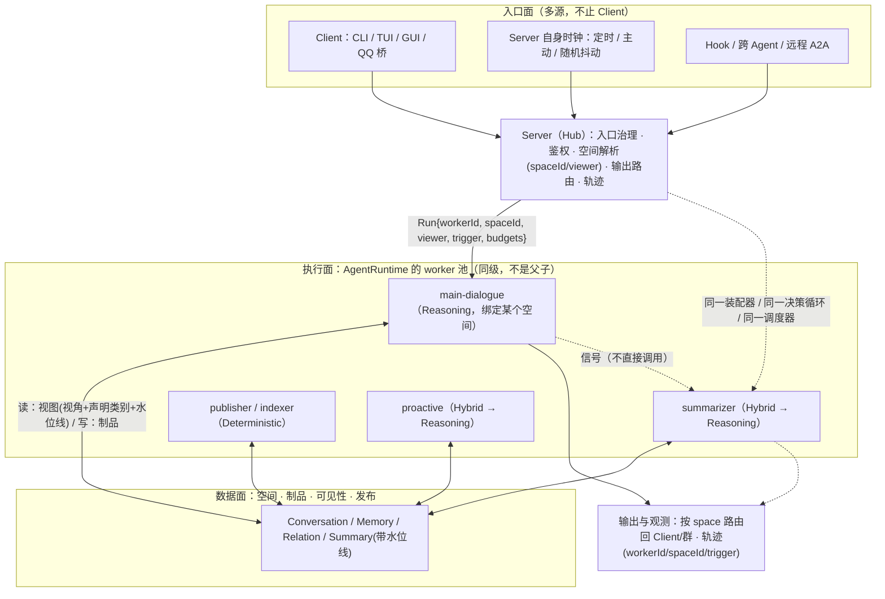
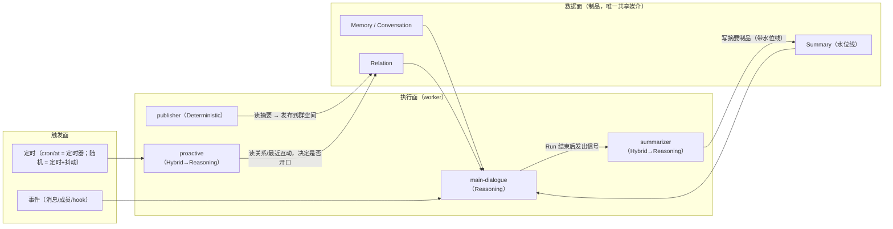

# Worker 与 Hook：执行面模块设计（与上下文/空间的接口）

> **状态**：**设计稿（本文不实施）**——只描述形态、契约与迁移路径，不含代码改动。
> **数据面 / 执行面的分工**：数据面的边界（空间、制品、可见性、发布）在
> [`context-spaces.md`](context-spaces.md)；本文是它的**对偶**——执行面的边界（谁在跑、被谁唤醒、能读写什么、能挂在哪）。
> **上游文档**：[`context-spaces.md`](context-spaces.md)（空间/制品/权限）、[`context-domains.md`](context-domains.md)（域键）、
> [`context-budget.md`](context-budget.md)（预算）、[`skills-workflows.md`](skills-workflows.md)（工作流=黑盒 worker 的先例）、
> [`runtime-modules.md`](runtime-modules.md)（四模块边界：Transport / Context / UAC / Worker）、
> [`../todos.md`](../todos.md)（本条设计的未实现项登记）。
> **术语**：本文提到的"装配器 / 上下文装配"就是 [`runtime-modules.md`](runtime-modules.md) 的 **Builder**（取名以那篇为准）；
> worker 读写的**权限表达**（role × `<容器>.<级别>` × `rwx`）见那篇 §3.1，本文只描述"worker 声明什么"。
> 相关代码：`openLuo.Capabilities/Core/ICapabilityDecisionLoop.cs`（含 `DecisionEventKind` / `TerminationReason`）、
> `openLuo.Capabilities/Infrastructure/{DefaultCapabilityDecisionLoop,DefaultCapabilityDispatcher}.cs`、
> `openLuo.Capabilities/Core/{ISchedulerService,IJobService,IOutputQueue,ICapabilitySource}.cs`、
> `openLuo.AgentContext/Core/IMessageTagPipeline.cs`（"白名单 + 剥离"式管线的既有先例）、
> `openLuo.Application/Composition/ComposedAgentRuntime.cs`、`openLuo.Server/HubServer.cs`（`RunProactiveTurnAsync`）。
> **一句话**：今天的执行层只有**一个匿名的执行单元（回合）**，它同时是"会话 + 决策循环 + 工具批次 + 输出投递"；
> Worker 模型要做的是把这个单元**命名、声明化、可被多种触发源唤醒**，并给它一个**受权限约束的上下文读写接口**——
> 数据面已经划了边界，执行面还没有。

---

## 0. 可行性判定

| 你的设计 | 判定 | 依据 |
| --- | --- | --- |
| 把实际执行层抽象为 worker，context 属数据层 | ✅ **方向正确，且是当前缺的那一半** | 数据面（空间/制品/可见性）已在 [`context-spaces.md`](context-spaces.md) 定型；执行面今天只有匿名的"回合"，连"这是个什么 worker、谁唤醒的、能读什么"都无处声明 |
| 一个 agent 多个 worker（主对话 / 动态总结 …） | ✅ **合理，且已有 1:1 的真实需求** | 动态总结需要作业/调度（`IJobHandler` 零实现、调度↔作业无连线）、主动回合需要空间语义（`RunProactiveTurnAsync` 忽略 `Kind/Payload`）、摘要需要制品与水位线 |
| worker 与上下文之间有标准通信协议 / 访问接口 | ✅ **是核心**，但必须定义**读/写两端 + 水位线 + 权限** | 今天的贡献者各自读库（`MemoryBaselineContributor` 自己拼 `gameId`/`userId`），没有任何访问契约 ⇒ "接口"若只是一个 `IContextReader`，等于把"谁都能读一切"制度化 |
| 触发三类（事件 / 定时 / 随机） | ✅ 合理；**随机不需要新机制** | `ISchedulerService` 已支持 `at`/`cron` + `Payload`；"随机"= 定时 + 抖动/概率策略，复用同一通道 |
| 能力两类（纯代码 / LLM） | ⚠️ 合理但不完整 | 缺第三类 **Hybrid**："代码先判断要不要花 token，再唤起 LLM"——这正是"5 分钟 loop"不烧钱的前提 |
| 加 hook 机制 | ✅ 该有；但**hook 不是旁路，是权限模型的一部分** | 既有 `IMessageTagPipeline`（白名单 + 输出剥离）与 `DecisionEventKind` 事件流是现成的地基；hook 若能在任意视角下自由改 prompt，就是权限后门 |

**结论**：可行、合理，且与 [`context-spaces.md`](context-spaces.md) 是**同一件事的两面**——
空间划数据边界（读得到什么），worker 划执行边界（谁在跑、能写什么）。落地时**只有一个硬约束**：
**必须复用既有的装配器与决策循环**（`IContextAssembler` / `ICapabilityDecisionLoop`），
worker 是"参数化的调用者"，不是第二套执行引擎。

### 0.1 目标数据流（端到端）

原始表述：`Client => Server => MainAgent( context + n*(worker => LLM/Code/SubAgent/Tool/...) )`。
**方向对（三层分工正确），但作为数据流有五处要改**——改后如下：



| # | 你的写法 | 修正 | 理由（现状证据） |
| --- | --- | --- | --- |
| 1 | 入口从 `Client` 开始 | **入口是三源**：Client / Server 自身时钟 / Hook 与跨 Agent | 定时、主动、随机触发**不经任何客户端**；今天的 `RunProactiveTurnAsync` 就是这类，且它借用既有会话、忽略 `Kind/Payload` |
| 2 | `MainAgent` 之下挂 `n*worker`（父子） | **`MainAgent` 是同级 worker 之一**：它是"绑定某个空间的那个 Reasoning worker" | 画成父子会立刻得到：嵌套 LLM 循环、权限放大、并发失控、递归失控。今天唯一的嵌套先例 `ask_character`（`IAgentRuntimeHub.RequestAsync`，**同步**；名义 30s 默认超时但**实现忽略该参数 ⇒ 实际无超时**，且**无递归深度限制**）正是"把委派当手段"的代价 |
| 3 | `MainAgent(context + …)`，context 属于 MainAgent | **context 属数据面**；Run 只持有**视图**（`(spaceId, viewer, reachable)` 的函数产物） | 否则每个 worker 各持一份上下文 ⇒ N 份漂移；装配必须是单一来源（今天只有一个装配器，要守住） |
| 4 | `worker => LLM/Code/SubAgent/Tool` 混为一类 | **拆成两个正交维度**：worker **形态**（`Code` / `LLM` / `Hybrid`）× **手段**（Tool / MCP / A2A / Workflow / Skill） | "SubAgent"不是手段：它是**另一次 Run**（跨 agent 空间），必须走触发面、受权限与递归上限约束，而不是被当成一个可随手调用的内部函数 |
| 5 | 只有 `Client => Server` 单向 | **回程与观测必须同等重要**：输出按 `space` 路由回对应 Client/群，每次 Run 进轨迹 | 否则"角色在群里说的话回到私聊去了""这句话是谁在什么触发下说的"都无法回答；`IOutputQueue` 的续传与轨迹已经具备，缺的是空间级寻址 |

**五条不变量**（改动后必须成立，任何实现都不得违反）：

1. **1 次输入 → 1 次主 Run + N 次由信号引发的 Run**（不是 1:1）；信号可异步、可延迟、可跨空间。
2. **Run 的身份是 `(workerId, spaceId, viewer, trigger, budgets)`**——这五个字段从入口一路带到轨迹。
3. **执行面只有一个装配器和一个决策循环**（`IContextAssembler` / `ICapabilityDecisionLoop`）；worker 只是参数化调用者。
4. **数据面是唯一共享媒介**：worker 之间不共享内存对象、不互相调用内部方法（只发信号、只读写制品）。
5. **每条箭头都有可挂 hook 的点**（入口 / 装配后 / 决策 / 工具 / 输出 / 提交），且每次 Run 都有轨迹可查。

## 1. 现状（执行面今天有什么、缺什么）

| 你的概念 | 今天最接近的东西（证据） | 差距 |
| --- | --- | --- |
| **worker 声明** | **无**：唯一"非对话"执行是 `HubServer.RunProactiveTurnAsync`——`SourceId="hub"` / `ActorId="system"` / `Text=""`，且**不读** `ScheduleDue.Kind/Payload` | 没有"这是个什么 worker、它的职责/权限/预算是什么"的声明；无法注册、无法列举、无法审计 |
| **Run（一次执行）** | 回合（turn）✓：`DefaultCapabilityDecisionLoop`（for decision 1..MaxDecisions，工具批次、重试、单步超时、7 类 `TerminationReason`） | 回合与**会话**强绑定（`ComposedAgentRuntime.PrepareTurnAsync` 取 `SessionId` 快照）；无法在一个回合里以"另一个视角"读，也没有"这是哪个 worker 发起的"标识 |
| **事件触发** | `turn.submit` / `message.append` ✓（+ `confirm.*` / `presence.*` / `audit.subscribe`） | 事件只有"消息"一类；没有通用事件总线，也没有"消息到达 → 唤起某 worker"的反应式接线 |
| **定时触发** | `ISchedulerService`：`ScheduleInfo{Id, SessionId, Kind, At, Cron, Enabled, NextRunAt, Payload}` + `WatchAsync` ✓（cron 已支持，类注释过期见 `../todos.md` D3） | 按 **sessionId** 寻址（空间模型下应是 spaceId）；`Kind` 有字段但无人消费 |
| **随机触发** | 不存在 | 无需新建：定时 + 抖动策略即可（见 §2.3） |
| **纯代码 worker** | `IJobService` / `IJobHandler` / `JobContext{Id, Kind, Payload, SessionId, Progress}` ✓ 形状齐全、hub.db 持久化 + 重启恢复 ✓ | **零个实现**；`HubStartup` 未传 handlers（`POST /v1/jobs` 必然失败）；调度与作业**无任何连线** |
| **LLM worker** | `ICapabilityDecisionLoop` ✓（能力调度/确认/预算/轨迹全复用） | 只能由 `turn.submit` 驱动；无"按 worker 授予能力子集"的概念（`CapabilityPermissions` 生产恒全放行） |
| **生命周期点（hook 的挂点）** | `DecisionEventKind{Decision, ToolCall, ToolResult, Output, Final}` ✓ 已是**类型化事件流** | 缺"回合前/装配后/输出投递前/提交后"等点；事件流目前只用于流式输出，不作为扩展挂点 |
| **可改文本的纪律先例** | `IMessageTagPipeline`（注册 renderer：**白名单 + 输出侧剥离**，D43）✓ | 只覆盖"消息标签"一处；但它证明了"受限管线"在本仓可行 |

**要害**：执行面缺的不是"循环"（`ICapabilityDecisionLoop` 已经是合格循环），而是
**执行单元的声明、触发源的统一、以及受约束的上下文读写接口**——三者都由 hook/worker 补齐。

## 2. 模型

### 2.1 Worker 是"声明 + 执行单元"，不是线程/进程/第二个 agent

```
Worker = { id, agentId, kind(Deterministic|Reasoning|Hybrid), triggers[], 
           readContract, writeContract, capabilityGrant, budgets, policy }
Run    = 一次执行实例（今天叫"回合"）——带 (workerId, spaceId, viewer, trigger, budget)
```

| 字段 | 含义 | 为什么必要 |
| --- | --- | --- |
| `id` / `kind` | 稳定标识与形态 | 审计与配额的最小单位；一个 agent 可以有 `main-dialogue` / `summarizer` / `publisher` / `proactive` / `indexer` |
| `triggers[]` | 谁能唤醒它（见 §2.3） | 把"谁触发"与"做什么"解耦（今天两者都塞在 `turn.submit` 与空回合理） |
| `readContract` / `writeContract` | **读/写哪些制品类**（§2.4） | 权限与审计的基础；也是"合作方式"的接口定义 |
| `capabilityGrant` | 能力子集（受空间策略上限约束） | 摘要 worker 不该有 IoT 能力；主对话 worker 不该直接写发布制品 |
| `budgets` | 决策次数 / 工具调用 / 并发 / 时限 / token | 多 worker 并存时必须有"谁花多少"的账（今天只有 per-session 回合闸） |
| `policy` | 失败、重试、冷却、递归上限 | 防"摘要触发 hook 又触发摘要"这类自激 |

> **worker ≠ 新 agent**：worker 复用同一 `ICapabilityDecisionLoop` / `IContextAssembler` / `ICapabilityDispatcher`，
> 只是参数不同的调用者。**不要**让每个 worker 自己装配上下文或自己跑循环——那会产生"同一份数据两套读取语义"。

### 2.2 Run：一次执行实例

Run 携带 `(workerId, spaceId, viewer, trigger, budgets)`，其余全部复用：
装配器（按 [`context-spaces.md`](context-spaces.md) §2.4 判定可读）→ 决策循环 → 能力调度（含确认闸门）→ 输出路由 →
提交（写制品，受 `writeContract` 与发布规则约束）→ 轨迹（记 `workerId`，让"这次是谁干的"可查）。

### 2.3 统一触发源

| 触发 | 载体 | 说明 |
| --- | --- | --- |
| **事件** | 既有命令/事件（`turn.submit` / `message.append` / `member.joined` …）+ 一条**内部信号**（见下） | 需要一张"事件 → worker"的声明式映射；事件本身不携带业务逻辑 |
| **定时** | `ISchedulerService`（已支持 `at` / `cron`） | 需要把寻址从 `SessionId` 改为 `spaceId`，并**真正消费 `Kind`/`Payload`**（今天被丢弃） |
| **随机** | **定时 + 抖动/概率策略** | 不需要新机制：一个 `random` 触发 = "cron 到点后按概率决定是否真的跑"（§9 的可解释性要求） |

**两条设计规则**：

1. **触发与执行分离**：触发器只产生 `(workerId, spaceId, viewer, reason)`，不产生业务逻辑；
   业务逻辑一律在 worker 声明里。这让人能一眼回答"这个群为什么忽然有反应"。
2. **定时必须分两级**：`tick`（纯代码、便宜、可高频）与 `thinking`（LLM、贵、低频）。
   "5 分钟一次 loop"应该是 5 分钟一次 **tick**，tick 判断"有没有新素材/是否到阈值"，
   再决定是否唤起 LLM worker（§3 Hybrid）。否则成本按空格数线性爆炸。

### 2.4 上下文访问接口（读/写两端，这是"合作方式"的契约）

**读端**（worker 看世界）：

| 项 | 形态 |
| --- | --- |
| 入口 | 由**装配器**统一裁决（单一检查点），worker **不直接拼 `gameId`/`userId`** |
| 视角 | `(spaceId, viewer)`——worker 以谁的立场读（[`context-spaces.md`](context-spaces.md) §2.1） |
| 范围 | 声明 `readContract`（制品类 + 主体维度）；未声明的类别**读不到** |
| 一致性 | 按**水位线**读（`(spaceId, artifactClass, watermark)`）：读到的是某个一致快照，不是半写状态 |
| 扩容 | 回合内需要更多内容 → `core:recall`（[`context-spaces.md`](context-spaces.md) §5.4），仍然过权限判定 |
| 记录 | 每次读取记账（`[ctx]` + 轨迹），让"它凭什么知道这件事"可回答 |

**写端**（worker 改世界）：

| 项 | 形态 |
| --- | --- |
| 单位 | **制品**（`ownerSpace, artifactClass, subject, sensitivity`），不是自由文本 |
| 限制 | 声明 `writeContract`；只能写它被允许的空间/类别（摘要 worker 写不了人格，主对话 worker 写不了发布制品） |
| 降级禁止 | `sensitivity` 只能**提升**不能降低（防"我把这段私聊标成 Public"） |
| 发布 | 跨空间写入**只能经发布管线**（[`context-spaces.md`](context-spaces.md) §2.5），且该 worker 必须被授权做发布 |
| 事务 | 复用 `IStateTransaction` 乐观锁；冲突 = 重试 + 审计（沿用既有机制） |

> **关键**：worker **不共享内存状态**，只通过**制品**协作。这条守住了"单一语义"，
> 也天然给多进程/联邦留了余地（未来 worker 可以跑在别的进程而不改协议）。

### 2.5 Hook：四类挂点 + 三种语义 + 纪律

**挂点（对齐既有 `DecisionEventKind`，而不是另发明一套）**：

| 阶段 | 挂点 | 今天的对应物 |
| --- | --- | --- |
| 入口 | `InputReceived`（消息/事件到达，尚未入库） | `HubServer` 的入口治理（`HubGuard`） |
| 装配后 | `ContextAssembled`（视图已定，尚未发模型） | `CreateTurnSnapshotAsync` 之后 |
| 决策 | `BeforeDecision` / `AfterDecision` | `DecisionEventKind.Decision` |
| 工具 | `BeforeToolCall` / `AfterToolResult` | `DecisionEventKind.ToolCall` / `ToolResult`（确认闸门已在 `BeforeToolCall` 位置） |
| 输出 | `BeforeOutput`（投递前）/ `AfterDeliver` | `DecisionEventKind.Output` + `IOutputQueue` |
| 提交 | `BeforeCommit` / `AfterCommit` | `DefaultAgentContextSession.CommitTurnAsync` |

**三种语义（必须分开，混在一起是系统腐烂的起点）**：

| 语义 | 能做什么 | 失败语义 | 例子 |
| --- | --- | --- | --- |
| **观察（observer）** | 只读，不能改流程 | **fail-open**（hook 报错不影响主流程） | 审计、轨迹、指标 |
| **拦截（interceptor）** | 可加约束/可拒绝 | **fail-closed**（拿不准就拒），且**只能"加限制"，不能"放宽"** | 隐私审查、输入治理、能力限制 |
| **反应（reactor）** | 触发别的 worker/Run | **异步、不影响当前 Run** | "消息入库 → 唤起摘要 worker"；"定时 tick → 唤起 proactive worker" |

**纪律（每一条都有既有先例或明确理由）**：

1. **只能操作类型化槽位，不能自由改文本**——hook 可以"追加一条 contribution / veto 一次能力调用 / 触发一个 worker"，
   **不可以**直接重写 prompt 字符串。理由：自由文本改写不可审计、不可复现，且是提示注入的天然温床；
   既有的 `IMessageTagPipeline`（白名单 + 输出剥离）就是本仓对"扩展改文本"给出的答案。
2. **hook 必须在某个视角下运行**：它的读/写受 §2.4 与可见性约束——**hook 不是权限后门**。
3. **顺序与优先级显式**：同挂点多 hook 要有确定顺序（沿用贡献者 `Priority` 的做法），不允许依赖注册顺序。
4. **超时必设**：拦截类 hook 有严格超时（超时 = 拒绝）；反应类 hook 超时只记日志。
5. **可观测**：每次 hook 调用（含耗时、结果、是否否决）进轨迹——否则"为什么这条消息没被放行"无人能答。
6. **防自激**：反应类 hook 触发的 Run 必须带递归深度与冷却，且继承的权限 **≤** 触发者（不得越权放大）。

## 3. Worker 形态三分类（你的两类 + Hybrid）

| 形态 | 何时用 | 执行方式 | 今天 | 成本 |
| --- | --- | --- | --- | --- |
| **Deterministic** | 定时器、发布、清理、索引维护、水位线计算 | 纯代码（`IJobHandler` 或调度回调） | 机制在（`IJobHandler` / `ISchedulerService`），**零实现** | 无 LLM 成本 |
| **Reasoning** | 主对话、摘要、反思、关系评估 | `ICapabilityDecisionLoop`（可 0 工具，也可多轮） | ✓ 已具备 | 按 token |
| **Hybrid** | "判断要不要花 token"：先 tick 看素材/阈值，再决定是否唤起 Reasoning | 代码分支 + 调用 Reasoning worker | 无（需新建） | 可控（默认不花） |

> 只用两类（纯代码 / LLM）也能表达上述三种，但**显式分出 Hybrid** 能防止"每个定时器都直接跑一次 LLM"这种最贵的误解。

## 4. 我对你设计的三处修正

| # | 你的表述 | 建议形态 | 理由 |
| --- | --- | --- | --- |
| 1 | 能力分两类：纯代码 / LLM | 三类：+ **Hybrid（tick 决策 → thinking）** | "5 分钟一次 loop"若直接是 LLM loop，成本随 agent×空间数线性爆炸；tick/thinking 两级是唯一可控形态 |
| 2 | "worker 具备 context 的访问接口" | 接口必须**读写两端 + 水位线 + 视角 + 声明式契约** | 只有一个宽松读口，等于把今天的"贡献者各读各的"制度化；写端没有契约则无法审计与防泄漏 |
| 3 | hook 作为扩展点 | hook 是**权限模型的一部分**（三语义 + 类型化槽位 + fail 语义 + 审计 + 防自激） | 否则 hook 成为绕过空间可见性与能力授权的后门；"能自由改 prompt"会让模型输入不可审计 |

补充一条**实现约束**（不是修正）：**worker 不得自带装配器/循环**——必须复用既有 `IContextAssembler` 与
`ICapabilityDecisionLoop`，否则同一份数据会出现两套读取语义，数据面的边界立刻失效。

## 5. 合作方式：worker 之间怎么协作



四条协作规则：

1. **唯一共享媒介是制品**（不共享内存对象、不互相调用内部方法）——这让"谁在什么时候写了什么"始终可查。
2. **反应式联动靠信号，不靠直接调用**：`main-dialogue` 结束时不"直接调用摘要函数"，而是发出"有新素材"的信号，
   由声明决定谁被唤醒（可被禁用、可被限流、可被替换）。
3. **权限不可放大**：被触发的 Run 继承 **≤** 触发者的权限与视角（`summarizer` 不能因为"被主对话触发"而获得主对话的全部能力）。
4. **单向数据流优先**：`Conversation → Summary → Relation → 发布` 是自上而下的一条链；
   任何"反向读"（发布物回流影响摘要）都必须显式声明，否则会出现难解释的反馈环。

## 6. 并发的现实约束

| 约束 | 今天的现状 | 需要补 |
| --- | --- | --- |
| 回合闸 | per-session（`ComposedAgentRuntime._turnGates`） | per-**(worker, space)**：不同 worker 可并行、同 worker 同空间串行 |
| LLM 配额 | 无（只有单回合预算） | worker 级 + agent 级配额（并发数、每分钟 token），否则多 worker 会互相挤兑 |
| 写冲突 | `IStateTransaction` 乐观锁 ✓ | 冲突策略（重试次数、谁让位）显式化；跨 worker 写同一制品要审计 |
| 递归/自激 | `TerminationReason.NoProgress` ✓（回合内） | **跨 Run** 的递归深度、冷却窗口、触发链记录 |
| 资源清理 | 输出队列滑窗淘汰 ✓ | 多 worker 的输出/轨迹保留策略（沿用 14 天/20 万保留） |

## 7. 与既有机制的关系（避免三套语汇）

| 新概念 | 关系 |
| --- | --- |
| **Worker** | 取代"匿名的主动回合"；是**执行主体**的声明。既有 `RunProactiveTurnAsync` 变成 `proactive` worker 的一次 Run |
| **Run** | = 今天的回合（turn），加 `workerId`/`spaceId`/`viewer` 标识 |
| **Trigger** | 复用 `turn.submit` / `ISchedulerService`；新增"内部信号"（事件→worker 映射） |
| **Job** | = **待办实例**（`JobContext` 已有 `Kind`/`Payload`/`SessionId`/`Progress`）：Deterministic worker 的一次执行；`POST /v1/jobs` 与调度要连线 |
| **Skill / Workflow** | 已是"worker 的内部手段"：技能=引用式提示（D30），工作流=黑盒编排（可当作一个 Hybrid worker 的内核） |
| **Capability** | worker 的**手段**，受 `capabilityGrant` 收窄（生效点仍是 `DefaultCapabilityCatalog` 快照过滤） |
| **Hook 挂点** | 对齐 `DecisionEventKind` 扩展，不新造一套生命周期 |
| **空间** | worker 运行在某个空间里、以某个视角（数据面契约见 [`context-spaces.md`](context-spaces.md)） |

## 8. 里程碑与验收判据

| 期 | 内容 | 验收判据（可观测） |
| --- | --- | --- |
| **W0 声明与触发** | `Worker` 声明 + 注册表；`Run` 带 `workerId`；`RunProactiveTurnAsync` 改为声明式 worker 的 Run；调度寻址改 spaceId 并消费 `Kind/Payload` | 轨迹里能查到"这次 Run 属于哪个 worker、被什么触发"；主动回合能指定目标空间 |
| **W1 Hook** | 挂点（对齐 `DecisionEventKind` 扩展）+ 三语义 + 失败语义 + 顺序 + 审计 + 防自激 | 能挂一个"观察型"hook 看到全部生命周期点且不影响主流程；挂一个"拦截型"hook 能拒绝一次工具调用并留下原因；hook 报错不炸主流程 |
| **W2 纯代码 worker** | 实现至少一个 `IJobHandler` + 调度↔作业连线；落地一个真实 worker（如摘要或索引维护）；Hybrid 的 tick | 定时任务真实执行、可查状态与产出；tick 在没有新素材时不产生 LLM 调用 |
| **W3 多 worker 并发** | per-(worker, space) 闸 + LLM 配额 + 递归防护 + 跨 worker 写审计 | 主对话与摘要 worker 可并行且互不阻塞；触发链深度受限；配额耗尽时有可读的拒绝原因 |
| **W4 跨 agent / 远程** | worker 与 [`context-spaces.md`](context-spaces.md) 的 `agent↔agent` 空间对齐；A2A 委派带视角 | 委派不能绕过权限；跨角色协作可在轨迹里还原完整链路 |

## 9. 风险与刻意不做

| 项 | 说明 |
| --- | --- |
| **不做第二套执行引擎** | worker 必须复用 `IContextAssembler` + `ICapabilityDecisionLoop`；否则数据面边界形同虚设 |
| **不做"每个定时器都跑 LLM"** | 定时一律两级（tick/thinking）；随机触发同理 |
| **不做无约束 hook** | hook 不能自由改 prompt、不能越权读写、不能无超时；三类语义分离（观察 fail-open / 拦截 fail-closed / 反应异步） |
| **不做共享内存状态的 worker 间协作** | 只通过制品协作；否则"谁改了什么"不可还原，也堵死多进程/联邦 |
| **不做不可解释的随机** | 随机触发必须记录"为什么跑"（种子/判据/阈值）并可复现——否则用户会把它当成 bug，调试也无从下手 |
| **风险：worker 数量膨胀** | 声明式注册 + 上限 + 空闲自动休眠；"每个功能一个 worker"会变成难维护的碎块 |
| **风险：配额与体验冲突** | 配额耗尽会让主动行为消失（体验下降），需要可观测的"因配额跳过"计数，而不是静默 |

## 10. 待裁决

| # | 问题 | 推荐 | 代价 |
| --- | --- | --- | --- |
| WQ1 | Hook 的注册面（扩展 `AddHook` / 配置 / 宿主内置） | **扩展 + 配置双入口**，但拦截类 hook 要能标"仅宿主可注册" | 需要权限分级 |
| WQ2 | Hook 能否改 prompt | 只能**追加类型化贡献**或否决，不能自由改文本 | 表达力略降，换可审计 |
| WQ3 | worker 预算来源 | **agent 级配额池 + worker 级上限**（池共享、上限防饿死） | 需要配额账目与观测 |
| WQ4 | 事件总线的边界 | 进程内信号优先；**上 wire 留给联邦**（不进 v1） | 多进程 worker 暂不支持 |
| WQ5 | worker 失败语义 | Deterministic：重试 + 告警；Reasoning：降级为"不产出"并记轨迹（不静默重试烧钱） | 需要分级告警 |
| WQ6 | 随机触发的抖动策略 | 概率 + 活跃时段 + 空间静音 + 每日上限，全部可配置且可解释 | 一份"空间首选项"数据（与 [`context-spaces.md`](context-spaces.md) Q5 同源） |
