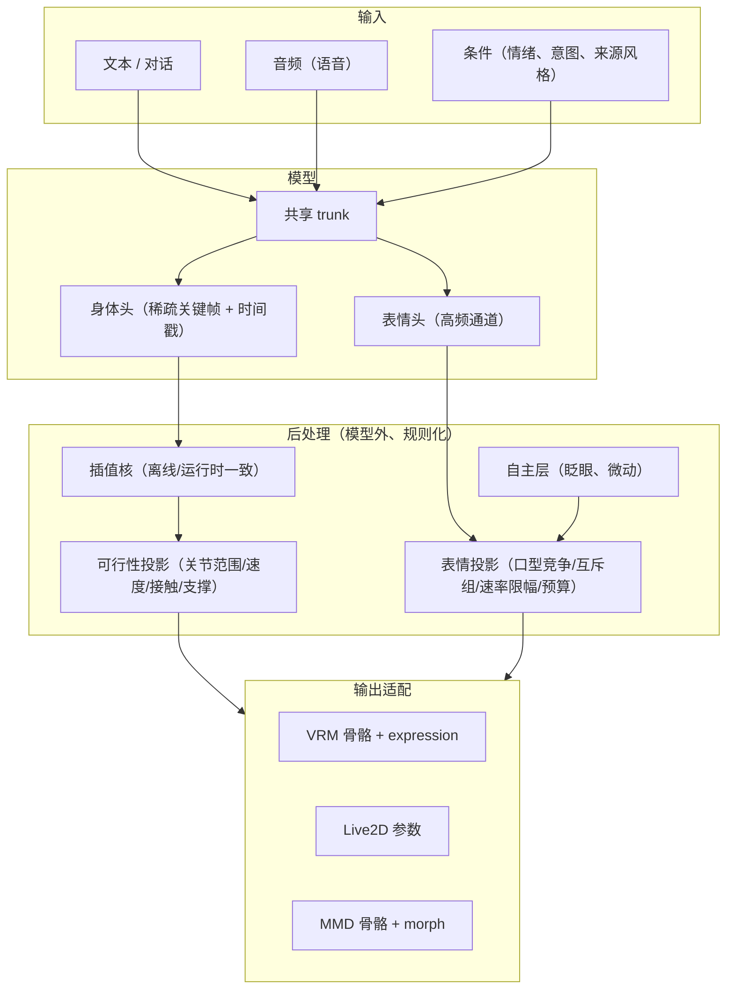

# 动作与表情系统（motion）

> **状态**：本目录是**动作/表情子系统的技术方案与证据存档**，其中 `training-design.md` / `data-pipeline.md` 是
> **方向性设计稿（未实施、未排期）**，`reference-hast-sec.md` 是**外部实现证据**。
> **排期只有一份真值**：`../todos.md`；**稳定契约只以 `../architecture/` 与代码为准**。
> 本目录不排期、不报实施状态——否则会立刻产生两处漂移（同 `../research/README.md` §1 纪律 1）。
>
> 建立时点：2026-10-14（`openLuo-cli@9e51e49`）。外部证据快照：`HAST-SEC@3595232`（2026-10-13）。
>
> **一句话**：把"文本/语料 → 角色动作 + 表情"的目标形态、表示选择、训练与数据纪律固定在
> 一处，并记下每个决定的**理由与被否决的备选**，供后续实施对照。

---

## 1. 边界（四条纪律）

| # | 纪律 | 理由 |
| --- | --- | --- |
| 1 | **本目录不排期、不报实施状态** | 排期见 [`../todos.md`](../todos.md)；实施状态见 [`../architecture/`](../architecture/) 与代码 |
| 2 | 每处外部结论必须带**来源快照**（仓库 + 提交号）与 `路径:行` | 外部项目会变；无快照的引用无法复核 |
| 3 | 每个决定必须标注**状态**：`已定` / `建议` / `未决`，并写清**被否决的备选** | 只写结论会让后来者重复讨论；"为什么没选另一条"比结论更容易丢 |
| 4 | 外部数字只作**量级参照**，不作本项目的契约 | 参考实现的关节范围/带宽阈值是在它的骨架、素材与场景下实测的；我方骨架与素材不同 |

### 与相邻目录的关系

| 目录 | 存放什么 | 与本文的关系 |
| --- | --- | --- |
| [`../architecture/`](../architecture/) | 已定案的稳定契约（分层、协议、上下文） | 本目录某项稳定成型后**上移**为架构文档，并在本目录留指针 |
| [`../research/`](../research/README.md) | 外部实现调研的**证据与理由** | 本目录的 `reference-hast-sec.md` 属同类证据，但因其**直接服务于本子系统设计**，就地存放 |
| [`../todos.md`](../todos.md) | 唯一待办真值 | 本目录 §6 的落地方向**需要**在 todos 登记后才算排期 |

---

## 2. 索引

| 文件 | 性质 | 内容 |
| --- | --- | --- |
| [reference-hast-sec.md](reference-hast-sec.md) | 证据存档 | HAST-SEC v0.1 的"文本 → 动作"四段式管线拆解：语义层 / 检索层 / 落地层 / 表情层，含实测规模、可复用性三分、已被作者承认的验证盲区 |
| [training-design.md](training-design.md) | 设计稿 | 目标表示、`Δt` 条件化、监督方式、局部+整体、表情三驱动与枢轴表示、参数量与数据账、验收指标、反模式清单 |
| [data-pipeline.md](data-pipeline.md) | 设计稿 | 数据源与时间基准、预处理顺序、伪影修复判据（谱熵）、抗混叠重采样与解析求值、逐链截止频率、质量门限与划分纪律、离线/运行时一致性 |

---

## 3. 术语与约定（系统无关部分）

这些是本目录内部使用的定义；与具体引擎（VRM / MMD / Live2D）无关。

| 术语 | 定义 |
| --- | --- |
| **`Δt`（决策步长）** | 两次模型决策之间的**实际经过时间**（秒）。**不是**帧号的函数，必须来自真实时间戳 |
| **tick / 采样点** | 一条轨迹上等间距的原始观测点；其间隔是**源的固有帧率**，与 `Δt` 无关 |
| **关键帧** | 模型输出的稀疏控制点，带**显式时间戳**；关键帧之间由插值核填充 |
| **exp-map 向量** | 用旋转向量（轴 × 角，3 维）表示的局部旋转；与四元数互为 `rotationLog` / `rotationExp` |
| **`mask`** | "本样本/本技能**监督或作用**到哪些通道"的集合（关节子集或参数子集） |
| **`confidence`** | "该通道的观测是否可靠"。**与 `mask` 是两个独立通道**，不可混用 |
| **局部 / 整体** | 局部 = 只作用于 `mask` 的通道；整体 = 驱动全部通道的底座 |

**坐标与单位约定**（跨引擎交换时必须显式声明，参考实现的做法值得沿用）：
手性、上向、前向、位置单位、时间单位、四元数分量顺序、旋转空间（局部相对静止姿态、是否归一化）、
根空间约定。参考实现在 `motion/schema.mjs` 的 `SPACE` 常量里把这几项全部冻结成 `const` 并由
schema 校验，交换格式里 `bone_order` / `expression_order` 随数据一起携带——这样"顺序"就不是隐含知识。

---

## 4. 关键决策一览

> 这里是"最终技术方案的落实方向"的浓缩。每条的理由、证据与被否决备选写在对应文件里。
> **状态含义**：`已定` = 已拍板；`建议` = 有依据的推荐，实施前仍需确认；`未决` = 尚无足够依据。

| # | 决策 | 状态 | 一句话理由 | 详见 |
| --- | --- | --- | --- | --- |
| D1 | `Δt` 作为**显式输入**，训练时随机化；推理在更低调用率下注入同一 `Δt` | `已定` | 训练密度 ≠ 推理密度时，固定步长 AR 会看到分布外历史 → 漂移 | [training-design.md](training-design.md) §2 |
| D2 | 采集 30–240 fps；预处理为**固定间距离散网格** | `已定` | 统一时间基准，便于批次化 | [data-pipeline.md](data-pipeline.md) §2 |
| D3 | **上下文步长与决策 `Δt` 解耦**（上下文按固定时间步长取样，速度按实际 elapsed 归一） | `建议` | 否则 token 数与上下文时长随 `Δt` 抖动，算力与语义窗口都不稳 | [training-design.md](training-design.md) §2.3 |
| D4 | 目标表示用**局部旋转 exp-map 向量**，不用"有界欧拉角范围" | `建议` | 欧拉插值非测地、有万向节；且 VRM/MMD 两端都要再转换 | [training-design.md](training-design.md) §1 |
| D5 | **不对训练目标做全局低通**；滤波只用于修伪影，判据用**谱熵**而非频率阈值 | `建议` | 低通会抹掉冲击瞬态并引入频率相关相位偏差；抖动与快动作的差别在熵不在频率 | [data-pipeline.md](data-pipeline.md) §3 |
| D6 | 用**解析样条精确求值**任意 `t+Δt`，替代"FFT 往返重采样" | `建议` | 消除重采样在分数帧上的误差（该误差与 `Δt` 相关，会训出欠动作）与边缘 artifact | [data-pipeline.md](data-pipeline.md) §4 |
| D7 | 监督必须**通过可微插值器**在稠密帧上计算 | `建议` | 只监督关键帧端点会得到"关键帧很准、中间很飘"；此改动同时压掉欠动作 | [training-design.md](training-design.md) §3 |
| D8 | 预测**位移量（相对当前状态、按 `Δt` 归一）**，不预测绝对状态；评估必报 identity 基线 | `建议` | `Δt` 随机化会打开"复制当前帧"的退化解 | [training-design.md](training-design.md) §3.4 |
| D9 | 局部+整体 = **`mask` 维度 + 共享 trunk + 底座先验填充** | `已定方向` | 局部数据不必塞进一个模型当不同模态；协调性只能来自共享表示 | [training-design.md](training-design.md) §4 |
| D10 | 表情拆成**三个独立驱动**（语义情绪 / 口型 / 自主层）+ 52 维枢轴 + 表情基 + 可行性投影 | `建议` | 三者时间常数差两个数量级；且只有"可自动标注的枢轴"能支撑"语料→表情" | [training-design.md](training-design.md) §5 |
| D11 | 物理/RL **只用在离散选择层**（选哪个技能 / 几个周期 / 哪个底座），奖励用**运动学可行性**，不用刚体动力学 | `建议` | 参考实现的实证：其全部 RL 都是"单次选择完整技能的环境回合"，奖励环境是 FK + 关节投影 | [reference-hast-sec.md](reference-hast-sec.md) §5 |
| D12 | 参数量**按数据量定档**，不预设上限 | `建议` | 参见数据账：周期运动的本质自由度极低，参数量必须与数据同量级 | [training-design.md](training-design.md) §6 |
| D13 | 逐链设定低通/监督率上限，依据是**该关节的速度/加速度/jerk 上限** | `建议` | 全局一个截止频率会同时"砍掉手部真实细节"和"放过躯干抖动" | [data-pipeline.md](data-pipeline.md) §5 |

---

## 5. 目标形态（本子系统要做什么）

**关键形态判断**：`POST` 这一整层**不放进模型**。参考实现的实证是——生成与可行性分离（生成靠检索/学习，
可行性靠确定性投影），并且它在 `models/timing/metrics.json` 自述
`"技能仍来自固定真人动作码, 未训练神经轨迹解码器或关节力矩"`。本项目的对应决策见 D11。

---

## 6. 落实方向（不排期）

以下顺序是**依赖顺序**，不是时间表；登记与排期归 [`../todos.md`](../todos.md)。

| 阶段 | 目标 | 关闭判据（可观测） |
| --- | --- | --- |
| M1 | 统一表示与交换格式：骨架定义、旋转空间、通道顺序、`Δt` 时间戳 | 一份数据能被两个不同引擎（检查器 + 播放器）读入并复现同一姿态 |
| M2 | 数据管线：伪影修复 → 抗混叠 → 解析样条；质量门限与划分 | 用 `data-pipeline.md` §7 的复核命令，报告逐链频带能量与关节相关性 |
| M3 | `Δt` 条件化最小闭环：单来源、单运动族（如走/跑） | 高密度训练 + 低密度推理，长时生成无漂移；identity 基线被明确击败 |
| M4 | 可行性投影层（关节范围/速度/接触） | 无骨长/限位越界；足滑以厘米计量且达标 |
| M5 | 表情规则层 + 投影层（**先不训模型**） | 眨眼/口型/情绪切换观感正确；非法通道组合为零 |
| M6 | 局部+整体：`mask` 监督 + 共享 trunk | 跨关节相位锁定指标不劣于纯整体训练 |
| M7 | 多来源混合（自有动捕 + 外部素材） | 混合训练后不出现"动作变软"；来源级验证集指标可解释 |
| M8 | 物理/RL 判据层（若 M4 仍不够） | 物理否决率下降且风格指标不退化 |

**M5 之前的每一步都不依赖模型质量**，可以独立验收——这是刻意安排的：把"不确定的模型"夹在两层确定性的工程件之间。

---

## 7. 未决问题

| # | 问题 | 为什么现在不能定 | 影响面 |
| --- | --- | --- | --- |
| U1 | 首要输出目标是 **VRM 还是 Live2D** | 两者骨架/参数模型根本不同：VRM 是 53 骨四元数 + expression，Live2D 是标量参数 + 变形器，无 IK、无物理 | 决定 D4 的表示是否保留"骨"的语义，以及 M1 的格式设计 |
| U2 | 是否引入**刚体物理引擎** | 现有证据倾向"不引入"（D11），但若目标含跳跃/受击/地形则需要重新评估 | M8 是否存在 |
| U3 | 表情枢轴选 **ARKit-52** 还是 **FACS/AU**；表情基数量 `K` | 取决于语料形态：有视频→52 可自动标注；纯音频→需视素集 | D10 与表情数据采集方式 |
| U4 | 全量（非 `mask`）样本的**最低占比** | 需要用相位锁定指标实测，不能拍 | M6 的采样配比 |
| U5 | 外部素材（MMD 等）的**许可边界** | 外部动作/模型通常由作者逐件规定，多数不允许随项目分发 | 决定哪些数据可入库、哪些只能本机使用 |

---

## 8. 参考

| 主题 | 来源快照 | 用途 |
| --- | --- | --- |
| 端到端"文本 → VRM 动作"实现、检索+投影架构、表情链与可行性投影 | `HAST-SEC`（github.com/sola1039/HAST-SEC）@ `3595232`（2026-10-13） | [reference-hast-sec.md](reference-hast-sec.md) |

> **许可提示**：`HAST-SEC` 采用 `hast-sec-noncommercial-0.1`（非商业），且公开版**不含训练流程与原始训练素材**。
> 本目录引用的是**架构与纪律**，不是可再分发的代码或数据。复用边界见 §9。

---

## 9. 许可与复用边界

> 本节是**机制说明与工程纪律**，不是法律意见。条款原文可读（见下表），但具体适用依赖司法辖区与事实。

三件事必须分开，它们各自独立触发：

| 层 | 何时被触发 | 结论 |
| --- | --- | --- |
| **思想 / 架构 / 算法** | 从不 | 版权不保护思想与功能架构；**独立重写不受任何许可约束** |
| **表达**（代码、配置、文档正文） | 复制或再分发时 | 触发该表达的许可 |
| **资产**（权重、轨迹数据、码本、角色、模型） | 使用或再分发时 | 触发该资产的许可；**且常与代码许可不同** |

### 9.1 参考实现的三层许可（实测）

| 层 | 条款 | 出处 |
| --- | --- | --- |
| 项目原创部分 | `hast-sec-noncommercial-0.1`：允许非商业学习/教学/研究的使用、复制、修改、**免费再分发**（须保留许可与第三方声明、标注修改、继续非商业）；商业用途需**书面授权**；自述"**不宣称符合允许自由商业使用的标准开源定义**" | `LICENSE` |
| 第三方**数据** | **CMU mocap**（经重定向与筛选的轨迹）+ **BEAT2**（运动表示与统计模型）。原文：`"BEAT2 作者数据仓库标注Apache-2.0, 相关研究站点同时提出非商业使用要求. 本发行版采用非商业研究范围; 项目商业授权不覆盖这些第三方数据, 有商业需求应另向数据权利人确认授权."` | `THIRD_PARTY_NOTICES.txt` |
| 第三方**软件/素材** | three.js MIT、`@pixiv/three-vrm` MIT、Qwen3.5-0.8B Apache-2.0、llama.cpp MIT、CUDA 运行库适用 NVIDIA 条款；示例角色 VRM Public License 1.0 | `THIRD_PARTY_NOTICES.txt`、`licenses/` |

**关键推论**：`models/trajectories/*.bin` 与码本/权重是**数据**层产物，其中含 CMU 与 BEAT2 来源。
⇒ **即使取得参考项目的商业授权，也不覆盖这些第三方数据**，商业路径上仍需分别确认。

### 9.2 本项目的许可现状（实测）

| 事实 | 出处 |
| --- | --- |
| `LICENSE` 文件内容是 **GNU LGPL 2.1** 版权文本 | `LICENSE` |
| 仓库内**没有**任何许可声明落点：`*.csproj` / `*.slnx` / `AGENTS.md` 中无 `license` 字样；`README.md` 无许可章节；源码无 `SPDX-License-Identifier` | grep 全仓 |

⚠️ **这是一处需要先修的空白**：LGPL-2.1 的适用依赖"作品声明自己受其覆盖"，
而当前只有一份**裸许可文本**——没有版权行、没有"是否 `or later`"的声明、没有逐文件或中央声明。
在补上声明之前，"本项目采用什么许可"这个问题的答案在事实上是**不明确**的。

### 9.3 反过来问：往 openLuo 里写新代码，要"选"许可吗？

不需要，也不能选：

- 写进 openLuo 的代码，随项目分发时**自动**受项目许可约束；
- 你**不能**给一份已被 LGPL 覆盖的库文件额外附加自己的条款（LGPL-2.1 要求受让方保有修改与重新链接该库部分的权利）。

### 9.4 复制参考实现的代码会怎样

| 情形 | 结果 |
| --- | --- |
| 复制其代码/配置 | 构成派生作品 ⇒ 受非商业条款；**且与 LGPL-2.1 冲突**（非商业限制会限制受让方对 LGPL 部分的自由），合并产物**无法合法分发** |
| 用其轨迹/码本/权重训练或蒸馏新模型 | 至少受其非商业条款；商业上还需**单独**解决 CMU/BEAT2 数据权利人 |
| 只读文档、独立重写、自采数据 | 不受其许可约束；成果归本项目许可体系 |

> 本目录（`docs/motion/`）属于**第三行**：只转述架构与纪律，含少量短引用（原文串 + `路径:行`）用于引证。
> **纪律**：此后对本目录的任何补充，都不得粘贴参考实现的代码、配置、权重或数据文件。

### 9.5 建议（按目标分）

| 目标 | 路径 |
| --- | --- |
| **非商业开源**（与现状一致） | 不复制表达、只借鉴架构；补齐 9.2 的许可声明使项目许可明确；保留来源与溯源记录 |
| **商业** | ① 独立重写 + 自采数据（干净房间，最省事）；② 向参考项目申请商业授权，**并**单独解决 CMU/BEAT2；③ 只按公开论文与公开数据集重建，不接触其资产 |
