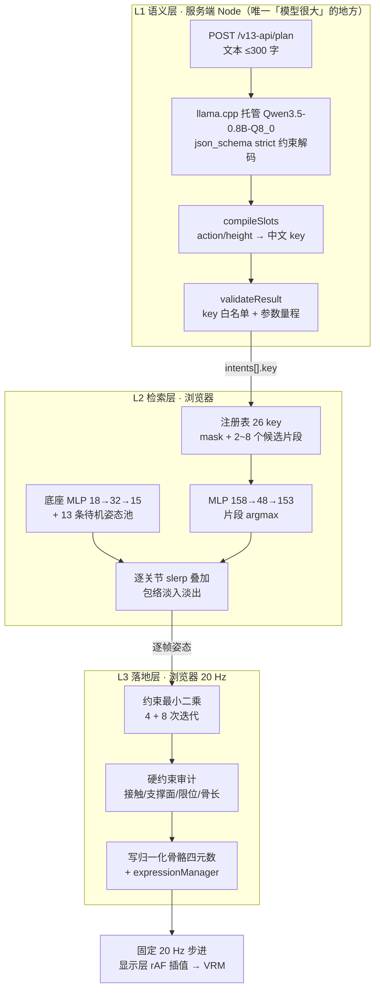

# 参考实现：HAST-SEC v0.1 的"文本 → 动作"

> **性质**：证据存档（**非规范**）。本文件不定义 openLuo 的行为，也不承诺实施。
> **来源快照**：`HAST-SEC`（github.com/sola1039/HAST-SEC）@ `3595232`（2026-10-13）。
> **许可**：`hast-sec-noncommercial-0.1`（非商业）；公开版**不含训练流程与原始训练素材**。
> 下文引用的是**架构与纪律**；数字为实测（复核命令见 §6），在本项目中**只作量级参照**。
>
> **一句话**：它不是"用模型生成动作"，而是**文本 → 语义槽 → 检索真人动作片段 → 可行性投影 → 写骨骼**；
> 神经网络只做三件事（意图解析、片段选择、底座选码），**没有任何网络输出关节轨迹**。

---

## 1. 总体管线



三层各自的**决策密度**（重要）：模型只在 L1（每句话一次）与 L2（每技能一次）做**离散选择**；
L3 是确定性求解，不学习。

---

## 2. L1 语义层

| 事实 | 证据 |
| --- | --- |
| 约束解码：`response_format` 为 `json_schema` strict，schema 内 `side`/`action`/`height` 全 enum、`intents` `maxItems:4`、`additionalProperties:false` | `service/qwen_requests.mjs:12`、`service/qwen_contract.mjs:4` |
| 双 slot 分工：`id_slot:0` 走动作规划（`temperature .1`, `max_tokens 650`），`id_slot:1` 走闲聊（`.6`/`160`） | `service/qwen_requests.mjs:12-13` |
| 模型为受管子进程：校验 model/server 双 SHA-256，端口 8783，空闲 120 s 自杀 | `service/qwen_process.mjs`、`configs/qwen_intent.json` |
| 槽编译**不读用户原文**，只做字段转换（文件首行注释明示）；`action`+`height` 拼成中文短语 key，过滤 `保持不动`，按 `delay` 排序产出 `同时/依次` | `service/qwen_slots.mjs:2`、`:7` |
| 第二道校验用**注册表白名单** + 量程（`speed∈[.4,2]`、`strength∈[0,1]`、`hold∈[0,20]`、`delay∈[0,30]`） | `service/motion_result.mjs:4` |
| 三层保险叠加：枚举挡非法词 → 编译期抛错挡非法组合 → 服务端白名单挡非法 key | `service/qwen_intent.mjs:29` |
| 兜底：能力外请求走 `unsupported` 并**明确禁止用别的动作替代** | `service/qwen_contract.mjs` 的 prompt、`service/qwen_intent.mjs` |
| 入口约束：文本 1–300 字、历史 ≤4 条 / ≤1200 字、`generation` 必须为 `v15` | `service/public_api.mjs:29` |
| **LLM 权重未被微调**（零样本 + few-shot + schema 约束） | `models/body/metrics.json` 的 `qwen_weights_trained: false` |

> **可直接借鉴**：L1 的**形状**（约束解码 → 枚举槽 → 白名单校验 → 能力外显式拒绝）。
> 它的价值不在模型，在**把"不可控的生成"压缩成"可控的枚举"**。

---

## 3. L2 检索层

### 3.1 注册表结构

一条技能类（实测 `models/skills/class-0.json`）：

```json
{"key":"left-向右移动","canonical":"把左手向右移动.","side":"left","mask":[7,8,9,10],
 "skills":[{"source":"86_02","start":1399,"end":1460,"duration":3,"score":35.95,
            "facts":{"wrist_delta_cm":[...],"wrist_spread_cm":[...],"path_cm":10.79,
                     "end_above_head_bone_cm":-37.84,"head_contact_label":false},
            "step_deg":1.43,"efficiency":0.483}, ... ]}
```

- `mask` = **骨骼下标数组**（`[7,8,9,10]` = 左肩/左上臂/左前臂/左手）。
- `skills[]` = 候选片段，每条指向一个 `.bin` 轨迹的一段帧窗。
- 入选依据是**运动学事实**（`facts`/`score`/`efficiency`），`manifest` 自述
  `"固定轨迹参照, 非递归残差"`、筛选规则 `"定向窗口峰值低于12度每帧, 按净位移除以路径长度排序; 摆臂保留周期运动"`。

### 3.2 片段资产

| 事实 | 值 | 证据 |
| --- | --- | --- |
| 技能轨迹库 | **51** 个来源，**25 509** 帧 = **21.3 分钟** @20 Hz | `models/skills/sources-{0..3}.json` |
| 每帧布局 | **848 B = 53 骨 × 4 float32**（四元数，**非** exp-map） | `motion/beat_layers.mjs`、`web/v13_assets.mjs`（`byteLength === frames*53*16`）、`tools/check.mjs` |
| 注册表规模 | **26** 个 key（22 个基库 + 4 个 v15 追加：挥手/抬腿 × 左右） | `models/skills/manifest.json` + `models/control/skills.json` |
| 每类候选数 | 2–8 条 | 同上 |
| 指骨真值 | **部分来源缺失**，自述 `"缺少指骨真值的技能保留底座手指"` | `models/skills/manifest.json` |

### 3.3 片段选择与底座

| 事实 | 证据 |
| --- | --- |
| 选片网络：**158→48→153**，15 129 参数；输入 = 32 维中文 key 嵌入（20 key×32）+ 21 关节点×6 维姿态特征；取 argmax，**不是手写距离排序**（代码注释明示） | `models/policy/model.json`、`motion/skill_policy.mjs:11`、`web/v13_policy.mjs:2`、`training/v13/selector.mjs:7` |
| 底座（v15）：`base` 网 **18→32→15**（1 103 参数）+ 13 条待机姿态池（13×61×53×4 float）；条件只有 3 个标量 + `listening` | `models/control/{base,idle}.json`、`web/v14_base.mjs:16` |
| 底座（v13 旧路）：48 码 codebook（48×80×178，683 520 float）+ bigram **97→192→48**（28 080 参数） | `models/body/{model.json,codes.bin}`、`training/beat_runtime.mjs:18` |
| 接缝处理：切换码时算位姿差与速度差，用三次 Hermite 在 `max(0.4, min(1, 1.5·gap/(120°/s)))` 内衰减——**大动作自动获得更长过渡** | `training/beat_runtime_v9.mjs:19` |
| 叠加：只在自己的 `mask` 上逐关节加权归一混合；淡入淡出时长按**实际角距** `max(0.7, 1.875·gap/2.5)`；同 `mask` 旧轨在起点进入 cancel；轨数上限 16 | `motion/beat_layers.mjs:18`、`:29` |

> **可直接借鉴**：`mask` + 逐关节权重归一 + "全局底座常驻" 的合成规则（见 [training-design.md](training-design.md) §4）。
> **需改造**：选片网络与码本是我方数据上重训的产物；其**结构**可留，**权重与码位**全部作废。

---

## 4. L3 落地层（本项目中**大部分不可用**，但有两条纪律值得抄）

| 事实 | 证据 |
| --- | --- |
| 变量表 ≈30 维（根 3 + hips 3 + 脊柱/双腿/双臂/足），**不含 `*Hand`、不含任何指骨** | `motion/v9/projector.mjs:8` |
| 手与 30 根指骨走"惯性目标 + 关节投影的闭式更新"，即**跟随滤波后的轨迹**；自述 `"30指骨来自原始动作轨迹"` | `models/body/model.json`、`motion/v9/projector.mjs` 的 `prepare` |
| 代价项：手部任务误差、足底接触/滑动、支撑多边形重心、未来支撑面重心转移、髋/胸倾角上限、手臂-躯干/头部胶囊净距、步长上限、关节扭转限 20°/35°/35° | `motion/v9/targets.mjs`、`motion/v9/arm_task.mjs` |
| 求解失败 → `retainedState` 回退上一可行帧；累计保持 ≥0.5 s 抛错暂停 | `motion/v9/controller.mjs`、`motion/v9/retained.mjs` |
| 每一步都做硬约束审计（骨长误差、限位越界），不通过直接抛错 | `motion/v9/controller.mjs` |
| **运行时硬性时间不变量**：求解器状态输入拒绝 `dt > 0.051 s`（≈19.6 Hz）；显示/轨道时钟拒绝 `dt > 0.2 s` | `motion/v9/observations.mjs:3`、`motion/v9/clock.mjs:8`、`motion/beat_layers.mjs:38` |
| 输出平滑：**分链**临界阻尼 + 运动自适应截止（躯干 `max 1.6 Hz`、手臂 `4.5 Hz`、手 `4 Hz`、细节 `4 Hz`；`beta` 0.8 / `arms_beta` 2） | `motion/v9/damped_output.mjs:21`、`configs/v9_control.json` |
| 历史缓冲：**按固定 50 ms 步长取样**（保留 4 个），速度按**实际 elapsed** 归一 | `motion/history_filter.mjs:36` |
| 分链"有效带宽"判定（用于区分噪声）：躯干/腿/足 **4 Hz**、头颈 **6 Hz**、其余 **7.5 Hz** | `motion/multiscale_motion.mjs:11` |
| 关节范围表：**硬范围 + 软范围 + 速度 + 加速度 + jerk（= accel×16）**，投影用 `interval`（软硬之间平滑压缩，非 `clamp` 硬切）；膝关节扭转范围随屈曲角动态收紧 | `motion/joint_feasibility.mjs:16` 起、`projectJoint` |
| 动力学是**未标定代理**：`physics_strength` 仅 **0.00002**、`mass_kg` 60；UI 自述"动力学为未标定杆段代理, 目标值不能当作准确率" | `configs/v9_control.json`、`web/v15_controls.mjs` |

> **不适用**：接触/支撑/质心/刚体代理这一整套是为**三维骨骼**设计的；Live2D 无 IK、无物理。
> **可直接借鉴**：`dt` 上限式的**显式不变量**、分数链的截止频率表、固定步长历史取样。

---

## 5. 训练事实（与"不做 RL"的常见误解相反）

所有权重**都是本项目在 CPU 上几十秒内训完的小网络**，且**选择层用的是强化学习**：

| 网络 | 参数量 | 算法 | 更新数 / epoch | 训练耗时 |
| --- | --- | --- | --- | --- |
| 局部策略（选片段） | 15 129（**可训 2 009 / 冻结 13 120**） | **裁剪策略梯度**，`clip 0.2`，`entropy 0.005` | 1 600 | **3.50 s**（best_epoch 98/100） |
| 周期数（timing） | 3 916 | 同上，`entropy 0.035` | 1 280 | **0.76 s**（best 39/80） |
| 底座（v13 路） | 2 989 | 同上，`entropy 0.035` | 1 600 | **1.98 s**（best 83/100） |
| v15 底座 | 1 103 | 同上 | 2 560 | —（见 `models/control/base.json`） |
| v15 expert（挥手/抬腿） | 4 522 | 同上，`entropy 0.02` | 3 200 | **2.15 s**（best 156/200） |
| 身体 bigram（v13 旧路） | 28 080 | **监督**（交叉熵） | 40 epoch | **7.35 s**（best 5） |

> 两份 metrics 的**顶层** `seconds` 分别为 18.15 s（`models/timing/`）与 83.27 s（`models/control/`），
> 含环境评估等开销；上表为各网络自身的训练耗时。
> 合计可训系数约 **60 k**（28 285 + 15 129 + 3 916 + 2 989 + 1 103 + 4 522 + 4 557 = **60 501**），**全程 CPU，`gpu_training: false`**。

三处关键自述：

- `loss_definition`：`"负期望奖励, 非监督姿态误差"`；`algorithm`：`"裁剪策略梯度, 单次选择完整技能的环境回合"`。
- `reward_environment`：`"实际流明骨架正向运动学和关节投影, 完整第九版求解另行验收"`
  ⇒ **奖励环境是运动学可行性，不是刚体动力学**。
- `limits`：`"技能仍来自固定真人动作码, 未训练神经轨迹解码器或关节力矩"`
  ⇒ RL 只学**离散选择**，轨迹本体冻结。

**结论**：这个项目把"物理/RL"用在**离散选择 + 可行性判据**上，而不是用来发现新动作。
这正是 [training-design.md](training-design.md) 中 D11 的来源。

---

## 6. 已由作者承认的验证盲区（最有借鉴价值的部分）

| 字段 | 原文 | 含义 |
| --- | --- | --- |
| `models/body/metrics.json` → `validation` | `"两个完整文件留出, 同人物采集条件, 非独立场次泛化"` | **按文件划分不等于跨来源泛化**：同一人物、同一采集条件下留出 |
| `models/body/metrics.json` → `conditioning` | `"无状态分类, 不用音频…"` | 底座无条件输入 |
| `models/timing/metrics.json` → `validation_scope` | `"留出的初始姿态上下文, 不是新来源动作泛化"` | 同上 |
| `models/control/metrics.json` → `expert.scope` | `"真实页面重置与推进6秒训练, 推进3秒留出, 原始素材和全身网络冻结"` | 训练/验证规模是**秒级** |
| `README.md` | 「本版只提供运行所需代码和资源, **不包含训练流程或原始训练视频**」；「**尚未完成完整的强化学习训练与应用适配**」 | 公开版不是完整训练方案 |

> **纪律（建议采纳）**：验证集划分必须**按来源/场次**，并明确写出"该划分能证明什么、不能证明什么"。
> 参考实现做对了"按文件划分"，但仍自述不能证明跨场次泛化——**这就是诚实的写法**，也是本项目
> [data-pipeline.md](data-pipeline.md) §6 的模板。

---

## 7. 表情链路（本项目最值得直接复用的部分）

| 事实 | 证据 |
| --- | --- |
| 运行时帧格式：`178 = 53×3 + 19`，面部 19 通道与骨骼在**同一帧向量**里 | `models/body/model.json` 的 `dim`/`face`、`motion/feasible_state.mjs` |
| 面部驱动**独立性**：待机码把面通道**整体清零** | `web/v14_base.mjs:30`（`values.fill(0, bones*3)`） |
| 面部时间步上限 **`dt ≤ 0.12 s`**（≈8.3 Hz 下限），比身体更严 | `face/v9_motion.mjs:9`、`face/feasible_face.mjs` |
| 情绪：13 类枚举 → 手写姿势表（每类只点亮 3–8 个通道） | `face/v9_expressions.mjs:3` |
| 眨眼：间隔 `2.5+3·rand`、时长 0.24 s 余弦包络、被眼眯抑制 | `face/v9_motion.mjs:15` |
| 口型预算：`budget = 1 − 0.35·mouthSmile − 0.3·mouthAngry − 0.25·mouthPanic`，再按 `lip_gain` 缩放进预算 | `face/v9_motion.mjs:29` |
| 竞争投影：口型 5 通道单纯形、眉毛左右成对、互斥组逐组求和 ≤1 | `face/feasible_face.mjs:5`、`:20`、`face/v9_profile.mjs:6` |
| 速率限幅：眨眼 30/s、其余 12/s，**组内取最小速率**保证同步；另有 gram 形态度量迭代（≤60 次） | `face/feasible_face.mjs` |
| **52 维枢轴与自动标注接口存在，但消费者未随公开版发布**：`FACE_NAMES` 是 MediaPipe FaceLandmarker 的 52 项 blendshape；`packFaceFrame` 的入参就是 `FaceLandmarkerResult`（`faceLandmarks` + `faceBlendshapes[0].categories`） | `face/format.mjs:1`、`:16` |
| 52 → 运行时通道的**解析映射**：含元音竞争归一化与情绪缩放 `emotionScale = (1−0.7·opening)(1−0.5·blink)` | `face/mapping.mjs:5`、`face/details.mjs:5` |
| 上述路径（`packFaceFrame`/`mapFace`/`faceSampler`/`expressionFromText`）**无外部消费者**；仅 `registerFineFace` 被 `web/feasible_view.mjs:6` 引用 | grep 全仓 |
| 通道→目标名的绑定是**按角色 morph 名动态注册**的；默认示例角色（解析 `assets/resources.json` 指向的 pixiv `VRM1_Constraint_Twist_Sample.vrm` 所得）只有 18 个 VRM1 预设表达式、57 个 `Fcl_*` morph，**8 个 fine + 17 个 extra 通道一个都不存在** ⇒ 默认角色上只有 11 个通道生效 | `face/details.mjs`、`face/v9_profile.mjs`、`assets/resources.json` |

> **可直接借鉴**：整套后处理（竞争投影 / 互斥组 / 速率限幅 / 口型预算 / 眨眼包络）**与模型无关**。
> **可直接借鉴**：`face/format.mjs` 的 52 维枢轴接口——它是"**可自动标注的中间表示**"的现成范式（见 [training-design.md](training-design.md) §5）。

---

## 8. 可复用性三分

| 分类 | 项 | 说明 |
| --- | --- | --- |
| **可直接借鉴（形状/纪律）** | 约束解码 → 枚举槽 → 白名单校验 → 显式拒绝；`mask` + 逐关节权重归一的合成规则；接缝位姿+速度残差衰减；分链平滑；固定步长历史取样；关节范围表（硬/软 + 速度 + 加速度 + jerk）；表情后处理全家桶；52 维枢轴接口；"先审后训" + 来源级划分 + 资产哈希自检 | 与骨架、引擎无关 |
| **需改造** | 语义 key 词表与槽 schema；选片网络结构（权重作废）；码本/底座；轨迹交换格式；逐链截止频率与带宽阈值 | 结构可留，数值必须在我方数据上重测 |
| **不适用** | 三维接触/支撑/质心/刚体代理与全部 `motion/v9/*`；手部任务空间 IK（在公开版里**恒为 null**，无生产者）；VRM 专有 53 骨/19 通道假设；`generation` 的 `v13` 分支（实际不可运行，服务端强制 `v15`） | 目标引擎不同或无生产者 |

---

## 9. 复核命令

```bash
# 注册表规模、类与候选数
node -e 'const fs=require("fs");const m=JSON.parse(fs.readFileSync("models/skills/manifest.json","utf8"));
const c=JSON.parse(fs.readFileSync("models/control/skills.json","utf8"));
console.log("keys:",m.classes.length+c.classes.length);'

# 技能轨迹库规模与每帧字节数
node -e 'const fs=require("fs");
const s=[0,1,2,3].map(i=>JSON.parse(fs.readFileSync(`models/skills/sources-${i}.json`,"utf8"))).flat();
const f=s.reduce((a,x)=>a+x.frames,0);
console.log(s.length,"sources",f,"frames",(f/20/60).toFixed(1),"min @20Hz");
console.log("bytes/frame",fs.readFileSync("models/trajectories/"+s[0].file).length/s[0].frames);'

# 身体语料规模与划分
node -e 'const fs=require("fs");const b=JSON.parse(fs.readFileSync("models/body/sources.json","utf8"));
console.log(b.length,"sources",b.reduce((a,x)=>a+x.frames,0),"frames",b.map(x=>x.split));'

# 训练事实（RL / 奖励环境 / 能力边界自述）
node -e 'const fs=require("fs");
for(const p of ["models/timing/metrics.json","models/body/metrics.json","models/control/metrics.json"]){
 const m=JSON.parse(fs.readFileSync(p,"utf8"));console.log(p,JSON.stringify(m.limits??m.validation??m.expert?.scope??m.conditioning));}'
```

---

## 10. 纠错记录

| 日期 | 对象 | 结论 |
| --- | --- | --- |
| 2026-10-14 | "该项目不做 RL" | **错误**。它**在离散选择层做了 RL**（裁剪策略梯度，单次选择完整技能的环境回合），只是**轨迹本体冻结**；奖励环境是骨架 FK + 关节投影，不是刚体动力学。见 §5 |
| 2026-10-14 | "手部有 IK" | **需修正**。手与 30 根指骨**不在优化变量表内**，只是跟随滤波轨迹；任务空间路径（`handGoal`）在公开版**恒为 null**（无生产者），`hands/arm_ik.mjs` 的 `hands()` 零调用者 |
