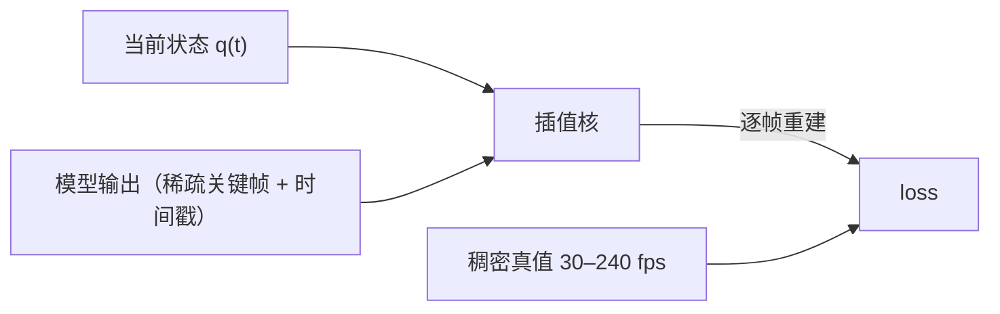

# 训练技术方案（设计稿）

> **性质**：方向性设计稿，**未实施、未排期**。排期归 [`../todos.md`](../todos.md)。
> 每条决定标注 `已定` / `建议` / `未决`，并写出**被否决的备选与理由**——理由比结论更容易丢。
> 外部数字出自 [`reference-hast-sec.md`](reference-hast-sec.md)，**只作量级参照**。
>
> **一句话**：本方案的核心不是"更大的模型"，而是**三个表示选择 + 一条监督纪律**——
> `Δt` 显式输入、旋转空间 exp-map 表示、解析样条求值，以及**监督必须过插值器**。

---

## 0. 范围与非目标

| 范围 | 非目标 |
| --- | --- |
| 动作（全身关节）与表情的**输出表示、训练目标、监督方式、数据纪律、验收指标** | 具体网络架构的超参搜索；具体引擎的导出器实现（属 M1 交换格式的调用方） |
| 与外部参考实现的**对照与取舍** | 与某篇论文的逐项复现 |

---

## 1. 目标表示（D4）

### 1.1 采用：局部旋转 exp-map 向量

每个骨/通道输出 **3 维旋转向量**（轴 × 角，局部、相对静止姿态），与四元数通过 `rotationLog`/`rotationExp` 互转。

**被否决的备选：每关节"角度范围 `range[角度]` + 限位盒"**

| 否决理由 | 细节 |
| --- | --- |
| 插值非测地 | 欧拉空间线性插值在跨 ±180°、万向节附近会甩动；四元数/slerp 天然测地 |
| 限位不该由表示承担 | 把数据夹进范围盒会削成台阶；正确做法是**生成后投影**（§1.2） |
| 两端都要转换 | VRM 用归一化骨骼四元数，MMD 用建模骨骼欧拉——选欧拉省不了转换，反而多一次往返 |
| 与 `Δt` 条件化冲突 | Δt 归一化要求"方向 × 时间"可分解，exp-map 天然给出角速度向量；欧拉角的速度在万向节附近不可解 |

> 参考实现的实证：其离线码本与运行时帧都是此类旋转表示（`models/body/codes.bin` 的 `dim = 53×3 + 19`），
> 格式可直接当规范用，省掉一轮对齐。

### 1.2 关节范围是**投影层**，不是编码层

参考实现的 `jointPolicy` 给了完整范式，建议照搬其**形状**（数值需在我方骨架上重测）：

| 每关节携带 | 用途 |
| --- | --- |
| **硬范围** + **软范围**（各 3 轴） | 软范围外给二次惩罚，硬范围是绝对界；投影用 `interval`（软硬之间**平滑压缩**，不是 `clamp` 硬切） |
| **角速度上限** | 时间上是限速；也是"该关节真实带宽"的依据（D13） |
| **角加速度上限**、**jerk = accel × 16** | jerk 有限 ⇒ 高频内容有理论上界 ⇒ 可用于设定该链的滤波/监督率 |

特殊项（参考实现的做法值得保留）：膝关节的**扭转范围随屈曲角动态收紧**；髋部**偏航单独处理**，
避免大偏航混入侧倾。

### 1.3 通道分组与顺序

- 顺序必须**随数据携带**（`bone_order` / `expression_order`），并由 schema 校验——不要让它成为隐含知识。
- 坐标与单位（手性/上向/前向/单位/四元数序/旋转空间/根空间）冻结为常量并在交换格式里 `const` 校验。
- 面部通道与身体通道在**同一帧向量**里，但**驱动速率不同**（§5.4）。

---

## 2. `Δt` 条件化（D1，已定）

### 2.1 为什么必须（而不是可选）

固定步长的自回归模型，其历史输入的**时间间隔**是输入分布的一部分。训练用 16–33 ms、推理用
66–200 ms ⇒ 模型看到分布外输入 ⇒ 漂移。**除非 `Δt` 是显式输入，且训练时就把它随机化。**

### 2.2 采样规则（`建议`，逐条都是可验证的）

| 规则 | 原因 |
| --- | --- |
| **`Δt` 从真实时间戳采样（秒）**，不由"跳 N 帧"推导 | 源帧率不同（30/60/120/240）时，"跳 2 帧"在不同样本上语义不同；且 120 fps 源跳 1–4 帧的最大 `Δt` 只有 33 ms，会让部署点**贴在训练分布边界上** |
| **训练 `Δt` 上界 ≥ 部署 `Δt` 的 2–4 倍** | 部署点必须落在分布**内部**，不能落在边界 |
| 分布用 **log-uniform**，并按部署区间加权 | 覆盖若干数量级，同时不浪费容量在极少用到的区间 |
| **保留 1–5% 长尾样本**（2–4× 部署 `Δt`） | 否则尾部是冷的，长间隔推理会突然劣化 |
| **始终包含最密的 `Δt`**（= 源的最小帧间隔） | 锚定亚帧精度 |
| 不假设等间隔 | 外部素材有丢帧、重复关键帧、可变播放速度；采集设备也可能掉帧 |

### 2.3 上下文步长与决策 `Δt` 解耦（D3）

否则 `Δt` 一跳，token 数与上下文时长都跟着跳，算力与语义窗口都不稳。

采用参考实现的模式（`motion/history_filter.mjs:36`）：**上下文按固定时间步长取样（如 50 ms），
速度用实际 `elapsed` 归一**。于是 token 数稳定、上下文时长按秒可控，`Δt` 只影响"下一次决策隔多久"。

### 2.4 `Δt` 带来的收益与它**不能**带来的收益

| 能给 | 不能给 |
| --- | --- |
| 降低**调用率**（前向次数），这是真实算力节省 | 降低所需的**上下文时长**：`Δt` 越大，单次跳跃越远，反而需要**更长**的历史才能连贯 |
| 把"输出率"从训练率上解耦出来 | 恢复 **`sub-Δt` 的细节**：比 `Δt` 更短的细节事件永远不会被生成 |
| 支持**事件自适应**：冲击/快速手势处自动减小 `Δt` | 替代插值核的质量——插值核错了，稀疏点再准也白搭 |

**部署率的量化参照**（以 60 fps 为基准）：

| 部署 `Δt` | 等于向前外推 | 相对 3 Hz 质心弹跳 | 判断 |
| --- | --- | --- | --- |
| 17 ms | 1 帧 | 0.05 周期 | 安全 |
| 33 ms（30 fps） | 2 帧 | 0.1 周期 | 安全 |
| 66 ms（15 fps） | 4 帧 | 0.2 周期 | 可接受 |
| 200 ms（5 fps） | 12 帧 | 0.6 周期 | 只适合站立/手势 |

> 结论：**推理远离训练率时，向高频走（30 fps 或更高）比向低频走安全得多**。
> 降频的收益来自"少调用"，不来自"少采样"。

### 2.5 事件自适应 `Δt`（`建议`，低成本高收益）

在预测速度/曲率高的时刻自动降低 `Δt`，平稳段拉长 `Δt`。判据可用模型自身输出的速度范数，
或照搬参考实现的**分链运动门控**形状（低于门限视为噪声/静止）。这是"既保留高频冲击、
又不全程高密度推理"的唯一路径。

---

## 3. 监督（D7 / D8，`建议`）

### 3.1 必须通过可微插值器在稠密帧上监督

| 若只监督关键帧端点 | 若监督重建后曲线 |
| --- | --- |
| 模型学会"复制第 N 帧"，**插值误差完全不受约束** ⇒ "关键帧很准、中间很飘" | 模型同时学"在哪放键"与"值是多少"，**插值器的系统误差被自动补偿** |
| 丢掉中间帧的全部监督信号 | 用满全部数据 |

代价与副作用：插值路径在旋转空间是近线性的，高曲率段 loss 偏大——**而这是想要的**，
它把模型推向"把关键帧放在该放的地方"。

### 3.2 预测位移量，不预测绝对状态（D8）

`Δt` 随机化会打开退化解："直接输出当前状态"在小 `Δt` 上误差很小 ⇒ 模型学会**欠动作**。

做法（参考实现同型）：网络输出**旋转向量速度**，乘 `Δt` 后 `rotationExp` 还原，
即 `q_next = q ⊗ exp(ω · Δt)`（`motion/history_filter.mjs` 的 `propose`）。identity 映射到零，loss 直接惩罚欠动作。

**评估必须并排报 identity 基线**，否则发现不了自己训了个"复制当前帧"的模型。

### 3.3 loss 按频带加权

否则模型把容量花在拟合噪声上。逐链的"有效带宽"必须**在我方素材上实测**（方法见
[data-pipeline.md](data-pipeline.md) §3/§7）；参考实现的判定是躯干/腿/足 **4 Hz**、头颈 **6 Hz**、
其余 **7.5 Hz**——**只作量级参照**，它是在"站立聊天"场景下定的。

### 3.4 `mask` 与 `confidence` 是两个独立通道

| 通道 | 含义 | 误用的后果 |
| --- | --- | --- |
| `mask` | "这里**不监督**"（局部数据） | 与 confidence 合并后分不清"没录"和"录坏了" |
| `confidence` | "该通道观测**不可靠**" | 同上；参考实现对低置信度走**历史预测回填**，对 `mask` 走跳过 |

---

## 4. 局部 + 整体（D9，`已定方向`）

### 4.1 先分辨"部分数据"的两种形态

| 类型 | 定义 | 风险 | 处理 |
| --- | --- | --- | --- |
| **掩码式** | 从完整采集中截取，全身真值都在，只是声明"这段算手部技能" | 低 | **`mask` loss，不 `mask` 输入**；其余通道照常作上下文 |
| **真·部分** | 只录了手/只有手部设备，未观测通道的目标是编造的 | **高** | 未观测通道**必须由底座先验填充**，**绝不留自由目标** |

> 填零等于教模型"这些关节可以任意"⇒ 耦合关系在训练中从未建立 ⇒ 推理时的"整体协调"不存在。
> 参考实现遇到同类问题（指骨缺真值）时的做法是显式 fallback 到底座，而不是填零。

### 4.2 合成规则可以直接借用参考实现

"**全局底座常驻 + 局部技能按 `mask` 覆盖**"，逐通道加权归一（重叠轨道按权重分配，超出 1 的部分归底座）。
这套规则与引擎无关，且**把局部数据从"模型内的多模态"降级为"数据布局 + 合成规则"**——问题规模小一个量级。

### 4.3 协调性只能来自共享表示，且必须被度量

| 纪律 | 说明 |
| --- | --- |
| **共享 trunk + 部位间交叉注意力** | 各部位头独立 ⇒ 你重建的正是"局部 + 局部"问题 |
| **全量样本保底占比**（`未决`，建议 ≥30–40%） | 作为协调性的锚；参考实现的运行时全局底座**永远在场**，即这个比例的含义 |
| **度量而非期望**：跨关节相位锁定 | 同一动作类别下配对关节的相位差分布，或链间典型相关；对比"纯局部 vs 混合" |
| **归一化统计按 `mask` 分别计算** | 否则模型会把"这个关节不动"归因于 `mask` 而非动作 |

> 参考实现的实证：其局部策略训练时**冻结了 87% 参数**（可训 2 009 / 冻结 13 120），
> 只训选择头。即"协调骨架冻结、只学局部选择"是可行的工程折中。

---

## 5. 表情（D10，`建议`）

### 5.1 核心判断：不要用一个模型做"语料 → 表情"

语料里的驱动信号有**三种**，时间常数差两个数量级：

| 驱动 | 时间常数 | 正确形态 | 参考实现怎么做 |
| --- | --- | --- | --- |
| **语义情绪** | 秒级 | **分类**，不是回归 | LLM 输出 13 类枚举 → 手写姿势表 → 每通道目标 |
| **口型 / 视素** | 10–100 ms | 音频 → 系数回归 | 只是 hack：布尔 `speaking` → 选带口型通道的底座码 + `lip_gain` 放大 |
| **自主层**（眨眼、微动、扫视） | 0.1–5 s，**无输入信号** | **规则**，不要学 | 间隔 `2.5+3·rand`、0.24 s 余弦包络、被眼眯抑制 |

### 5.2 枢轴表示是"语料 → 表情"的关键（这是本项目对该问题的主要答案）

**只有能被自动标注的表示，才能撑起"语料 → 表情"的绑定。** 可选枢轴：

| 枢轴 | 可自动标注 | 备注 |
| --- | --- | --- |
| **ARKit-52 / MediaPipe blendshape** | ✅ 现成模型可从普通视频抽取 | 参考实现里**已有该接口的形状**（`FACE_NAMES` 52 项 + `packFaceFrame` 的入参是 `FaceLandmarkerResult`），但消费者未随公开版发布 |
| **FACS / AU** | ✅ 有 AU 检测器 | 与肌肉语义对齐，跨角色可迁移 |
| MMD 模型自带的 morph | ❌ 逐模型不同、语义由作者决定 | **不能当枢轴**，只能当**目标端** |

**流程**：`视频/语料 → 52 维枢轴（自动标注）→ 训练情绪分类器 / 视素回归 → 枢轴系数 → 目标端通道`。
其中"枢轴 → 目标端"是**每角色一份的解析适配器**（参考实现的 `mapFace` / `fineFaceWeights` 就是范式）。

### 5.3 精细度来自**表情基**，不来自通道数

"超过 MMD 精细度"的可行路径：

- 参考实现的手写情绪表是 **13 类 × 稀疏 3–8 通道**，本质是一个**手写的低秩码本**。
- 把它换成**从数据学出的基**：对 52 维枢轴序列做 NMF/PCA 得 `K` 个基（`未决`，建议 20–60），模型只预测 `K` 维系数。
- 收益：精细度随基数量与标注质量提升；且基跨模型共享，逐模型的 morph 名差异被隔离在适配器里。

### 5.4 时间尺度必须与身体解耦

| 事实 | 含义 |
| --- | --- |
| 参考实现面部驱动**拒绝 `dt > 0.12 s`**（≈8.3 Hz 下限），比身体更严 | 面部不能跟随低频输出率 |
| 它把**待机码的面通道整体清零** | 面部与身体是刻意解耦的两条驱动 |
| 眨眼 0.24 s 包络、视素 10–100 ms | 与身体 20 Hz 决策不是同一时间尺度 |

**做法**：分头 + 分频；或统一 trunk 但**面部单独一个高频输出头**，并给 face loss 单独加权（否则被身体通道的梯度淹没）。

### 5.5 后处理是必需的，与模型无关

独立回归 52 个通道**一定**会产生非法组合（张嘴 + 闭嘴、`aa` 与 `ih` 同时高）。参考实现的这套可直接搬：

| 件 | 作用 |
| --- | --- |
| 口型 5 通道**单纯形投影** | 元音互斥，落在单纯形上 |
| 眉毛左右**成对投影** | 左右对称约束 |
| **互斥组**逐组求和 ≤1 | 眼特效、嘴形、眉毛族、眼形族 |
| **gram 形态度量**迭代投影（≤60 次） | 用角色实际 morph 顶点位移约束"哪些组合在几何上合理" |
| **速率限幅**（眨眼 30/s、其余 12/s，**组内取最小**） | 网络会输出跳变；组内最小保证同步 |
| **口型预算** `1 − 0.35·smile − 0.3·angry − 0.25·panic` | 笑与说话的开口量竞争同一个预算——**"边笑边说"不崩的关键** |

---

## 6. 参数量与数据账（D12，`建议`）

### 6.1 参照实现的规模的实测

| 项 | 值 |
| --- | --- |
| 技能轨迹库 | 51 来源 / **25 509 帧 = 21.3 分钟** @20 Hz |
| 身体语料 | 12 来源 / **81 392 帧 = 1.13 小时** @20 Hz（10 train / 2 validation） |
| 每帧标量 | **178**（53×3 + 19） |
| 全语料标量总量 | 81 392 × 178 ≈ **14.5 M** |
| 全部可训系数 | body 28 285 + policy 15 129 + timing 3 916 + base 2 989 + expert 4 522 + wave 4 557 ≈ **59 k** |
| 全部训练耗时 | **≈90 秒 CPU**（GPU 未使用） |

### 6.2 由此得到的两条硬约束

1. **参数量必须与数据量同量级**。以 14.5 M 标量为参照：500 M 参数 ≈ 数据的 **34 倍**，
   1 B ≈ **69 倍**——即"模型参数比整个数据集里的数字还多两个数量级"。
   连续运动信号时间相关性极强，有效信息量远低于标量计数。
2. **周期运动的本质自由度极低**。10 分钟跑步 @60 fps = 36 000 帧 = 6.4 M 标量，
   但压缩后（相位 + 速度 + 风格 + 基）其**独立信息量在 10³–10⁴ 量级**。
   用 10⁸–10⁹ 参数去表示它是 10⁵ 倍浪费，且会在几百步内**把数据背下来**。

### 6.3 建议分档

| 目标 | 数据量下限 | 建议参数量 | 方法 |
| --- | --- | --- | --- |
| 复现 / 变速 / 无缝插值（单一运动族） | 分钟级单来源 | **10⁴–10⁶** | 相位条件化 / 匹配检索（非神经或极小网络） |
| 多运动族共享骨架先验 | 小时级、**多来源** | **5–20 M** | 码本 + 序列模型，或连续时间 chunk 生成 |
| 文本/语义 → 任意动作 | 数十小时、多来源、多风格 | **20–200 M** | 条件序列模型 |
| 0.5–1 B 才有意义 | 100+ 小时、多模态条件（文本+音频+全身+表情） | — | — |

> **推论**：若一期只有"自有动捕 + 外部素材"的**分钟到小时**级数据，模型规模应在
> `10⁴–10⁷`，而不是 `10⁸⁺`。"先把数据扩到量级"与"先把模型缩小到量级"是同一件事的两面。

---

## 7. 验收指标（`建议`，全部在**稠密率**上对重建后的输出计算）

| # | 指标 | 为什么是它 |
| --- | --- | --- |
| 1 | **分频带重建误差**（低频姿态 / 高频冲击分别报） | 部署率不足的问题**只会在高频段暴露**；平均值会把 `Δt` 的代价藏起来 |
| 2 | **按 `Δt` 分桶**报上述指标 | 得到 latency-quality 曲线，才知道 30 fps 够不够、60 fps 值不值 |
| 3 | **identity 基线**并排 | 确认模型不是"复制当前帧"（§3.2） |
| 4 | **事件存活率**：先统计语料中最短事件时长分布（取 5 分位），再验证 `2·Δt < 事件时长` | 直接回答"部署率够不够" |
| 5 | **长时自持性**：≥60 秒生成后的相位/幅度漂移，按 `Δt` 分桶 | 周期运动的典型失效是相位漂移，不是瞬时误差 |
| 6 | **足滑**（厘米） | 接触一致性；参考实现的量级是 `contact_tolerance_m 0.03` / `support_tolerance_m 0.02` |
| 7 | **接触/限位越界计数**（应为 0） | 可行性投影是否真的生效 |
| 8 | **协调性**：跨关节相位锁定 | §4.3；唯一能验证"整体协调"的方式 |
| 9 | **非法表情组合计数**（应为 0） | §5.5 投影是否生效 |
| 10 | **关键帧时间抖动**（模型输出 `Δt` 序列的方差） | 抖动大 ⇒ 模型在犹豫 ⇒ 插值层要做更多补偿 |

> **纪律**：验证集划分必须**按来源/场次**，并在文档里写明"该划分能证明什么、不能证明什么"。
> 参考实现做对了"按文件划分"，但自述 `"两个完整文件留出, 同人物采集条件, 非独立场次泛化"`——
> 这种诚实的标注应作为模板。

---

## 8. 反模式清单（被否决的备选与理由）

| # | 反模式 | 否决理由 |
| --- | --- | --- |
| 1 | **固定网格关键帧 + 事后插值** | 关键帧方案的重建精度取决于**键放在哪**，不是放在多密；固定网格会产生幅度**拍频**。键的时间戳应由模型给出 |
| 2 | **对训练目标做全局低通** | 抹掉冲击瞬态（脚跟着地从冲激变圆包）；引入频率相关相位偏差；且离线零相位滤波与运行时因果滤波不一致 ⇒ 稳定滞后偏差 |
| 3 | **FFT 往返做重采样** | 顺序错（先取点再滤波 ⇒ 混叠已发生）；分数帧误差与 `Δt` 相关 ⇒ 训出欠动作；FFT 的周期性假设在首尾不连续片段上产生环绕瞬态 |
| 4 | **端到端回归全部表情通道** | 必产生非法组合；正确做法是模型 + 投影层（§5.5） |
| 5 | **一个模型做"语料 → 表情"** | 三种驱动时间常数差两个数量级；混在一起必然顾此失彼（§5.1） |
| 6 | **用频率阈值判抖动** | 抖动与快动作的频率分布可重叠，差别在**谱熵**（随机相位）与幅度/持续性；应用熵判据 |
| 7 | **全局单一截止频率 / 统一监督率** | 会同时"砍掉手部真实细节"和"放过躯干抖动"；应逐链（依据速度/加速度/jerk） |
| 8 | **未观测通道留自由目标** | 教模型"这些关节可以任意" ⇒ 协调性从未建立；应用底座先验填充 |
| 9 | **把 `mask` 与 `confidence` 合并** | 分不清"没录"与"录坏了"，两种情况的正确处置相反 |
| 10 | **按帧随机划分验证集** | 相邻帧跨集会虚高指标；必须按来源/场次 |
| 11 | **只监督关键帧端点** | "关键帧很准、中间很飘"（§3.1） |
| 12 | **不报 identity 基线** | 无法发现欠动作退化（§3.2） |
| 13 | **参数量与数据量脱钩** | 见 §6；1 B 参数在小时级数据上只会背数据 |
| 14 | **从零 RL 学步态/跳跃** | 参考实现的 RL 只学**离散选择**（选哪个技能/几个周期），奖励是**运动学可行性**而非刚体动力学；轨迹本体保持冻结。若确实需要，应先有监督先验，再以**判据/评论家**方式使用物理（见 [README](README.md) §6 M8） |

---

## 9. 未决

| # | 问题 | 阻塞什么 |
| --- | --- | --- |
| 1 | 输出目标优先 **VRM 还是 Live2D**（见 [README](README.md) §7 U1） | §1 表示是否保留"骨"的语义；M1 格式设计 |
| 2 | 表情枢轴选 ARKit-52 还是 FACS/AU；基数量 `K` | §5.2 / §5.3 的数据采集口径 |
| 3 | 全量样本保底占比（§4.3） | 需用相位锁定指标实测 |
| 4 | 是否引入刚体物理（M8 是否存在） | 取决于目标是否含跳跃/受击/地形 |
| 5 | 外部素材许可边界 | 决定哪些数据可入库 |
