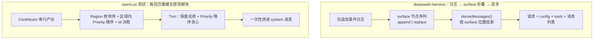

# deepseek-harness 上下文管理：可借鉴清单（A–R）

> **状态**：调研存档，**非规范、未实施**。本文件不定义 openLuo 的行为，也不承诺落地；采纳路径见 [../README.md](../README.md)。
> **来源快照**：`deepseek-harness` @ `d7432673`（2026-10-09，`release-0.2.1-alpha.2`）。所有 `路径:行` 均指该快照，证据索引见 [evidence-index.md](evidence-index.md)。
> **一句话**：对方的上下文不是"每回合重建的块"，而是**日志上的 append-only 前缀**；但**这条前提与我们不同**（见 §1.1）——因此本文件只借"与单一日志无关的纪律"，不整包搬结构。
> **优先级声明（2026-10-14 决定）**：削减类条目（删减与计量口径：**E–J**、**K–L**、**M–N**）在空间与装配模型定案**之前弱化考虑**；本节保留其内容只作"未来实现的取材库"，**不进入近期落地顺序**。

---

## 1. 他们的模型：日志是真相，历史是投影

三条不变式：

1. **模型可见即已记录**：每个模型请求都能从会话日志重建；新增模型可见输入必须落成持久事件。
2. **只有两种 surface 操作**：`append` 或 `replace{startSeq,endSeq}`。被替换的节点被**遮蔽**（shadow）——仍在日志里、可回放，但对模型不可见。
3. **提示词是 surface 第 0 号节点**：请求头 `EpochHeader` 只含 config / 适配器默认 / 工具 schema，**绝不含提示词文本**；提示词变 = 对该节点的精确替换，或按路由能力**追加**。

> 两边都有 `Priority`，但语义不同：对方是**集中分配表里的具名位置**，我方是**贡献者自报的数字**。

---

## 1.1 适用性前提差异（先读这条：为什么不能整包搬运）

| 维度 | deepseek-harness | openLuo | 后果 |
| --- | --- | --- | --- |
| 上下文的粒度 | **一个工作区（harness home / profile）就是一份统一上下文**：会话日志是"模型所见上下文的唯一来源"，一个会话一条 append-only 日志、一个 surface | **容器化 + 每回合动态构建**：多类空间（`agent` / `user` / `group` / `system`）各自持有容器，装配器按本次**视角**动态拼装；容器可以有**一定程度的持久化**，但不等于"一个工作区一份日志" | 以"单一 append-only 日志 = 唯一真相"为前提的整套结构**不可迁移** |
| 可见性 | 作用域**扁平、按 agent**（注册归属 + 最近层遮蔽），解决的是"同一进程内多个 agent 各自看到什么" | 可见性是**方向性**的：个人空间可**全量读取**"包含该用户的群空间"，群空间只能得到个人空间中被**发布**的部分；**私聊内容不得泄漏到群聊**（[context-spaces.md](../../architecture/context-spaces.md) R3/R5、§2.4–§2.6） | 我方需要**装配期的可见性检查点**，不能像对方那样让各贡献者自由读同一份日志 |
| 混合风险 | 单一日志天然把"人 × 场景"合成一条流 | 混着说（把私聊内容说进群）是**正确性问题**，且多群历史会把预算打爆（同上 §2.6） | 对方的"全局块缓存 + 全局前缀"只能**降级为按空间/按视角的局部前缀** |

具体到本文件的条目：

- **不搬**：`surface` 的 replace/遮蔽机制、每会话单一 surface、提示词作为"第 0 号节点"、按路由 `in-history` 追加提示词——这些都以"单一日志"为前提。
- **可搬（与单一日志无关的纪律）**：排序确定性（B）、结构不可裁在裁剪点强制（C）、空块占位（D）、**稳定内容在前 / 易变内容在后**（A 的排序部分）、指纹按结构化事实（P）、块级决策可观测（Q）、失败姿态（R）。
- **需重新表述**：A 的"只追加、未变零写入"与 O 的"一次基线 + 只发差量"，在我方要落到**某个空间自身的持久历史或容器**上（"该空间"才是一条可追加的流），而不是全局唯一的一条流。

---

## 2. 可借鉴清单

### 2.1 结构与顺序

| 编号 | 策略 | 他们的做法（要点） | 我方现状 | 结论 |
| --- | --- | --- | --- | --- |
| **A** | **稳定头固定 + 易变内容只追加** | 提示词 = surface 第 0 号节点；时间读数、运行时快照、技能目录、工具增删一律以**带来源的 user 消息追加在尾部**；渲染文本未变则**零写入**；文档反复以"新可见内容位于可复用前缀之后，不会使现有 KV 缓存条目失效"表述该不变式 | 块序 = 先按 `ContextRegion` 枚举序分组、区域内 `Priority` 降序，而 **`TimeContext` 排第 2 位**（`openLuo.AgentContext/Core/Models/ContextModels.cs:13-33`）；装配器注释却声称这样"保证系统块前缀稳定"（`DefaultContextAssembler.cs:18`）⇒ 与 **D5** 自相矛盾 | **只借其排序纪律（按 §1.1 收窄）**：取"稳定内容在前 / 易变内容在后 + 未变则渲染逐字节相同"，**不引入**对方的 surface 替换/遮蔽机制（那以单一日志为前提）。正确修法不是调 Priority，而是把易变块移出稳定前缀；前缀内**任何中段变动**都会让其后的全部块失配，位置微调只是把损失点后移 |
| **B** | 集中分配表 + 稀疏编号 + 名称序决胜 | 20 多个包各写数字字面量 ⇒ 撞号 ⇒ 同号退化为语言层稳定排序（= 插件激活顺序）⇒ **同一套组合在不同加载顺序下产出不同请求头与快照**。修法：中心分配表持有具名位置、贡献方调 `getSectionOrder(name)` 取号、**禁止字面量**、相邻已分配值差 ≥10；同号时以**名称代码单元序**决胜（与本地化、注册时序无关） | 我方**已有**确定性决胜：`ThenBy(m => m.Contribution.Id, StringComparer.Ordinal)`（`DefaultContextAssembler.cs:192-196`），并用同一规则做 Trim 排序（`:173-175`）——**这条我们已经做对**；但 `Priority` 仍是各贡献者自报的字面量（撞号由 Id 兜底，语义靠人读） | **部分借鉴**：把 `Priority` 换成具名位置表（`ContextRegionPolicies` 是雏形），并加一条单测断言"值唯一 + 排序后相邻差 ≥10"（他们是拿真实跨平台回归买的教训） |
| **C** | 结构不可裁 vs 策略保留，分离 | 第 0 号节点的不可裁性**写死在替换操作内部**（surface 层强制拒绝覆盖它的替换），压缩后端无法通过"把范围锚定到第 0 个节点"绕过；而"保留多少"只是**输入** | 我方"保底不可裁集合"（`ContextRegionPolicies`）是**裁剪的输入**——任何新裁剪路径都能绕过它（例如按相关度分数排序后的后续裁剪） | **直接借鉴**：把"结构不可裁"做成裁剪执行点的硬拒绝（拒绝/抛错），而不是配置集合里的一个级别 |
| **D** | 空块占位 | 提示词渲染为空时**也预占第 0 号节点**（空内容投影为 `null`、不进 wire）；理由：省略它会让**后来的非空提示词落到别的位置**（相邻实现会把它当成普通历史消息） | `Trim` 会跳过/裁掉整块；空块与"曾经非空又变空"的块在呈现序里没有稳定位置 | **直接借鉴**：稳定前缀内块为空时保留占位（渲染无内容），否则"块由空变非空"等价于**插入** |

### 2.2 压缩与裁剪（我方完全空白）

> **优先级（2026-10-14 决定）：本组弱化考虑** —— "削减类"（压缩 / 剪枝 / 溢出恢复）在**空间与装配模型定案前不排期**；以下内容留作未来实现的**取材库**，不进入近期落地顺序。条目仍按 §1.1 的前提校验过：压缩本身可以在"某个空间/容器各自的历史"上成立（不必是全局单一日志），因此将来要做的形态会与对方**不同**（按空间削减，而非全局削减）。

前置事实：全仓（`openLuo` / `openLuo.Application` / `openLuo.AgentContext` / `openLuo.Capabilities` / `openLuo.Server`）**零命中** `Compact` / `Summarize` / `Spill`；历史只有"取最近 N 条"（`DefaultAgentContextSession.cs:95`、`ComposedAgentRuntime.cs:278`），系统块才有预算裁剪。

| 编号 | 策略 | 他们的做法（要点） | 结论 |
| --- | --- | --- | --- |
| **E** | 触发阈值与归属 | `threshold = floor(min(W × 0.8, W − O − 65536))`；`retain = (W − O) × 0.16` 或绝对 `retainTokens`（两者互斥）；`W` 由**适配器按精确路由**解析、`O` = 生效信封 `maxTokens` ?? 适配器默认 ?? 0；**加载期**校验 `retain ≥ threshold` 即拒绝加载；每次检查重解析（路由/输出上限变更即时生效）；同一路由只警告一次 | **直接借鉴**：容量与策略**按路由**而非全局；**加载期**做自洽校验；输出预留必须显式从预算里扣除 |
| **F** | 先无模型剪枝，再决定要不要摘要 | 压力命中 → 先跑确定性工具结果剪枝（head + 固定标记 + tail，`head+marker+tail ≤ threshold` 的常量约束保证收敛、按 Unicode 码点切片不拆代理对）→ 用计量服务**重测** → 仍超才调模型摘要 | **直接借鉴**：零模型调用的削减优先；剪枝**只在压缩触发后运行**（低压对话绝不触碰），别做成常驻清理器 |
| **G** | 替换式检查点，而不是删除/尾附 | 唯一表层变更 = 一条 `user/message` 带 `surfaceOp:{op:'replace',startSeq,endSeq}` 与 `source=compactCheckpointSource(compactionId)`（**冻结标记对象**，跨后端可识别，不靠内容嗅探）；被遮蔽事件仍在日志里 | **需改造**：语义可借（遮蔽 + 事务 id + 可回放），但我方需自建等价的**单调进展量**（见 I） |
| **H** | 五条退化防护 | ① 系统头永不进入裁剪范围；② 尾部按**已计价 token** 从尾向前累加出保留预算；③ 裁剪边界必须保持"工具调用 ↔ 结果"配对（不劈开配对、不留未闭合步骤）；④ **净收缩门**：摘要估价必须小于被遮蔽总量，否则抛错并保持原状；⑤ 无安全范围时**零写入**返回 `null` | **直接借鉴（整组）**：与我们 `ContextBudgetSnapshot` / `TurnBudgetPolicy` 相容；"宁可不动，不动要可观测" |
| **I** | 溢出恢复的"进展证明" | 只有提供方确认的上下文溢出才走溢出路径（绕过阈值，强制做一次最大平衡缩减）；重试前提是**表层替换代次严格前进**（剪枝落盘也算进展），而不是"函数返回成功"；重试上限 1，成功响应即清零；失败保留**原始提供方错误**，不吞成自己的错误码 | **直接借鉴**：直接消灭"后端报成功但模型可见状态没变 ⇒ 死循环"；我方对应物 = 被丢弃集合的计数/哈希等单调量 |
| **J** | 锁的崩溃可检测性 | 先落持久 `compaction/start`（**这就是锁**，先于一切异步）→ 摘要 → `compaction/summary` + 替换 → 恰好一次 `compaction/end`；中途崩溃留下**可检测的孤儿锁**（而非一条谎称完成的 end）；陈旧判定用生命周期边界（早于最新生命周期的孤儿标签不算锁） | **直接借鉴**：锁语义用"落盘标记对 + 生命周期边界"，别用内存标志 |

### 2.3 外置与降级

> **优先级（2026-10-14 决定）**：**K（外置）属削减类 ⇒ 弱化考虑**，留作取材库；**L（降级姿态）与削减无关，可随时单独采纳**（它是"失败不得污染语义"的通用纪律）。

| 编号 | 策略 | 他们的做法（要点） | 我方现状 | 结论 |
| --- | --- | --- | --- | --- |
| **K** | 占位符 + **复用已有工具**取回 | 外置后**不新增取回工具、不新增检索 API**：后端把 locator 选成"模型已有工具能读的东西"（本地绝对路径），并给一行 `retrievalHint`（如 "Use read with offset/limit, or grep this path"）。通知放**尾部**：`(Omitted N bytes. Full formatted result stored at: <locator>. <hint>)`；预算**先扣掉最坏通知与 gap 的估算成本**再分给 head/tail；对 `read` 类工具**豁免**以防 read → spill → read 自激；seam 只有 `saveText` 一个方法（不定义保留策略、不做检索） | 工具结果直接回填对话（无外置）；已知教训：MCP 失败语义（失败不得伪装 `isError=false`） | **直接借鉴（零模型调用、改动局部）**：建议**优先于压缩**落地；豁免名单做成显式清单 + 注释说明为何 |
| **L** | 降级永不污染调用语义 | 替换全流程包在 try/catch 里，任一失败（无会话归属 / 无存储后端 / 保存失败 / 计量失败）都只记警告并**保留原内容**；**一次成功的工具调用绝不因裁剪失败变成错误**；会话引用场景还区分 `save-failed` 与 `storage-not-configured`（模型必须知道全文到底能否取回） | 与我们踩过的"失败伪装成功"同源 | **直接借鉴**：推广到所有"上下文侧降级"动作；对模型**诚实说明**可恢复性 |

### 2.4 度量与可观测

| 编号 | 策略 | 他们的做法（要点） | 我方现状 | 结论 |
| --- | --- | --- | --- | --- |
| **M** | 精确锚 + 有符号增量 | 对外占用率 = 最近一次提供方 usage **锚点** + 自锚点以来表层的有符号增量；原因：**压缩不报告 usage**，裸样本数字会"看着不动"（他们修过的真实故障）。锚点仅在请求头等价**且** `usage ≥ 完整启发式锚点价` 时才采信，否则回退估算 | `ITokenCounter` + 每回合全量 `ContextBudgetSnapshot`（估算器已含 CJK 权重） | **需改造后借鉴**：若引入压缩/裁剪，预算快照改"锚 + 增量"结构；**估算偏差不得进入对外数字**，也不得把启发式缩放到提供方总量上凑数 |
| **N** | 影子价协议 | 任何 `replace` 事件必须**紧邻**声明被移除部分的代价，且必须用**与折叠同一口径**（固定启发式，而非路由定价），否则 O(1) 增量计费会静默漂移；路由定价只用于内部选段比较 | 无（无替换类操作） | **直接借鉴**（若做裁剪/替换）："变更事件自带被移除代价"是最低成本的正确性投资 |
| **O** | 一次基线 + 只发差量；只缓存元数据 | 首个合格步骤注入**完整基线**，之后只发 `set/replace/remove` 差量；缓存**只存元数据**（路径 + 版本令牌 + 摘要），**不缓存正文**；探针只查元数据，版本相等即跳过读取；渲染为空时不提交版本状态（下轮重试，而不是每轮发通知） | 全局块缓存 `(subjectId, contributorId)` + TTL 30s + `CurrentVersion` 版本探针 | **直接借鉴**：与我方"按内容失效优于按时间失效"同构；建议 TTL 降为兜底、指纹升为主判据；技能正文本就"只缓存元数据不缓存正文" |
| **P** | 指纹覆盖**结构化事实**，而非渲染文本 | 技能目录的摘要从"渲染后文本"迁到**持久条目**，否则"改了措辞"会被误判为"改了内容"而重新发布 | 探针已按内容 | **直接借鉴**：若块指纹取自渲染结果，渲染层改动会引发**假失效**（我方块缓存与技能目录都要注意） |
| **Q** | 块级决策可观测 | 请求 = 日志的纯函数：`request/header`（字节契约：config + 工具）、`request/context`（路由元数据，**刻意不进 header**，否则路由变化会被登记成"信封变化"）、提示词每个版本都是一个节点、工具增删只记差量 | 轨迹入 hub.db（有 tool call/result 与 dispatch 日志），但**无块级决策记录** | **直接借鉴（低成本）**：补一条"区块决策事件"：`{块 id, 位次, 注入/替换/跳过, 原因}`——正对 **T17**（观测无主） |
| **R** | 两条失败姿态纪律 | ① **历史数据宽容、现行生产者严格**：旧会话缺影子价 ⇒ 中性折叠；但"已就位却指向另一区间"的声明必须抛错（否则总量静默漂移）。② 对外精确数字 **fail-closed**：缺证据就整体省略，不显示"下界小计"冒充完整账单 | 无统一规则 | **直接借鉴**：一并以这两条为准（度量、计费、UI 一致） |

---

## 3. 需改造才能用

| 项 | 为什么不能直接搬 |
| --- | --- |
| **按模型能力追加提示词（`systemPromptUpdate: 'in-history'`）** | 前提就不成立（§1.1：我方没有"单一日志 + 单一 surface"，也就没有"第 0 号节点"可追加在其后）；即便将来做，也只能作为**按路由声明的可选优化开关**，不能进日志/装配的结构 |
| **spill 的生命周期管理** | 对方只在进程启动清理一次、**无容量上限**（长跑进程磁盘只增不减）。我方是常驻服务 ⇒ 需周期扫描 + 配额（总字节/文件数）+ 最旧优先回收，并在回收时处理"通知里的 locator 已失效" |
| **"裁掉中间块"** | 对方**没有这个语义**：真正的中间裁剪只发生在**单个工具结果节点内部**（head + 标记 + tail）。我方 `Trim` 若允许摘中间块，需自补一致性规则（建议：中间块只能被**等长占位或摘要**替换，不得消失） |
| **单位混用** | 对方三处混用单位：估算 token / UTF-8 字节 / Unicode 码点（其中一处把 token 容量乘 4 当字节预算）。我方若引入外置/压缩，请把计量单位写进类型（token 预算 vs 字节预算），**不得在同一公式里混算** |

---

## 4. 明确不适用（别抄）

| 项 | 理由 |
| --- | --- |
| 会话格式迁移机（多代格式、排他发布后继） | 对我们的规模过重 |
| 插件生态机制（profile / bundle / 作用域库） | 宿主框架特有，C# 侧用抽象 + DI 即可 |
| 客户端会话/轨迹视图装配、UI 卡片、token 遥测 | 产品面特有，与提示词上下文管理无关 |
| **recallable compaction（被裁历史可召回）** | 对方自己仍是 `proposed`、未实现——别提前抄 |
| 固定 `4 字符 ≈ 1 token` 的启发式 | 对方文档自己承认**系统性低估 CJK 与 JSON schema**；我方 `ITokenCounter` 已含 CJK 权重，别退化 |
| "把易变块做成仅请求、不落库的虚拟前缀" | **反面教材**：对方试过"仅请求前缀"seam 并**回退**，理由是持久性/压缩可见性/fork 语义；正确做法是"易变内容落成带来源的历史消息" |

---

## 5. 我方已对齐（不必动）

| 能力 | 我方实现 | 对方对应 |
| --- | --- | --- |
| 确定性块序 | Region 枚举序 + 区域内 Priority 降序 + `Id` 序号决胜（`DefaultContextAssembler.cs:173-175,192-196`） | 中心表 + 名称代码单元序决胜 |
| 按内容失效 | `CurrentVersion(request)` 版本探针 | 元数据版本令牌探针 |
| 能力三层 | Service Definition / Provider / Consumer（Capabilities 面） | seam 三段论 |
| 失败不伪装成功 | MCP 失败语义（`isError` 必须是真值） | 外置降级的 best-effort 姿态 |
| 回合预算 | `TurnBudgetPolicy` + `ContextBudgetSnapshot`（含被裁账目） | 阈值 + 保底 + 影子价 |

---

## 6. 若定案落地：建议顺序

**近期：与"削减类"无关，可独立推进**

| 步 | 动作 | 为什么先做 | 关闭判据（雏形，正式条目在 `docs/todos.md`） |
| --- | --- | --- | --- |
| 1 | **A（排序部分）+ B + D**：易变块移出稳定前缀；块位置改由具名位置表决定；空块占位；未变则渲染逐字节相同 | 纯排序/占位规则，零新组件，直接兑现 **D5**；且与"容器化 + 动态构建"不冲突 | 同一空间连续两回合的**稳定前缀逐字节一致**（前缀指纹可断言）；时间块变化只影响其后的后缀；空块在稳定前缀内保留位次 |
| 2 | **C**：结构不可裁写进裁剪执行点 | 与块序/裁剪重排同批改动，越早越省 | 任何裁剪路径都无法移除结构保底块（含"绕过尝试必须失败"的测试） |
| 3 | **Q + R**：块级决策事件；失败姿态两条纪律 | 装配是动态的 ⇒ 没有决策记录就无法解释"这回合为什么长这样"；成本低 | 每次装配可回答"哪些块进了、在第几位、为什么被跳过/替换"；对外数字遵守"历史宽容、生产者严格、精确值 fail-closed" |

**暂缓：削减类，等空间与装配模型定案（2026-10-14 决定）**

| 条目 | 暂缓理由 | 将来落地时的形态差异 |
| --- | --- | --- |
| **E–J**（压缩 / 剪枝 / 溢出恢复） | 触发与阈值模型以"单一窗口 + 单一日志"为前提；用户决定当前设计阶段先弱化 | 按**空间/容器**削减（每个空间各自的历史与预算），不是全局削减 |
| **K**（外置） | 同属削减类 | 外置句柄与取回路径必须遵守空间可见性（外置物不得成为跨空间泄漏通道） |
| **M–N**（度量口径） | 为压缩铺轨；压缩暂缓则不急 | 占用率按**每个空间/视角**分别计量，而不是单一份全局数字 |
| **O**（一次基线 + 只发差量） | 只对"该空间自身的持久流"成立 | 落到空间级历史/容器，不做全局基线 |
| **P**（指纹按结构化事实） | 可随块缓存一起做，非紧急 | —— |

---

## 7. 与 `docs/todos.md` 的对应关系

| 本文件条目 | 登记表状态 |
| --- | --- |
| A（排序部分）、D（空块占位） | 已被 **D5** 覆盖（其"关闭判据"栏已写"块序重排为稳定前缀 → 易变后缀、空块固定占位、分数排序块置尾、裁剪只动后缀"）——本文件只提供**来源与理由**，不新增条目 |
| B（具名位置表）、C（结构不可裁在裁剪点强制） | 与 D5 同批；检查 D5 的关闭判据是否已覆盖这两点，未覆盖则补进该条判据（避免"块序改了但裁剪仍能绕过保底块"） |
| Q（块决策事件）、R（失败姿态） | 与 **T17**（观测指标/回放前端重复且无主）相邻；若采纳，T17 需先拆清"指标派生"与"回放 UI" |
| L（降级姿态） | 独立于削减，可随时单独采纳；与既有"MCP 失败语义"经验同源，建议归入同一主题 |
| **E–J、K、M–N**（削减类） | **暂缓（2026-10-14）**且**尚未登记**：等空间/装配模型定案后再登记，避免"登记了却长期排在末位"的半成品状态 |
| O、P | 待块缓存与空间级历史定案后再议 |
| 潜在宿主 | **T6**（作业系统零 `IJobHandler`）可作为"摘要/记忆整理"类作业的宿主（暂缓后此结论仍成立）；**T8**（记忆压缩只剩恒真谓词）是**另一件事**（记忆库列，不是上下文窗口），勿混 |
